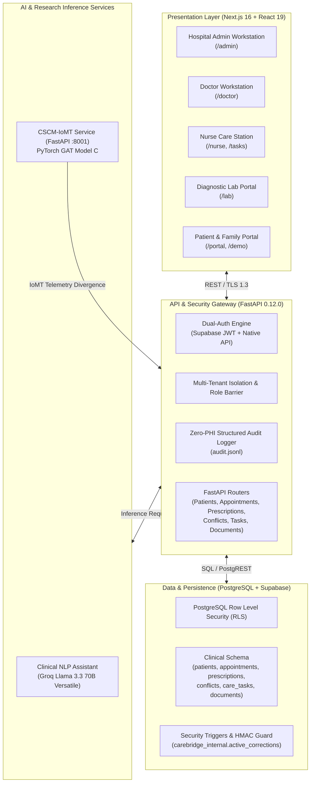
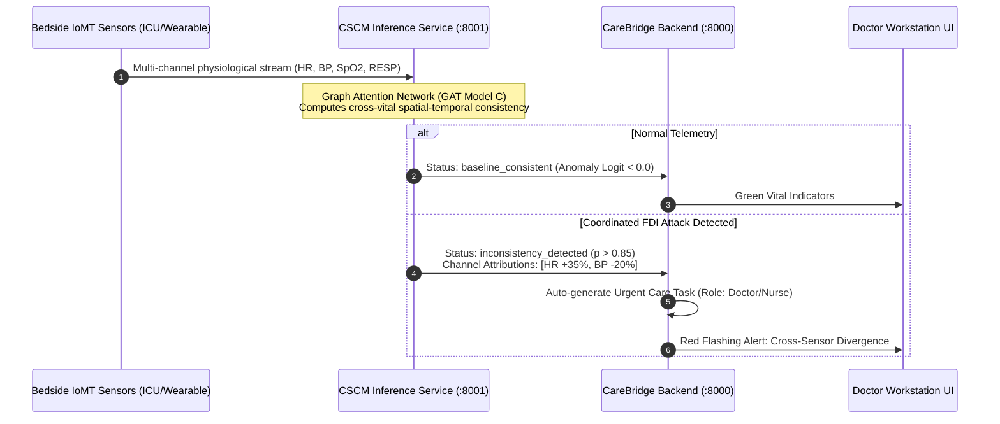

# CareBridge AI

<div align="center">

[](https://nextjs.org/)
[](https://react.dev/)
[](https://fastapi.tiangolo.com/)
[](https://python.org/)
[](https://pytorch.org/)
[](https://supabase.com/)
[](https://tailwindcss.com/)
[](carebridge/backend/tests/)
[](verify_phase15_post_audit.py)

**Dual-Engine Clinical Workflow Automation & IoMT Cybersecurity Platform**

*Bridging hospital workflow orchestration, multi-persona clinical portals, and deep-learning edge IoMT cybersecurity.*

[Key Features](#key-features) • [Architecture](#system-architecture) • [Role Workstations](#role-based-clinical-workstations) • [CSCM-IoMT Engine](#cscm-iomt-cybersecurity-engine) • [Quick Start](#quick-start) • [Security](#security-privacy--compliance) • [Documentation](#documentation-hub)

</div>

---

## Executive Overview

Modern healthcare systems face dual existential pressures: **clinical administrative overload** resulting in diagnostic delays and clinician burnout, and the **vulnerability of Internet of Medical Things (IoMT) devices** to coordinated cyber-physical attacks such as False Data Injection (FDI).

**CareBridge AI** is an enterprise-grade medical platform designed to solve both challenges in a unified, multi-tenant ecosystem:
1. **Clinical Orchestration Engine:** Full-stack healthcare management with dedicated workstations for Hospital Administrators, Physicians, Nurses, Diagnostic Technicians, and Patients. It automates clinical conflict detection, e-prescribing, caregiver verification, and document entity extraction.
2. **CSCM-IoMT Cybersecurity Engine:** Edge-deployed Graph Attention Network (GAT) performing physiology-aware cross-sensor consistency modeling in real-time. It detects subtle, coordinated multi-channel sensor perturbations before malicious telemetry can trigger erroneous clinical interventions.

---

## Key Features

- **Multi-Tenant Clinical Workstations:** Role-specific web portals for 5 distinct personas with strict Row Level Security (RLS) enforcement.
- **Real-Time IoMT Consistency Monitoring:** Physiological graph modeling that correlates vital signs (Heart Rate, Blood Pressure, SpO2, Respiration, Temperature) to flag anomalies and malicious data injection.
- **Deterministic Clinical Conflict Engine:** Multi-source drug-allergy matching, duplicate therapy detection, and priority stratification that mandates physician rationale for overrides.
- **Cryptographic e-Prescriptions:** Tamper-evident digital signatures, zero-PII public verification endpoints, and pharmacy dispensing lifecycle management.
- **Demographics-Masked Diagnostic Workstation:** Enforces privacy protection for laboratory technicians accessioning specimens and processing diagnostic tests.
- **Dual-Context Administrative Correction Procedure:** Cryptographically authenticated (HMAC-SHA256) audit-safe correction workflow preventing unauthorized table mutation or privilege escalation.
- **Zero-PHI Audit Logging:** Structured JSONL logging capturing all security events, access attempts, and administrative actions without leaking Protected Health Information (PHI).

---

## System Architecture



---

## Role-Based Clinical Workstations

CareBridge AI delivers tailored, responsive user interfaces designed around the specific operational needs and regulatory boundaries of clinical stakeholders:

| Persona | Primary Route | Key Capabilities & Security Controls |
|---|---|---|
| **Hospital Admin** | `/admin` | System-wide analytics, staff credentialing, RLS audit verification, hospital department management. |
| **Doctor** | `/doctor`, `/doctor/documents/[id]` | Patient telemetry monitoring, clinical document verification, automated drug-allergy conflict review, cryptographic e-prescriptions. |
| **Nurse** | `/nurse`, `/tasks` | Shift task queue, bedside vitals recording, patient check-in triage, medication administration tracking. |
| **Diagnostic Lab** | `/lab` | Specimen accessioning, diagnostic test entry, demographics-masked patient matching (zero PII exposure). |
| **Patient / Caregiver** | `/portal`, `/portal/book`, `/portal/caregivers` | Self-service appointment booking, caregiver authorization requests, active medication review, adherence check-ins. |

---

## CSCM-IoMT Cybersecurity Engine

The **CSCM-IoMT** (Cross-Sensor Consistency Modeling in Internet of Medical Things) engine is the core artificial intelligence research component integrated into CareBridge AI.



### Research Foundations
- **Hypothesis:** Physiological systems maintain invariant cross-sensor dependencies governed by human homeostatic feedback loops. Coordinated cyber-attacks that inject false signals cannot simultaneously simulate all interrelated biological pathways without revealing spatial divergence in graph attention space.
- **Model Architecture:** Multi-head Graph Attention Networks (GAT) trained over spatio-temporal physiological graphs.
- **Benchmark Datasets:**
  - **PhysioNet CinC 2012:** 4,000 multi-parameter ICU patient records (irregular time-series, vital signs, laboratory markers).
  - **WESAD:** Synchronized multimodal wearable physiological signals (Chest RespiBAN @ 700 Hz, Wrist Empatica E4).
- **Integrity Guarantee:** All 17,727 foundational research files, checkpoints, and evaluation results are cryptographically locked and preserved with 100% verified SHA-256 baseline parity.

---

## Security, Privacy & Compliance

1. **Row Level Security (RLS) & Multi-Tenancy:**
   All clinical tables enforce strict hospital tenant isolation via PostgreSQL RLS. Hospital personnel cannot read or modify records belonging to other healthcare institutions.
2. **Dual-Context HMAC Administrative Corrections:**
   Administrative database corrections require a dual-context authorization protocol combining a secure session context with an HMAC-SHA256 signature generated by an authorized DBA key. Unsigned writes fail closed.
3. **Zero-PHI Audit Trail:**
   Every authentication event, role change, document access, and prescription state transition generates an immutable record in `carebridge/backend/logs/audit.jsonl`. Patient names, MRNs, and sensitive clinical notes are excluded to prevent secondary privacy leaks.
4. **Demographics Masking:**
   Laboratory technicians and non-clinical staff access views where patient identifiers are masked using cryptographically salted tokens.

---

## Quick Start

### Prerequisites
- **Node.js:** v20.x or higher
- **Python:** v3.13.x
- **Package Managers:** `npm` (v10+) and `pip`
- **Database:** Supabase project or PostgreSQL 15+ instance

### 1. Repository Setup
```bash
git clone https://github.com/PRABAKAR-S/CareBridge-AI.git
cd CareBridge-AI
cp carebridge/.env.example .env
```

### 2. Backend Service Setup
```bash
cd carebridge/backend
python -m venv .venv
# Windows PowerShell
.venv\Scripts\Activate.ps1
# Linux / macOS
source .venv/bin/activate

pip install -r requirements.txt
cp ../.env.example .env  # Configure your Supabase credentials
uvicorn main:app --host 127.0.0.1 --port 8000 --reload
```
*Backend API documentation available at: `http://localhost:8000/docs`*

### 3. Frontend Web Application Setup
```bash
cd carebridge/frontend
npm install
npm run dev
```
*Frontend portal available at: `http://localhost:3000`*

### 4. CSCM Inference Service Setup (Optional)
```bash
cd carebridge/cscm-service
pip install -r requirements.txt
uvicorn main:app --host 127.0.0.1 --port 8001 --reload
```

---

## Testing & Verification

The CareBridge AI platform includes comprehensive automated test suites covering functional workflows, security invariants, and research asset integrity:

```bash
# 1. Run CareBridge Backend Integration & Security Test Suite (128 tests)
pytest carebridge/backend/tests/ -v

# 2. Run CSCM-IoMT Research Test Suite
pytest tests/ -v

# 3. Verify Frontend Linting & Production Build
cd carebridge/frontend
npm run lint
npm run build

# 4. Verify CSCM Research File & Audit Log Parity Gate
python verify_phase15_post_audit.py
```

### Verification Gate Results
- **Backend Test Suite:** `128 / 128 PASSED` (100% pass rate)
- **Frontend ESLint:** `0 Errors` (clean production build)
- **Frontend Turbopack Build:** `19 / 19 Static & Dynamic Routes Generated`
- **CSCM Research Asset Parity:** `17,727 / 17,727 Files 100% Bit-for-Bit Identical`
- **Audit Log Parity:** `48 / 48 Historical Records 100% Byte-for-Byte Intact`

---

## Repository Layout

```
.
├── carebridge/                  # CareBridge AI Full-Stack Platform
│   ├── frontend/                # Next.js 16 web application & role portals
│   ├── backend/                 # FastAPI clinical backend & security services
│   │   ├── app/                 # Routers, schemas, models, and core logic
│   │   ├── supabase/            # SQL migrations, RLS policies, seed scripts
│   │   ├── tests/               # 128 integration & security test suites
│   │   └── logs/audit.jsonl     # Immutable zero-PHI audit trail
│   └── cscm-service/            # Real-time IoMT PyTorch inference microservice
├── src/                         # CSCM-IoMT Core Research (PROTECTED, READ-ONLY)
│   ├── models/                  # GAT architecture and neural components
│   ├── data/                    # PhysioNet and WESAD dataset loaders
│   ├── attacks/                 # Coordinated FDI attack generators
│   └── utils/                   # Reproducibility seeds and config parsers
├── models/                      # Trained PyTorch model checkpoints (.pt, .pth)
├── data/                        # Research splits and dataset artifacts
├── configs/                     # Experiment and dataset configurations
├── docs/                        # Comprehensive documentation hub
│   ├── ARCHITECTURE.md          # Architectural blueprints and component contracts
│   ├── LOCAL_SETUP.md           # Step-by-step local developer setup guide
│   ├── PRODUCTION_RUNBOOK.md    # Production deployment and operational runbook
│   ├── VIVA_DEMO_GUIDE.md       # Interactive clinical demonstration script
│   ├── phase-plans/             # Canonical plans for Phases 1 through 15
│   └── phase-reports/           # Verified execution reports and QA evidence
├── scripts/                     # Operational, evaluation, and inspection scripts
├── tests/                       # CSCM research unit tests
├── .github/                     # GitHub Actions CI workflow & issue templates
├── .env.example                 # Master environment variable template
├── CONTRIBUTING.md              # Contributor guidelines and standards
├── SECURITY.md                  # Security policies and disclosure procedures
├── CHANGELOG.md                 # Version release history and phase milestones
├── LICENSE                      # MIT Open-Source License
└── verify_phase15_post_audit.py # Standalone CSCM integrity verification script
```

---

## Documentation Hub

Detailed technical guides are maintained in the [`docs/`](docs/) directory:
- [Architecture Blueprint](docs/ARCHITECTURE.md)
- [Local Developer Setup](docs/LOCAL_SETUP.md)
- [Production Runbook & Disaster Recovery](docs/PRODUCTION_RUNBOOK.md)
- [Clinical Viva & Demonstration Script](docs/VIVA_DEMO_GUIDE.md)
- [Phase 1–15 Execution Reports & Evidence](docs/phase-reports/)

---

## License

This project is licensed under the [MIT License](LICENSE).

---

<div align="center">
<b>CareBridge AI</b> · Developed with clinical excellence and cryptographic rigor.
</div>
