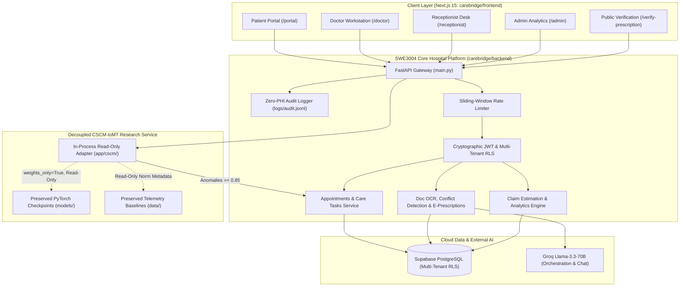
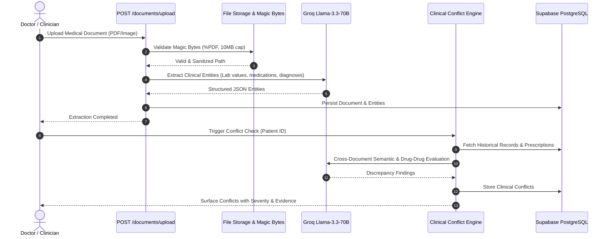

# CareBridge AI — System Architecture Document
## Multi-Portal Hospital Operations Platform & Decoupled CSCM-IoMT Research Service

**Document:** `docs/ARCHITECTURE.md`  
**Project:** CareBridge AI (SWE3004 Capstone & Research Integration)  
**Date:** 2026-10-16  
**Status:** Completed & Formally Verified  
**Author:** Antigravity (Advanced Agentic Pair Programmer)

---

## 1. Executive Summary

**CareBridge AI** is an advanced, production-grade healthcare operations platform built for modern multi-tenant hospital environments. It uniquely combines an enterprise software engineering system for clinical workflows, medical document intelligence, and tamper-evident e-prescribing (the SWE3004 Capstone contribution) with a cutting-edge deep learning research service for vital sign telemetry security (**CSCM-IoMT: Coordinated Multi-Channel False Data Injection Attack Detection Using Physiology-Aware Cross-Sensor Consistency Modeling in IoMT**).

The system operates under a strict **₹0 operational cost constraint** during evaluation, utilizing open-source frameworks, free-tier cloud serverless databases (Supabase PostgreSQL), high-throughput AI inference (Groq Llama-3.3-70B), and local in-process deep learning execution.

### Fundamental Architectural Tenet: Strict Research Decoupling
CareBridge AI maintains a strict boundary between enterprise hospital operations and academic deep learning research. The core research assets across `models/` (109 checkpoint files), `data/` (17,582 datasets and normalization records), and `src/` (36 research pipeline files) remain **strictly immutable and isolated**. The hospital platform interacts with the research model exclusively through an in-process, read-only PyTorch adapter (`carebridge/backend/app/cscm/`) executing in evaluation mode (`torch.no_grad()`, `weights_only=True`, frozen parameters), ensuring 100% preservation of published academic research.

---

## 2. High-Level System Topology



---

## 3. Client Layer Architecture (`carebridge/frontend`)

The frontend application is built with **Next.js 15 (App Router)**, **TypeScript**, **Tailwind CSS**, and **shadcn/ui**. It supports 16 compiled routes structured into dedicated, role-tailored workspaces:

| Route Path | Target Persona | Primary Functionality |
|---|---|---|
| `/` | Public | Landing page, system overview, portal navigation |
| `/login` | All Personas | Supabase JWT authentication with role-based dashboard redirection |
| `/portal` | Patient | Personal health summary, upcoming OPD appointments, doctor directory |
| `/portal/book` | Patient | Step-by-step specialty doctor booking and time-slot reservation |
| `/portal/caregivers` | Patient / Caregiver | Dependent relationship registration and verification tracking |
| `/portal/documents` | Patient | Personal medical records, lab reports, and doctor prescription access |
| `/doctor` | Doctor | Clinical workstation, active patient queue, clinical conflict reviews, live **CSCM-IoMT Telemetry Monitor** |
| `/doctor/documents/[id]` | Doctor | Interactive document viewer, PDF text extraction, structured entity viewer |
| `/receptionist` | Receptionist | Real-time OPD desk queue, patient check-in, walk-in management |
| `/receptionist/verify-caregivers` | Receptionist | KYC document verification desk to approve/reject caregiver relationships |
| `/tasks` | Clinical & Biomedical Staff | Priority care coordination task board with automated IoMT anomaly alerts |
| `/admin` | Hospital Administrator | Operational analytics, OPD volume, doctor utilization, insurance pre-auth adjudication |
| `/verify-prescription/[hash]` | Public / Pharmacy | Tamper-evident SHA-256 prescription authenticity verification |
| `/_not-found` | Public | Standard 404 handler |

---

## 4. Application Backend Architecture (`carebridge/backend`)

The backend is built with **FastAPI (Python 3.13)**, implementing an asynchronous, non-blocking REST API structured into domain-specific modules:

```
carebridge/backend/
├── app/
│   ├── api/v1/endpoints/     # REST Route Controllers
│   │   ├── auth.py           # Authentication & token issuing
│   │   ├── appointments.py   # OPD scheduling & status lifecycle
│   │   ├── patients.py       # Patient record management
│   │   ├── doctors.py        # Physician directories & schedules
│   │   ├── caregivers.py     # Caregiver relationship management
│   │   ├── documents.py      # Multipart PDF upload & secure retrieval
│   │   ├── conflicts.py      # Clinical document conflict detection
│   │   ├── care_tasks.py     # Priority clinical task management
│   │   ├── prescriptions.py  # Tamper-evident e-prescriptions
│   │   ├── chat.py           # Conversational AI assistant
│   │   ├── insurance.py      # Coverage calculation & adjudication
│   │   ├── analytics.py      # Operational aggregation queries
│   │   └── cscm.py           # IoMT telemetry verification & attack simulation
│   ├── core/                 # Cross-Cutting Infrastructure
│   │   ├── config.py         # Pydantic environment settings
│   │   ├── database.py       # SQLAlchemy connection pooling & health checks
│   │   ├── security.py       # JWT validation & role-based dependencies
│   │   ├── rate_limit.py     # In-memory sliding-window rate limiting
│   │   └── audit.py          # Zero-PHI structured JSONL audit logging
│   ├── cscm/                 # Decoupled Research Adapter
│   │   ├── adapter.py        # Read-only PyTorch model evaluation
│   │   ├── model_loader.py   # Checkpoint caching & weights_only safety
│   │   ├── attribution.py    # Graph relation divergence scoring
│   │   └── alerting.py       # Gated care task generation & 15-min cooldown
│   ├── models/               # SQLAlchemy ORM Database Entities
│   └── schemas/              # Pydantic Request/Response DTOs
├── supabase/
│   ├── migrations/           # 7 Versioned PostgreSQL migrations
│   └── seed.sql              # Synthetic multi-tenant test data
├── tests/                    # 11 Dedicated test files (128 regression tests)
└── main.py                   # FastAPI Application Entry Point
```

---

## 5. Security & Multi-Tenancy Architecture

### 5.1 Cryptographic JWT Authentication & Algorithmic Pinning
- **Bearer Tokens**: Validated using `python-jose` with explicit cryptographic signature verification.
- **Algorithm Pinning**: Strictly pinned to `HS256`. Malformed tokens attempting `alg="none"`, expired timestamps (`exp`), or forged signatures are rejected with `401 Unauthorized`.
- **Identity Context**: Each validated token resolves to an `authenticated` user context containing `sub` (User UUID), `email`, and `user_metadata.role`.

### 5.2 Multi-Tenant Row-Level Security (RLS)
- Every clinical entity (`patients`, `appointments`, `documents`, `prescriptions`, `care_tasks`, `insurance_claims`) is bound by a foreign key to `hospital_id` (`organization_id`).
- All queries executed by backend services enforce tenant filtering either via Supabase RLS policies or explicit tenant scoping (`filter(Model.hospital_id == current_user.hospital_id)`).
- Cross-tenant access attempts (e.g., Hospital 1 staff querying Hospital 2 records) return `404 Not Found`, completely preventing data leaks.

### 5.3 Role-Based Access Control (RBAC) Matrix
Permissions are enforced at the API dependency layer (`require_role(...)`):

| API Domain | Authorized Roles | Rejected Roles (`403 Forbidden`) |
|---|---|---|
| **E-Prescriptions Authoring** | `doctor` | `nurse`, `receptionist`, `patient`, `hospital_admin` |
| **Caregiver KYC Verification** | `receptionist`, `hospital_admin` | `doctor`, `nurse`, `patient` |
| **Document OCR Upload** | `doctor`, `nurse`, `receptionist` | `patient` (restricted to own portal view) |
| **Operational Analytics** | `hospital_admin`, `receptionist` (OPD desk) | `doctor`, `nurse`, `patient` |
| **CSCM Telemetry Verification** | `doctor`, `hospital_admin` | `patient`, `nurse`, `receptionist` |
| **Public Prescription Validation** | Open (Public / Pharmacy) | N/A (Sanitized payload, zero patient PHI) |

### 5.4 Zero-PHI Audit Logging
All critical mutations and security events are logged to `logs/audit.jsonl` using structured JSON format. In compliance with HIPAA privacy standards, the audit trail records:
- `timestamp`: ISO-8601 UTC timestamp.
- `actor_id`: Masked user UUID.
- `actor_role`: User role (`doctor`, `receptionist`, etc.).
- `tenant_id`: Hospital tenant UUID.
- `action`: Specific operation (`document.extract`, `prescription.create`, `cscm.telemetry_verify`).
- `resource_id`: Entity UUID.
- **Zero Patient PHI**: Patient names, contact details, medical histories, and clinical notes are strictly omitted from log streams.

---

## 6. Decoupled CSCM-IoMT Deep Learning Research Architecture

The CSCM-IoMT component provides real-time verification of multi-channel vital sign telemetry (Heart Rate, Systolic BP, Diastolic BP, SpO2, Respiration Rate, Temperature) to detect Coordinated False Data Injection Attacks (FDIA).

### 6.1 Physiological Cross-Sensor Consistency Graph
Normal human physiology exhibits strict homeostatic coupling between vital sign parameters (e.g. Mean Arterial Pressure $MAP = \frac{Sys + 2 \cdot Dias}{3}$, Pulse Pressure $PP = Sys - Dias$, and compensatory Heart Rate vs Blood Pressure responses). Coordinated attackers manipulate multiple sensors simultaneously to evade single-channel threshold alarms while violating cross-sensor physiological constraints.

CSCM models vital signs as a fully connected physiological graph $G = (V, E)$, where:
- Nodes $v_i \in V$ represent sensor channels.
- Edges $e_{ij} \in E$ represent learned cross-sensor relationship constraints.

### 6.2 In-Process Adapter Workflow
1. **Telemetry Ingestion**: Receives multi-channel time-series windows (shape: `[batch, channels, window_size]`).
2. **Read-Only Model Evaluation**: The adapter loads frozen PyTorch weights (`weights_only=True`, `requires_grad=False`) inside a `torch.no_grad()` context.
3. **Reproducible Anomaly Scoring**:
   $$\text{Anomaly Probability} = \sigma(\text{Logit})$$
4. **Calibrated Safe Classification**:
   - $\text{Probability} < 0.85 \implies \text{status: } \text{"baseline_consistent"}$  
     *(Calibrated wording: "No anomaly detected by current model" — never claims "integrity verified").*
   - $\text{Probability} \ge 0.85 \implies \text{status: } \text{"anomaly_detected"}$  
     *(Wording: "Cross-sensor inconsistency detected (Suspected FDIA)").*
5. **Grounded Graph Attribution**: Edge divergence residuals are aggregated to identify diverging channels without making unverified hardware failure claims.
6. **Automated Care Task Alerting & Cooldown**: When an anomaly is detected ($\ge 0.85$), the adapter automatically dispatches a high-priority Care Coordination Task to biomedical staff. A **15-minute per-device cooldown** prevents repeated duplicate alerts and eliminates alert fatigue.

---

## 7. Clinical Intelligence & Document Pipelines



---

## 8. Cryptographic E-Prescription & Public Verification Pipeline

To eliminate counterfeit prescriptions and protect patient privacy:
1. **Authoring**: Licensed physician authors prescription with items, dosages, and instructions (`POST /api/v1/prescriptions`).
2. **Cryptographic Hashing**: The backend generates a SHA-256 integrity hash from the canonicalized prescription payload:
   $$\text{Hash} = \text{SHA256}(\text{Prescription ID} \parallel \text{Doctor ID} \parallel \text{Patient ID} \parallel \text{Timestamp} \parallel \text{Medications})$$
3. **Tamper-Evident Storage**: The hash is recorded in the database, and a public verification URL is generated:
   `https://carebridge.hospital/verify-prescription/{hash}`
4. **Public Verification**: When queried, the public endpoint returns:
   - Verification status: `VALID`
   - Prescribing physician name and registration number
   - Issuing hospital name
   - Prescription timestamp and medication list
   - **Zero Patient Demographic PHI**: Patient name, age, gender, and contact details are omitted to preserve patient privacy.

---

## 9. Visual Architecture Map

The project root contains 12 visual architectural diagrams illustrating specific subsystems:

| File Name | Architecture Subsystem Illustrated |
|---|---|
| [`fig_context.png`](file:///c:/Users/PRABAKAR/Documents/capstone_PRABAKAR/fig_context.png) | System Context & External Actors (C4 Context Diagram) |
| [`fig_components.png`](file:///c:/Users/PRABAKAR/Documents/capstone_PRABAKAR/fig_components.png) | High-Level Component Decomposition (FastAPI, Next.js, Supabase) |
| [`fig_authz_flow.png`](file:///c:/Users/PRABAKAR/Documents/capstone_PRABAKAR/fig_authz_flow.png) | Cryptographic JWT Authentication & RBAC Authorization Flow |
| [`fig_appointment_seq.png`](file:///c:/Users/PRABAKAR/Documents/capstone_PRABAKAR/fig_appointment_seq.png) | Multi-Portal Appointment Scheduling & Check-in Sequence |
| [`fig_document_flow.png`](file:///c:/Users/PRABAKAR/Documents/capstone_PRABAKAR/fig_document_flow.png) | Medical Document Upload, Magic-Byte Validation & OCR Extraction |
| [`fig_conflict_flow.png`](file:///c:/Users/PRABAKAR/Documents/capstone_PRABAKAR/fig_conflict_flow.png) | Cross-Document Clinical Conflict Detection Flow |
| [`fig_prescription_flow.png`](file:///c:/Users/PRABAKAR/Documents/capstone_PRABAKAR/fig_prescription_flow.png) | Tamper-Evident E-Prescribing & Public Hash Verification |
| [`fig_insurance_flow.png`](file:///c:/Users/PRABAKAR/Documents/capstone_PRABAKAR/fig_insurance_flow.png) | Deterministic Insurance Pre-Auth Estimation & Claim Adjudication |
| [`fig_cscm_flow.png`](file:///c:/Users/PRABAKAR/Documents/capstone_PRABAKAR/fig_cscm_flow.png) | CSCM-IoMT Physiology-Aware Consistency Inference & Alerting |
| [`fig_er.png`](file:///c:/Users/PRABAKAR/Documents/capstone_PRABAKAR/fig_er.png) | Complete Entity-Relationship (ER) Relational Schema |
| [`fig_deployment.png`](file:///c:/Users/PRABAKAR/Documents/capstone_PRABAKAR/fig_deployment.png) | Local & Cloud Deployment Topology (FastAPI, Uvicorn, Supabase, Groq) |
| [`fig_phase_deps.png`](file:///c:/Users/PRABAKAR/Documents/capstone_PRABAKAR/fig_phase_deps.png) | 14-Phase System Dependency & Execution Roadmap |

---

## 10. Architectural Integrity & Verification Summary

The architectural controls described in this document are fully verified through automated test suites:
- **RBAC & Multi-Tenancy**: Verified in `test_phase2_security.py` and `test_phase13_security_e2e.py`.
- **Clinical Workflows**: Verified in `test_phase3_workflows.py`, `test_phase6_documents.py`, `test_phase7_conflicts.py`, `test_phase8_care_tasks.py`, and `test_phase9_prescriptions.py`.
- **Decoupled CSCM Research Service**: Verified in `test_phase12_cscm_integration.py` and `test_phase13_security_e2e.py`.
- **Research Preservation**: 17,727 files verified identical to baseline SHA-256 hashes with zero mutations.
