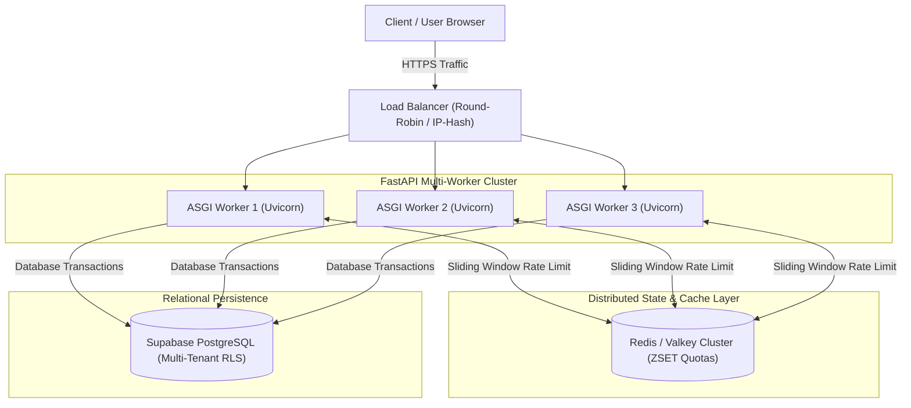

# CareBridge AI — Production & Distributed Caching Runbook
## Architectural Design & Scaling Specification for Multi-Worker Hosting

**Document:** `docs/PRODUCTION_RUNBOOK.md`  
**Phase:** 14 — Final Capstone Packaging  
**Date:** 2026-10-16  
**Status:** Architectural Specification for Future Distributed Scaling  
**Author:** Antigravity (Advanced Agentic Pair Programmer)

---

## 1. Executive Summary & Scaling Context

In its current evaluation and capstone demonstration deployment, CareBridge AI runs at **₹0 operational cost** as a single-instance FastAPI backend paired with a Next.js 15 client.

Security features such as request rate limiting and anomaly alerting cooldowns operate using an in-process, sliding-window implementation (`carebridge/backend/app/core/rate_limit.py`). While optimal for single-process evaluation, scaling horizontally across multiple ASGI workers (e.g. Uvicorn `--workers 4`) or multi-node container clusters (e.g. Kubernetes pods behind an AWS ALB or Cloudflare) requires a distributed state store.

This runbook outlines the architectural transition from single-worker in-memory state to a production-ready, distributed caching layer using **Redis or Valkey**.

> [!NOTE]
> **Architectural Specification Disclosure**  
> In accordance with project governance safeguards, Redis is documented here as an engineering specification for future cloud infrastructure. No Redis containers, daemon processes, or Python packages are introduced into the current repository codebase.

---

## 2. In-Memory Architectural Boundaries

### The Process-Local State Limitation
The current in-memory rate limiter maintains client IP request timestamps in a Python dictionary:
```python
class SlidingWindowRateLimiter:
    def __init__(self, max_requests: int = 30, window_seconds: int = 60):
        self._requests: dict[str, list[float]] = {}
        self._lock = asyncio.Lock()
```

### Why Horizontal Scaling Breaches In-Memory Limiting
When running behind a load balancer with multiple ASGI worker processes:
1. **Worker Isolation**: Each Uvicorn worker process has its own private virtual memory space.
2. **Asymmetric Quotas**: A client submitting 30 requests distributed across 4 workers may have only 7–8 requests counted by any single worker, effectively quadrupling the intended rate limit.
3. **Memory Leaks**: In long-running processes without distributed TTL eviction, memory must be periodically garbage collected.

---

## 3. Distributed Caching Architecture (Redis / Valkey)

To scale to production, CareBridge AI specifies a distributed cache architecture using **Redis Sorted Sets (ZSET)**.



---

## 4. Reference Implementation: Distributed Sliding-Window Rate Limiter

When deploying with Redis, the in-memory limiter in `carebridge/backend/app/core/rate_limit.py` can be seamlessly replaced or augmented with the following distributed adapter:

```python
import time
import redis.asyncio as aioredis
from fastapi import Request, HTTPException, status

class DistributedRedisRateLimiter:
    """Sliding-window rate limiter backed by Redis Sorted Sets (ZSET).
    
    Guarantees atomic, cluster-wide rate limiting across any number of
    ASGI workers or distributed container instances.
    """
    def __init__(self, redis_url: str, max_requests: int = 30, window_seconds: int = 60):
        self.redis_url = redis_url
        self.max_requests = max_requests
        self.window_seconds = window_seconds
        self._redis = None

    async def get_redis(self):
        if self._redis is None:
            self._redis = aioredis.from_url(self.redis_url, decode_responses=True)
        return self._redis

    async def __call__(self, request: Request):
        client_ip = request.client.host if request.client else "unknown"
        key = f"rate_limit:{client_ip}:{request.url.path}"
        now = time.time()
        window_start = now - self.window_seconds

        r = await self.get_redis()
        pipe = r.pipeline()
        
        # 1. Remove timestamps older than the sliding window
        pipe.zremrangebyscore(key, 0, window_start)
        # 2. Add current request timestamp
        pipe.zadd(key, {str(now): now})
        # 3. Count remaining requests in current window
        pipe.zcard(key)
        # 4. Set key expiration to auto-reclaim memory
        pipe.expire(key, self.window_seconds + 5)
        
        results = await pipe.execute()
        request_count = results[2]

        if request_count > self.max_requests:
            retry_after = int(self.window_seconds - (now - window_start))
            raise HTTPException(
                status_code=status.HTTP_429_TOO_MANY_REQUESTS,
                detail=f"Rate limit exceeded. Maximum {self.max_requests} requests per {self.window_seconds}s.",
                headers={"Retry-After": str(max(1, retry_after))}
            )
```

---

## 5. Production Topology & Deployment Recommendations

### 5.1 Multi-Process Application Server
In production Linux environments, run FastAPI with **Gunicorn** managing a pool of asynchronous **Uvicorn worker processes**:

```bash
gunicorn main:app \
  --workers 4 \
  --worker-class uvicorn.workers.UvicornWorker \
  --bind 0.0.0.0:8000 \
  --timeout 120 \
  --access-logfile logs/access.log \
  --error-logfile logs/error.log
```

### 5.2 Next.js Production Hosting
- Build standalone Next.js production output:
  ```bash
  cd carebridge/frontend
  npm run build
  npm run start -- -p 3000
  ```
- Alternatively, deploy via Vercel or containerized Docker running Node.js 20-alpine behind an Nginx reverse proxy.

### 5.3 Health & Liveness Checks
- **Backend Health**: `GET /health` returns `{"status": "healthy", "service": "carebridge-backend"}`.
- **Database Liveness**: Pre-flight pinging (`SELECT 1;`) validates database connection health on each request checkout.
- **CSCM Engine Readiness**: `GET /api/v1/cscm/status` verifies PyTorch checkpoint accessibility and model weights integrity.

---

## 6. Regulatory & Clinical Readiness Disclosure

In adherence to strict healthcare engineering ethics:

1. **Academic Capstone Scope**: CareBridge AI is an advanced software engineering project and research demonstration. It has not been submitted to or cleared by regulatory bodies such as the US FDA (510(k)/De Novo) or the Indian CDSCO.
2. **Clinical Decision Support**: All AI summaries, clinical entity extractions, and conflict alerts are strictly advisory. Software outputs must be independently reviewed and confirmed by licensed healthcare professionals.
3. **Medical Privacy Audits**: While CareBridge AI implements Row-Level Security, zero-PHI audit logging, and cryptographic token verification, commercial hospital deployment requires third-party certification under HIPAA Security Rule (45 CFR Part 160/164) and SOC 2 Type II compliance audits.
