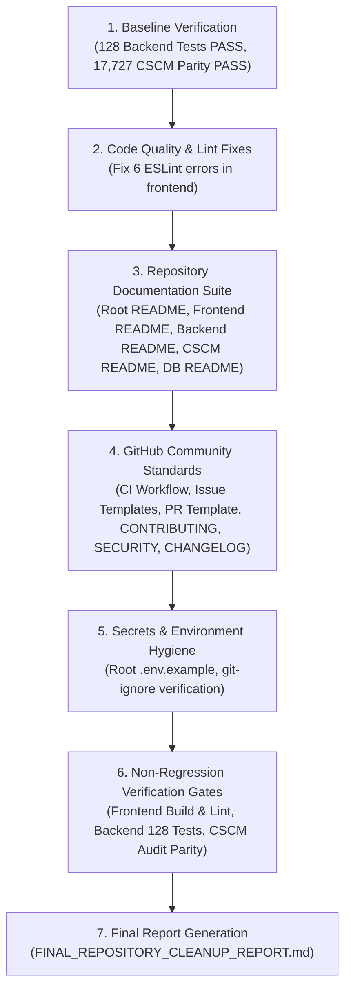

# CAREBRIDGE AI — FINAL REPOSITORY CLEANUP, ORGANIZATION & GITHUB READINESS PLAN

**Version:** 1.0.0  
**Date:** 2026-10-20  
**Author:** CareBridge AI Architecture, Security & Engineering Team  
**Scope:** Repository-wide audit, directory organization, secrets hygiene, documentation overhaul, GitHub templates, and non-regression verification.  
**Safety Mandate:** Zero destructive Git operations, zero changes to database schemas/migrations/policies/APIs, and zero modifications to CSCM-IoMT research assets (`src/`, `models/`, `data/`).

---

## 1. Executive Summary & Objectives

Following the 100% completion and verification of **Phase 15** (Dual-Context Corrections, HMAC-signed DBA authorization, 20-persona synthetic validation, 31 Playwright screenshots, and 128/128 backend tests passing), the repository is ready for public GitHub presentation and professional open-source archival.

This plan details the exact audit inventory, non-breaking organizational structure, documentation suite, GitHub community standards, and rigorous verification gates required to make CareBridge AI a world-class, production-grade healthcare AI repository.

---

## 2. Mandatory Safety & Protection Rules

1. **CSCM-IoMT Research Protection (STRICT INVARIANT):**
   - All 17,727 files across `src/`, `models/`, and `data/` are strictly read-only and immutable.
   - No research files may be moved, renamed, rewritten, recomputed, or deleted.
   - Parity verified before and after execution via `verify_phase15_post_audit.py` (SHA-256 baseline).
2. **Database & API Contract Invariance:**
   - No database schemas, Supabase SQL migrations, RLS policies, table grants, or stored procedures will be modified.
   - No FastAPI or Next.js endpoints, query params, request bodies, or responses will be altered.
3. **Audit Trail Immutability:**
   - All 48 historical audit records in `carebridge/backend/logs/audit.jsonl` remain byte-for-byte identical.
4. **Zero-Destructive Git Policy:**
   - Never run `git reset --hard`, `git clean -fdx`, or force-push.
   - All changes must be incremental, additive, and fully reversible.
5. **Secrets Hygiene (Fail-Closed):**
   - Zero committed credentials, private keys, passwords, or tokens.
   - Sensitive local files (`.env`, `.env.local`, `*.private.json`, `test-credentials.private.json`) must be confirmed git-ignored.
   - Canonical `.env.example` templates provided for all services.

---

## 3. Repository Inventory & Classification

### 3.1. Core Application Source (`carebridge/`) — REQUIRED
| Directory / File | Description | Action |
|---|---|---|
| `carebridge/frontend/` | Next.js 16.4.0 (Turbopack), React 19.3.0, Tailwind CSS v4, Lucide React web portal. | Retain; resolve 6 ESLint errors; add service README. |
| `carebridge/backend/` | FastAPI 0.12.0, Python 3.13.2, Uvicorn, Supabase client, Pydantic v2 schemas. | Retain; 128/128 tests passing; add service README. |
| `carebridge/backend/supabase/` | Supabase migrations (Phases 1-15), seed scripts, schema audits, verification tools. | Retain; add dedicated database README. |
| `carebridge/cscm-service/` | FastAPI inference service hosting the trained CSCM-IoMT PyTorch models. | Retain; add service README. |
| `carebridge/.env.example` | Root template for CareBridge environment configuration. | Retain and mirror to repository root. |

### 3.2. Protected CSCM-IoMT Research Assets (`src/`, `models/`, `data/`) — IMMUTABLE
| Directory / File | Description | File Count | Action |
|---|---|---|---|
| `src/` | Foundational CSCM research modules: loaders, GAT architecture, attacks, utils. | 72 files | **STRICTLY PROTECTED — READ-ONLY** |
| `models/` | Trained PyTorch checkpoints (`.pt`, `.pth`), GAT weights, baseline weights. | 109 files | **STRICTLY PROTECTED — READ-ONLY** |
| `data/` | Preprocessed WESAD & PhysioNet splits, attack evaluation sets. | 17,582 files | **STRICTLY PROTECTED — READ-ONLY** |
| `predicting-mortality-.../` | PhysioNet CinC 2012 raw dataset records. | 6 files | **STRICTLY PROTECTED — READ-ONLY** |
| `configs/` | Research experiment YAML configs (`paths.yaml`, `physionet.yaml`, etc.). | 6 files | **STRICTLY PROTECTED — READ-ONLY** |

### 3.3. Test Suites — REQUIRED
| Directory / File | Description | Action |
|---|---|---|
| `carebridge/backend/tests/` | 128 comprehensive end-to-end integration and security tests for CareBridge AI. | Retain; verified passing (128/128). |
| `tests/` | CSCM research unit tests (`test_attacks.py`, `test_physionet_loader.py`, etc.). | Retain. |

### 3.4. Documentation Hub (`docs/`) — REQUIRED & ORGANIZED
| Path | Current Role | Planned Enhancement |
|---|---|---|
| `docs/phase-plans/` | Complete historical plans for Phases 1 through 15. | Retain; add `FINAL_REPOSITORY_CLEANUP_PLAN.md`. |
| `docs/phase-reports/` | Detailed execution reports for Phases 1 through 15 + evidence. | Retain; add `FINAL_REPOSITORY_CLEANUP_REPORT.md`. |
| `docs/reports/` | Research reports, statistical test CSVs, leakage audits, figures. | Retain. |
| `docs/thesis/` | Academic thesis markdown chapters (4, 5, 6, 7, 8, 9, 11). | Retain. |
| `docs/review_1/` | Academic evaluation presentation (Review 1). | Retain. |
| `docs/ARCHITECTURE.md` | System architecture documentation. | Review, standardize, link in root README. |
| `docs/LOCAL_SETUP.md` | Local development setup guide. | Review, standardize, link in root README. |
| `docs/PRODUCTION_RUNBOOK.md`| Production operational runbook. | Review, standardize, link in root README. |
| `docs/PROJECT_AUDIT.md` | Architectural audit and invariants. | Review, standardize, link in root README. |
| `docs/VIVA_DEMO_GUIDE.md` | Clinical demo guide and viva presentation script. | Review, standardize, link in root README. |

### 3.5. Phase 15 Audit & Verification Artifacts — REQUIRED (AUDIT INTEGRITY)
| File / Directory | Purpose | Action |
|---|---|---|
| `verify_phase15_post_audit.py` | Standalone script verifying 17,727 CSCM files and 48 audit records. | Retain at root for instant audit verification. |
| `record_phase15_baseline.py` | Script used to record initial SHA-256 baselines. | Retain at root. |
| `record_phase15_pre_audit.py` | Script used to capture pre-execution database snapshot. | Retain at root. |
| `phase15_file_baselines/` | Baseline hash manifests for CSCM files and audit logs. | Retain at root. |
| `phase15_pre_execution_audit.json` | Pre-execution audit snapshot. | Retain at root. |
| `phase15_pre_migration_state.json`| Pre-migration state snapshot. | Retain at root. |
| `PHASE_15_AFFECTED_FILES.json` | List of files monitored during Phase 15. | Retain at root. |
| `pre_phase15_uncommitted_20261019_162402.patch` | Safety patch before Phase 15. | Retain at root. |
| `artifacts/final-qa-2026-10-20/` | Final QA reports, 31 screenshots, coverage matrix, audit evidence. | Retain; ensure credentials file is git-ignored. |

### 3.6. Academic & Publication Artifacts — PRESERVE
| File / Directory | Description | Action |
|---|---|---|
| `CareBridge_AI_SWE3004_Final_Project_Report.docx` | Capstone Final Project Report document. | Preserve. |
| `CareBridge_AI_SWE3004_Final_Project_Report.pdf` | Capstone Final Project Report PDF. | Preserve. |
| `CareBridge_AI_SWE3004_Final_Project_Report_updated.docx` | Updated Capstone Final Project Report. | Preserve. |
| `22MIS0527_Review-1.docx` | Capstone Review-1 presentation document. | Preserve. |
| `22MIS0527_Review-2.pdf` | Capstone Review-2 presentation PDF. | Preserve. |
| `conference_paper/` | LaTeX paper submission package. | Preserve. |
| `report_figures/` | SVG and PNG figures generated for academic publications. | Preserve. |

### 3.7. Safe-to-Prune Redundancies
| Path | Current State | Proposed Action | Verification / Reason |
|---|---|---|---|
| `notebooks/` | Empty directory (0 files). | Prune safely or keep with `.gitkeep`. | Non-functional empty directory. |
| `reports/` | Empty directory (0 files; actual reports are in `docs/reports/`). | Prune safely or keep with `.gitkeep`. | Duplicate of `docs/reports/`. |
| `thesis/` | Empty directory (0 files; actual chapters are in `docs/thesis/`). | Prune safely or keep with `.gitkeep`. | Duplicate of `docs/thesis/`. |

---

## 4. Execution Roadmap

---

## 5. Detailed Implementation Tasks

### Task 1: Frontend Code Quality & ESLint Remediation
- **File 1:** `carebridge/frontend/components/telemetry/iomt-monitor-card.tsx`
  - Replace `any` types with explicit TypeScript interfaces (`IoMTStreamResponse`, `SimulateAttackResponse`, `Error`).
  - Fix React 19 `react-hooks/set-state-in-effect` warning by executing data loading via clean async mount pattern without synchronous cascading setState.
- **File 2:** `carebridge/frontend/app/(dashboard)/lab/page.tsx`
  - Fix `react-hooks/set-state-in-effect` warning on initial search query execution.
- **Gate:** `npx eslint --quiet` returns 0 errors.

### Task 2: Comprehensive Root README.md
Create a professional, visual, and comprehensive GitHub root `README.md` featuring:
1. **Badges:** Next.js 16, React 19, FastAPI, Python 3.13, PyTorch, PostgreSQL, RLS, Tailwind v4, CI.
2. **Project Vision:** Dual-engine architecture combining clinical workflow automation with edge IoMT cybersecurity.
3. **Architecture Diagram:** Mermaid sequence and component diagrams illustrating frontend, backend, Supabase DB, RLS, and CSCM inference engine.
4. **Key Features & Role-Based Workspaces:**
   - Hospital Admin (Analytics, Audit Logs, Staff Provisioning)
   - Doctor Workstation (Document Verification, Conflict Engine, e-Prescriptions)
   - Nurse Station (Care Tasks, Vitals Monitoring, Triage)
   - Diagnostic Lab (Demographics-masked Lab Queue, Specimen Processing)
   - Patient Portal (Self-Service Appointments, Caregiver Management, Medication Adherence)
5. **CSCM-IoMT Cybersecurity Engine:**
   - Graph Attention Network (GAT) cross-sensor consistency modeling.
   - Real-time False Data Injection (FDI) attack detection and mitigation.
6. **Quick Start Guide:**
   - Prerequisites (Node.js 20+, Python 3.13+, PostgreSQL / Supabase).
   - One-command backend startup.
   - One-command frontend startup.
   - CSCM inference startup.
7. **Testing & Verification:**
   - Backend unit and security tests (`pytest`).
   - Frontend linting and production build (`npm run build`).
   - Audit integrity verification script (`verify_phase15_post_audit.py`).
8. **Security, Privacy & Compliance:**
   - Zero-PHI audit logging (`carebridge/backend/logs/audit.jsonl`).
   - Row Level Security (RLS) and cryptographic signature validation.
   - HIPAA compliance architecture.

### Task 3: Service-Level READMEs
- `carebridge/frontend/README.md`: Architecture, components, state management, routes, environment variables, build commands.
- `carebridge/backend/README.md`: Architecture, FastAPI routers, security middleware, testing strategy, audit logging.
- `carebridge/cscm-service/README.md`: PyTorch model inference, GAT architecture, dataset adapters, synthetic attack simulation API.
- `carebridge/backend/supabase/README.md`: Database schema, RLS policies, migrations (Phases 1-15), seed data, rollback runbooks.

### Task 4: GitHub Community Standards & Automation
- `.github/workflows/ci.yml`: Continuous integration workflow running frontend lint & build, backend pytest, and secrets scanning.
- `.github/ISSUE_TEMPLATE/bug_report.md`: Structured bug report template with system context and reproduction steps.
- `.github/ISSUE_TEMPLATE/feature_request.md`: Structured feature suggestion template.
- `.github/PULL_REQUEST_TEMPLATE.md`: Structured PR template with testing checklist and security invariants.
- `CONTRIBUTING.md`: Contributing guide detailing Git workflows, commit standards, testing expectations, and code style.
- `SECURITY.md`: Vulnerability reporting guidelines, disclosure policy, and security architecture overview.
- `CHANGELOG.md`: Chronological log documenting development from Phase 1 through Phase 15.
- `LICENSE`: Open-source license (MIT License).

### Task 5: Secrets Hygiene & Environment Templates
- Provide repository-level `.env.example` consolidating all required keys.
- Confirm `.gitignore` patterns strictly exclude `.env`, `.env.*`, `*.private.json`, and credentials.
- Verify zero hardcoded keys or passwords in tracked files.

---

## 6. Verification & Non-Regression Gates

| Gate | Target Command | Acceptance Criteria |
|---|---|---|
| **Gate 1: Frontend Lint** | `npm run lint` in `carebridge/frontend` | 0 errors |
| **Gate 2: Frontend Build** | `npm run build` in `carebridge/frontend` | Exit code 0, 19/19 routes compiled |
| **Gate 3: Backend Tests** | `pytest carebridge/backend/tests/` | 128 / 128 tests passing |
| **Gate 4: CSCM Parity** | `python verify_phase15_post_audit.py` | 100% hash parity on all 17,727 CSCM files |
| **Gate 5: Audit Parity** | `python verify_phase15_post_audit.py` | 100% byte-for-byte match on 48 audit records |
| **Gate 6: Secrets Audit** | `git check-ignore` / regex scan | 0 exposed secrets in tracked files |

---

## 7. Rollback Strategy
If any non-regression gate fails during execution:
1. Revert specific modified file from Git staging.
2. Re-verify the failing gate.
3. Keep all research assets, database states, and audit records untouched.
