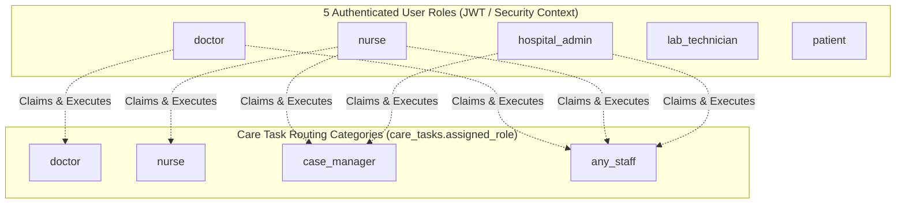
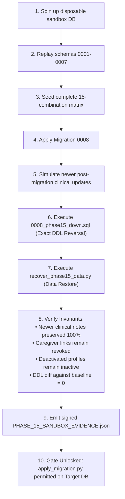
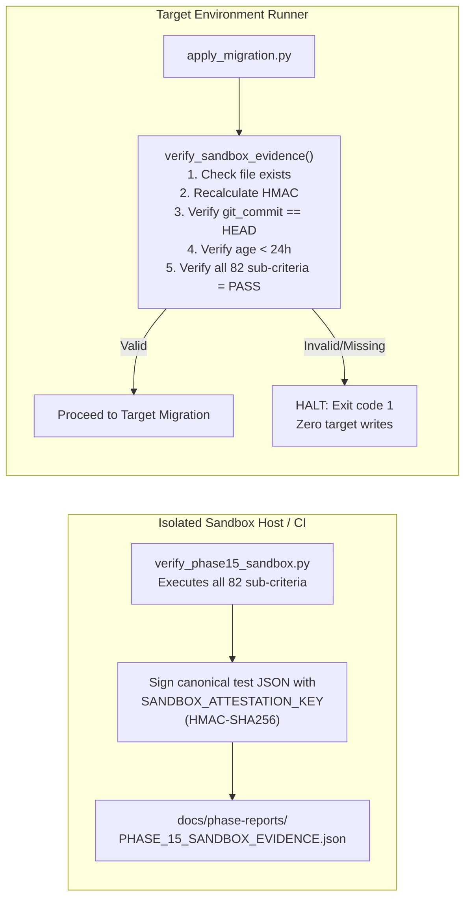
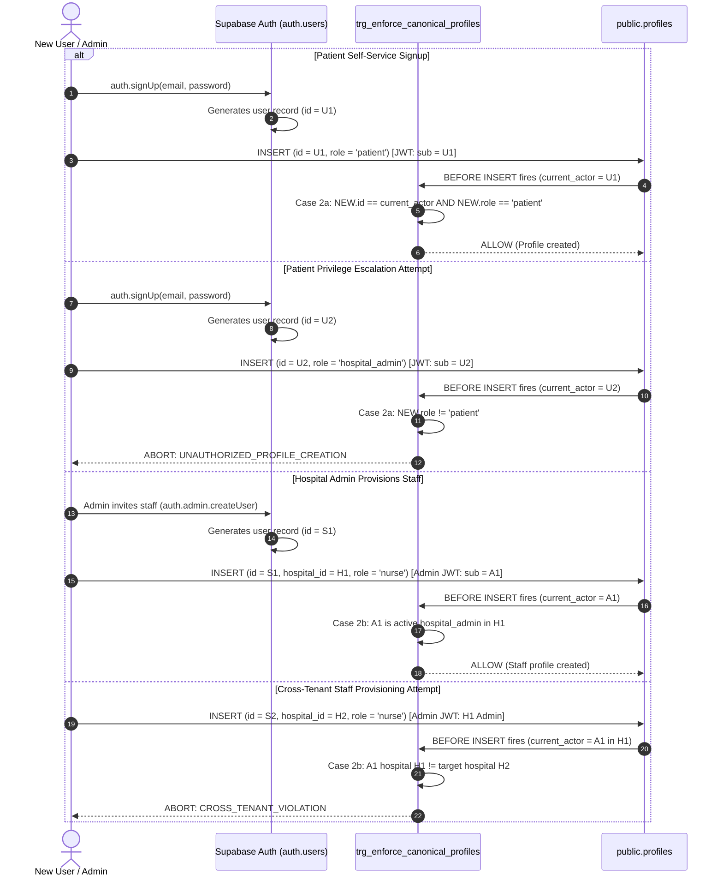
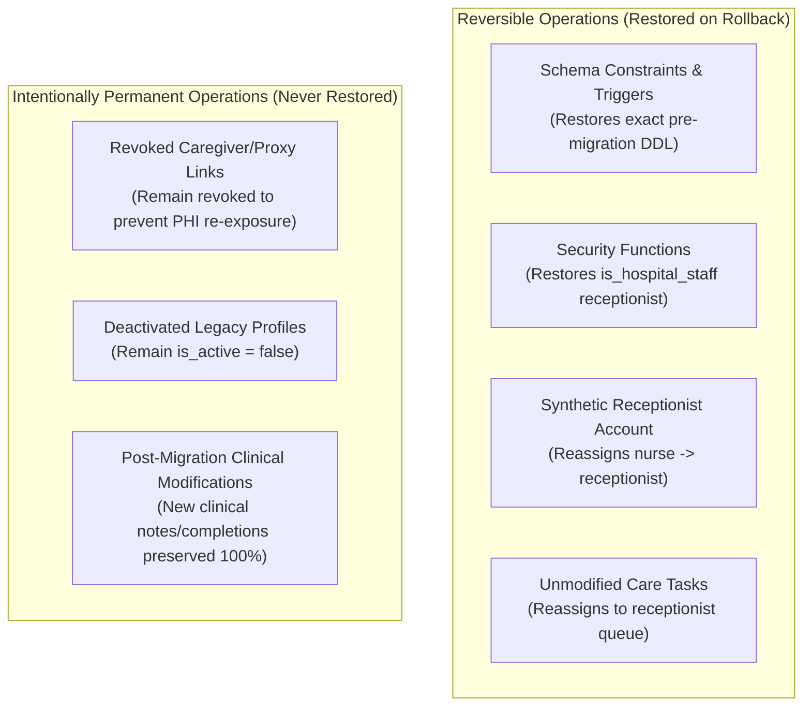
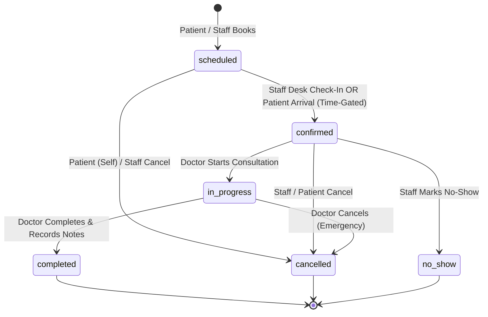
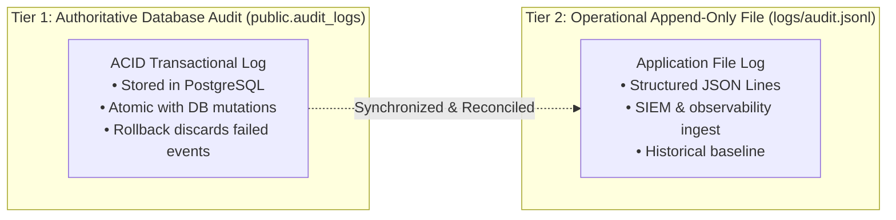
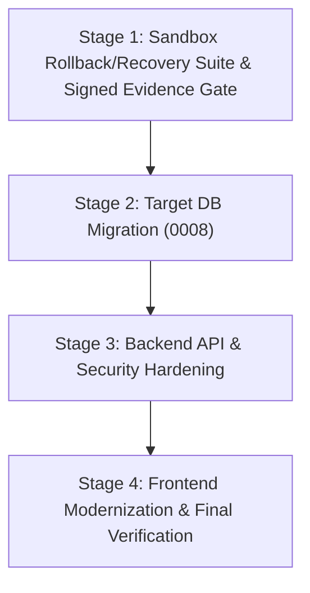

# Phase 15 Plan — Revision 17
## Retirement of Receptionist and Caregiver Roles & Consolidation to 5 Canonical Personas

**Document:** `docs/phase-plans/PHASE_15_PLAN.md`  
**Phase:** 15 — Role Consolidation & Access Control Hardening  
**Status:** Proposal for Owner Review — Implementation Blocked Awaiting Authorization  
**Date:** 2026-10-19  

> [!IMPORTANT]
> **PROPOSAL ONLY — NO IMPLEMENTATION AUTHORIZED**  
> In accordance with CareBridge AI critical governance rules, this document is an architectural planning proposal submitted for owner review. 
> - **Zero Code/Database Changes Authorized:** No application code, database schemas, migrations, seed data, environment files, or documentation files other than this plan may be modified.
> - **Zero File Churn:** No deleting, moving, renaming, or overwriting of existing repository files until explicit authorization is granted.
> - **Strict Research Preservation Mandate:** All 17,727 CSCM-IoMT research assets across `src/`, `models/`, and `data/` remain strictly immutable, isolated, and read-only.
> - **Zero Data Loss for Pre-existing Clinical Entities:** Existing patient records, clinical documents, conflicts, prescriptions, appointments, and historical audit logs will not be dropped, truncated, or corrupted.

---

## 1. Executive Summary & Objective

### 1.1 Objective
Update the existing CareBridge AI hospital management and care coordination platform to **completely remove two roles**:
1. **Receptionist**
2. **Caregiver / Verified Caregiver**

And consolidate the platform's role-based access control (RBAC), database constraints, security functions, frontend routing, navigation, and automated workflows around **exactly 5 active user roles**:

| # | Role Canonical Name | Database Enum / Identifier | Primary Functional Scope |
|---|---|---|---|
| 1 | **Hospital Admin** | `hospital_admin` | Hospital administration, facility operations, staff management, department configuration, operational analytics, and system oversight. |
| 2 | **Doctor** | `doctor` | Assigned patient records, clinical consultations, medical document review, clinical conflict resolution, care task creation/assignment, and prescription authoring. |
| 3 | **Nurse** | `nurse` | Inpatient/outpatient care task execution, triage, vital signs observation, medication administration checks, and post-discharge follow-ups. |
| 4 | **Lab Technician** | `lab_technician` | Diagnostic test orders, lab report uploads, structured lab entity review/verification, and demographics-limited patient lookup. |
| 5 | **Patient** | `patient` | Personal medical records, appointment booking/cancellation, prescription adherence logs, pre-auth status tracking, and direct self-service check-in. |

This modification is a **controlled, surgical refactoring** of the existing CareBridge AI application. The core system architecture, data models, APIs, and clinical features remain intact.

---

## 2. Summary of Governance & Technical Corrections in Revision 17

Revision 17 addresses all eight static-review findings from Revision 16 with concrete SQL implementations, explicit tenant boundaries, authenticated sandbox attestation, semantic task reassignment, and an exact canonical test inventory:

| # | Review Finding | Threat Addressed | Technical Implementation in Revision 17 | Plan Reference |
|---|---|---|---|---|
| **1** | **Transaction-Private Correction Authorization** | Race window in 5-second TTL allowing concurrent ordinary writes to piggyback on an active correction authorization. | • Replaced time-window authorization with a **PostgreSQL transaction-private, operation-bound DAC design**:<br>`PRIMARY KEY (xid BIGINT, record_id UUID, operation TEXT)`.<br>• Uses `txid_current()` which is kernel-private to the single executing transaction. Concurrent transactions have different XIDs and cannot reuse or hijack authorization.<br>• Authorization is consumed immediately within the same transaction. | §6.3, §6.4, §9.3 |
| **2** | **Tenant Scope of Historical Corrections** | Cross-tenant administrative tampering (Hospital Admin of Hospital A rectifying records of Hospital B). | • **Interactive Admin Path**: Strictly verifies that target profile or patient account belongs to `v_actor_hospital`. Cross-tenant calls immediately abort with `CROSS_TENANT_VIOLATION`.<br>• **Global System Corrections**: Strictly reserved for headless DBA execution with cryptographic HMAC signature and valid change ticket. | §6.4, §9.3 |
| **3** | **Exact Down-Migration Restoration (No DROP CASCADE)** | Undocumented cascading drops destroying dependent schema objects or leaving corrupted permissions on rollback. | • Completely eliminated `CASCADE`. Drops objects in strict reverse dependency order.<br>• Restores the exact pre-migration DDL signatures, search paths, check constraints, and role grants for `is_hospital_staff`, `care_tasks`, and `patient_accounts`.<br>• Added test **AC-15.12b** verifying zero DDL diff against captured baseline. | §7.3, §9.12 |
| **4** | **Authenticated Verification of Sandbox Evidence** | Replay of forged, stale, or tampered sandbox test results to bypass migration safety gates. | • Defined `docs/phase-reports/PHASE_15_SANDBOX_EVIDENCE.json` signed with `SANDBOX_ATTESTATION_KEY` (stored in CI/DBA vault, mode `0400`).<br>• `apply_migration.py` fails closed if file is missing, signature fails, commit hash mismatches current HEAD, timestamp is >24h old, or any test failed. | §5.4, §17 |
| **5** | **Expanded Negative Test Suite** | Unverified edge cases across tenant isolation, concurrency, verifiers, and baseline parity. | Added 6 dedicated negative test specifications:<br>• **AC-15.3a-5**: Cross-tenant profile creation blocked.<br>• **AC-15.3n-neg**: Cross-tenant historical correction blocked.<br>• **AC-15.3t-race**: Concurrent ordinary write during active correction blocked.<br>• **AC-15.6n-2**: Cross-hospital self-link verification blocked.<br>• **AC-15.12b**: Automated post-rollback DDL diff asserts 0 changes. | §9.3, §9.6, §9.12 |
| **6** | **Supabase Auth Signup & Trigger Ordering Verification** | Potential breakage of valid self-service patient signups or staff provisioning under the new trigger. | • Architecturally documented and tested Supabase auth execution sequence (`auth.users` -> `public.profiles` trigger ordering).<br>• Self-service signup strictly validates `NEW.id = auth.uid()` and `NEW.role = 'patient'`.<br>• Staff provisioning validates active `hospital_admin` actor in target hospital. | §6.2, §9.3 |
| **7** | **Semantic Task Reassignment (Non-Blind Routing)** | Overburdening nurses by dumping administrative/scheduling receptionist tasks into nursing queue. | • Migration `0008` inspects task semantics (`task_type`, `title`):<br>&nbsp;&nbsp;- Intake, scheduling, insurance follow-up -> `'case_manager'`<br>&nbsp;&nbsp;- Clinical triage, vital prep -> `'nurse'`<br>&nbsp;&nbsp;- General facility desk -> `'any_staff'`<br>• Appends migration audit marker to description cleanly. | §6.3, §9.1 |
| **8** | **Canonical Acceptance Criteria Inventory (Zero Mismatch)** | Inconsistent test counts and fragmented test IDs across document sections. | • Unified every test under the 12 core criteria (**AC-15.1** through **AC-15.12**).<br>• Generated a mathematically exact, single-source inventory: **exactly 83 discrete sub-criteria**.<br>• All 83 sub-criteria remain explicitly marked **`NOT TESTED / PENDING EXECUTION`**. | §9, §15 |

---

## 3. Comprehensive Codebase Audit Findings

A complete static analysis of the repository was conducted using automated AST and pattern-matching tools (logged to `carebridge/backend/supabase/audit_roles_report.json`). 

### 3.1 Quantitative Summary of Mentions

| Term Audited | Total Occurrences | Distinct Files Impacted | Primary Subsystems Affected |
|---|---|---|---|
| `receptionist` | 188 hits | 44 files | Frontend dashboards, navigation sidebar, appointment status PATCH API, patient creation/search API, care task schema & constraint, test fixtures, audit logs. |
| `caregiver` | 209 hits | 52 files | `caregiver.py` API router, `patient_accounts` junction table, document/prescription/conflict access checks, frontend caregiver portal, chat tools, test fixtures. |
| `lab_technician` | 11 hits | 7 files | Database schema enum (`user_role`), security functions, patient search demographics filter. *(To be expanded into active persona)* |
| `nurse` | 15 hits | 8 files | Database schema enum (`user_role`), care task assignment enum, security functions. *(To be expanded into active persona)* |

---

### 3.2 Detailed Inventory of Affected Files

#### A. Backend API Routes (`carebridge/backend/app/api/v1/`)
| File | Current Role References | Required Modifications |
|---|---|---|
| `caregiver.py` | Contains complete `/patient-accounts` router (request, verify, list, revoke caregiver links). | Deprecate router or transform into self-link management only. Reject caregiver proxy requests with `HTTP 403 Forbidden` / `HTTP 410 Gone`. |
| `appointments.py` | Allows `receptionist` to update status to `confirmed`/`no_show` and blocks clinical notes for receptionist. Checks patient access via `patient_accounts`. | Remove `receptionist` branches. Allow `hospital_admin`, `doctor`, and `nurse` staff transitions. Add time-gated patient arrival check-in without clinical note permissions. |
| `patients.py` | `create_patient` allows `["hospital_admin", "doctor", "receptionist"]`. `search_patients` provides demographics-only view to `receptionist` and `lab_technician`. | Update `create_patient` to `["hospital_admin", "doctor"]`. Restrict demographics-only view to `lab_technician`. |
| `documents.py` | Checks `if context.role in ("patient", "caregiver"):` across upload, list, download, and delete. | Change check to strictly `if context.role == "patient":` querying 1:1 patient account link. |
| `conflicts.py` | Checks `if context.role in ("patient", "caregiver"):` for conflict views. | Remove `caregiver`; check strictly `patient` self-access. |
| `care_tasks.py` | Checks `if context.role in ("patient", "caregiver"):`. Allows tasks to be assigned to `receptionist`. | Remove `caregiver` and `receptionist`. Support `nurse`, `doctor`, `hospital_admin`. |
| `prescriptions.py` | Checks `if context.role in ("patient", "caregiver"):` for prescription viewing and adherence logging. | Restrict patient-side access strictly to verified `patient` self-records. |
| `insurance.py` | Checks `if context.role in ("patient", "caregiver"):` for pre-auth estimates and policies. | Restrict to `patient` self-records. |
| `chat/tools.py` & `chat/engine.py` | Chat system prompt and tools reference caregiver verification and receptionist desk. | Clean prompt references; orient assistant to patient self-service and staff coordination. |
| `main.py` | Mounts `caregiver_router` at `/api/v1`. | Unmount or replace with sanitized account router. |

#### B. Backend Schemas & Security (`carebridge/backend/app/`)
| File | Component | Required Modifications |
|---|---|---|
| `app/core/security.py` | `get_security_context()`, `require_role()` | Enforce canonical 5-role whitelist. Tokens for retired roles (`receptionist`, `caregiver`) immediately rejected with `HTTP 403 Forbidden` (`ROLE_RETIRED`). |
| `app/schemas/care_task.py` | `AssignedRole = Literal["doctor", "nurse", "case_manager", "receptionist", "any_staff"]` | Remove `"receptionist"` from literal. Document that `case_manager` is an internal task routing tag, not an authenticated role. |
| `app/schemas/caregiver.py` | Pydantic models for caregiver requests and verifications. | Mark deprecated or retire. |
| `app/schemas/conflict.py` | Mentions caregiver in docstrings/field comments. | Sanitize documentation. |

#### C. Database Schema & Migration Objects (`carebridge/backend/supabase/`)
| Object | Current State | Required Modification |
|---|---|---|
| `public.user_role` (ENUM) | `('hospital_admin', 'doctor', 'nurse', 'receptionist', 'lab_technician', 'patient')` | Retain enum values for backward schema safety, but add composite check constraint and immutability trigger on `public.profiles` to strictly freeze legacy receptionist rows, prevent privilege escalation on insert, and block new non-canonical rows. |
| `public.patient_accounts` | `relationship` column checks `('self', 'parent', 'guardian', 'caregiver', 'spouse')`. | Update constraint to permit non-self relationships strictly when `status = 'revoked'`. Add immutability trigger freezing historical non-self rows against updates and deletions, and enforcing disjunctive three-path self-link authorization across all paths. |
| `public.is_hospital_staff()` | Checks role in `('hospital_admin', 'doctor', 'nurse', 'receptionist', 'lab_technician')`. | Update function to remove `'receptionist'`: `IN ('hospital_admin', 'doctor', 'nurse', 'lab_technician')`. |
| `public.has_patient_access()` | Allows staff OR verified account link. | Retain staff access and patient `self` verification. |

---

## 4. Architectural Clarification: Authenticated Roles vs. Task-Routing Categories

A key architectural finding from the codebase audit is the distinction between **User Security Roles** and **Care Task Assignment Categories**:



### 4.1 Authenticated User Roles (Strictly 5 Active Roles)
Every active user session, JWT token, database profile, and API security context belongs to exactly one of the 5 canonical roles:
1. `hospital_admin`
2. `doctor`
3. `nurse`
4. `lab_technician`
5. `patient`

**There is no active system user, JWT token, login identity, or database profile for `case_manager` or `receptionist` or `caregiver`.** Any attempt to authenticate or create a profile with non-canonical roles is rejected at the security layer.

### 4.2 Care-Task Assignment Categories (`care_tasks.assigned_role`)
In the clinical task engine (`public.care_tasks`), `assigned_role` is an organizational routing tag indicating which clinical staff discipline should claim the task:
- `'doctor'`: Complex clinical actions (e.g. prescription adjustments, specialist review). Claimed by `doctor`.
- `'nurse'`: Direct bedside/outpatient nursing actions (e.g. post-op wound care, vitals observation). Claimed by `nurse`.
- `'case_manager'`: Discharge coordination, patient follow-up calls, social service alignment, insurance intake. Claimed by authorized `nurse` or `hospital_admin`.
- `'any_staff'`: General operational task claimed by any active hospital staff member.

---

## 5. Target Verification, Key Provisioning & Sandbox Protocol

### 5.1 Mandatory 4-Point Fail-Closed Target Database Verification (Zero Defaults)
Prior to any database write operation against the target environment, the verification utility (`carebridge/backend/supabase/verify_target_env.py`) executes four explicit, non-fuzzy verification checks with **zero fallback defaults**:

```python
# Complete, non-fuzzy verification implementation in verify_target_env.py
from app.core.config import settings

class TargetEnvironmentMismatchError(Exception):
    """Raised when target environment fails verification."""
    pass

def verify_target_environment(conn) -> None:
    # 1. Exact Hostname Verification (Exact String Equality)
    parsed_host = (conn.info.host or "").lower().strip()
    EXPECTED_HOST = "vmuzexvtbodnkzhfitzf.supabase.co"
    if parsed_host != EXPECTED_HOST:
        raise TargetEnvironmentMismatchError(
            f"Host mismatch: Expected exact host '{EXPECTED_HOST}', got '{parsed_host}'"
        )

    # 2. Connection Principal & Database Identity Comparison (Zero Fallback Defaults)
    if not hasattr(settings, "EXPECTED_DB_USER") or not settings.EXPECTED_DB_USER:
        raise TargetEnvironmentMismatchError(
            "CRITICAL: 'EXPECTED_DB_USER' is not explicitly configured in settings. "
            "Failing closed to prevent unintended execution."
        )
    EXPECTED_PRINCIPAL = settings.EXPECTED_DB_USER.lower().strip()

    with conn.cursor() as cur:
        cur.execute("SELECT current_database(), current_user;")
        current_db, current_principal = cur.fetchone()
        
    EXPECTED_DB = "postgres"
    if current_db != EXPECTED_DB:
        raise TargetEnvironmentMismatchError(
            f"Database mismatch: Expected '{EXPECTED_DB}', got '{current_db}'"
        )
    if current_principal.lower().strip() != EXPECTED_PRINCIPAL:
        raise TargetEnvironmentMismatchError(
            f"Principal mismatch: Expected user '{EXPECTED_PRINCIPAL}', got '{current_principal}'"
        )

    # 3. Dedicated Target Environment Configuration Check
    if not hasattr(settings, "ENVIRONMENT") or settings.ENVIRONMENT not in ("test", "development") or settings.ENVIRONMENT == "production":
        raise TargetEnvironmentMismatchError(
            f"Environment mismatch: Expected 'test' or 'development', got '{getattr(settings, 'ENVIRONMENT', None)}'"
        )

    # 4. Project-Specific Database Record Identity Verification
    with conn.cursor() as cur:
        cur.execute(
            "SELECT id, name, slug FROM public.hospitals WHERE id = '00000000-0000-0000-0000-000000000001';"
        )
        row = cur.fetchone()
        if not row:
            raise TargetEnvironmentMismatchError("Database project identity check failed: Hospital row missing.")
        
        hospital_id, hospital_name, hospital_slug = row
        if str(hospital_id) != "00000000-0000-0000-0000-000000000001" or hospital_name != "Aegis Health System" or hospital_slug != "aegis-health":
            raise TargetEnvironmentMismatchError(
                f"Hospital entity mismatch: Expected 'Aegis Health System' ('aegis-health'), got '{hospital_name}' ('{hospital_slug}')"
            )
```

---

### 5.2 Out-of-Band HMAC Secret Provisioning & Permission Enforcement (`provision_dba_secrets.py`)

Cryptographic secrets are provisioned before migration execution via `provision_dba_secrets.py`. The script implements strict filesystem permission inspection and fail-closed overwrite prevention:

```python
"""
carebridge/backend/supabase/provision_dba_secrets.py
Secure, out-of-band provisioning of DBA HMAC secrets with permission validation and overwrite prevention.
"""
import os
import sys
import stat
import argparse
import subprocess
import psycopg2
from pathlib import Path

KEY_FILE_PATH = Path.home() / ".carebridge" / "keys" / "dba_hmac.key"

def verify_key_file_permissions(key_path: Path) -> None:
    """Fails closed if the secret key file is readable by any other user or process."""
    if not key_path.exists():
        raise FileNotFoundError(f"Key file not found at: {key_path}")

    if sys.platform == "win32":
        # Windows NTFS DACL inspection via icacls
        cmd = ["icacls", str(key_path)]
        result = subprocess.run(cmd, capture_output=True, text=True, check=True)
        output = result.stdout.lower()
        # Ensure 'Everyone', 'Users', or 'Authenticated Users' do NOT have read access
        for prohibited_principal in ("everyone", "builtin\\users", "authenticated users"):
            if prohibited_principal in output and ("(r)" in output or "(f)" in output or "(m)" in output):
                raise PermissionError(
                    f"INSECURE_KEY_PERMISSIONS: Windows key file {key_path} has open permissions granted to {prohibited_principal}. "
                    "Run icacls to restrict access strictly to the owner."
                )
    else:
        # POSIX octal mode inspection
        file_stat = key_path.stat()
        mode = stat.S_IMODE(file_stat.st_mode)
        # Fail closed if group or others have read/write/execute permissions (must be 0400 or 0600)
        if mode & 0o077 != 0:
            raise PermissionError(
                f"INSECURE_KEY_PERMISSIONS: Key file {key_path} has mode {oct(mode)}. "
                "Must be chmod 0400 or 0600 (owner-only access)."
            )

def provision_secret(db_conn_str: str, force_rotate: bool = False, ticket_id: str = None) -> None:
    verify_key_file_permissions(KEY_FILE_PATH)
    secret_key = KEY_FILE_PATH.read_text().strip()
    if len(secret_key) < 64:
        raise ValueError("INSUFFICIENT_ENTROPY: Secret key must contain at least 64 hex characters (256-bit entropy).")

    conn = psycopg2.connect(db_conn_str)
    try:
        with conn.cursor() as cur:
            cur.execute("""
                CREATE SCHEMA IF NOT EXISTS carebridge_internal;
                REVOKE ALL ON SCHEMA carebridge_internal FROM PUBLIC, anon, authenticated, service_role;
                GRANT USAGE ON SCHEMA carebridge_internal TO postgres;
                
                CREATE TABLE IF NOT EXISTS carebridge_internal.auth_secrets (
                    key_name TEXT PRIMARY KEY,
                    secret_value TEXT NOT NULL,
                    created_at TIMESTAMPTZ DEFAULT timezone('utc', now()),
                    rotated_at TIMESTAMPTZ DEFAULT timezone('utc', now())
                );
                REVOKE ALL ON TABLE carebridge_internal.auth_secrets FROM PUBLIC, anon, authenticated, service_role;
                GRANT ALL ON TABLE carebridge_internal.auth_secrets TO postgres;
            """)

            # Overwrite prevention check
            cur.execute("SELECT secret_value FROM carebridge_internal.auth_secrets WHERE key_name = 'dba_hmac_key';")
            existing = cur.fetchone()
            if existing and not force_rotate:
                raise RuntimeError(
                    "KEY_ALREADY_EXISTS: dba_hmac_key is already provisioned in carebridge_internal.auth_secrets. "
                    "Refusing unexpected overwrite. To rotate an active key, supply --force-rotate-key and --ticket-id."
                )

            if existing and force_rotate:
                if not ticket_id or len(ticket_id.strip()) < 4:
                    raise ValueError("TICKET_REQUIRED: Rotating an existing key requires a valid change ticket ID.")
                cur.execute("""
                    UPDATE carebridge_internal.auth_secrets
                    SET secret_value = %s, rotated_at = timezone('utc', now())
                    WHERE key_name = 'dba_hmac_key';
                """, (secret_key,))
            else:
                cur.execute("""
                    INSERT INTO carebridge_internal.auth_secrets (key_name, secret_value)
                    VALUES ('dba_hmac_key', %s);
                """, (secret_key,))

        conn.commit()
    finally:
        conn.close()
```

---

### 5.3 Mandatory Sandbox Rollback & Recovery Execution Gate

A dedicated validation suite (`carebridge/backend/supabase/verify_phase15_sandbox.py`) executes in an isolated environment. **As a mandatory pre-condition gate, target database migration is blocked until this suite executes all stages and produces cryptographic proof**:



---

### 5.4 Authenticated Sandbox Evidence Verification Architecture

To prevent reliance on unverified assertions, `apply_migration.py` enforces a cryptographic evidence gate:



**Security & Attestation Properties**:
1. **Key Protection**: `SANDBOX_ATTESTATION_KEY` is provisioned out-of-band at `~/.carebridge/keys/sandbox_attestation.key` (NTFS owner-only / POSIX `0400`) and never committed to Git.
2. **Replay Protection**: The payload binds the current Git commit SHA (`git rev-parse HEAD`). If application code or migrations change after sandbox execution, the evidence is automatically invalidated.
3. **Freshness Guarantee**: Execution timestamp must be within 24 hours of target migration execution.
4. **Fail-Closed Behavior**: Any missing file, invalid signature, commit mismatch, or non-passing test aborts `apply_migration.py` before any SQL statement is transmitted.

---

## 6. Database Migration & Canonical Role Enforcement

### 6.1 Mathematical Invariant of 5 Active Roles
The database enforces that exactly 5 active roles exist across all active users in `public.profiles`:

```sql
ALTER TABLE public.profiles ADD CONSTRAINT check_profiles_canonical_role
    CHECK (
        (is_active = false AND role = 'receptionist') OR
        (role IN ('hospital_admin', 'doctor', 'nurse', 'lab_technician', 'patient'))
    );
```

**Proof of Active Invariant**:
- Let $R$ be the role and $A$ be `is_active`.
- If $A = \text{true}$, then the left term `(is_active = false AND role = 'receptionist')` is identically $\text{false}$.
- Therefore, the check evaluates to $\text{true}$ if and only if the right term `role IN ('hospital_admin', 'doctor', 'nurse', 'lab_technician', 'patient')` is $\text{true}$.
- Consequently, **100% of active profiles ($A = \text{true}$) are mathematically guaranteed to possess one of the 5 canonical roles**.

---

### 6.2 Supabase Auth Signup & Trigger Ordering Sequence

A critical security analysis was conducted on how Supabase executes user registrations:



---

### 6.3 Deterministic Migration File: `0008_phase15_retire_roles.sql`

```sql
-- CareBridge AI — Migration: 0008_phase15_retire_roles.sql
-- Description: Deprecate 'receptionist' and 'caregiver', enforce 5 canonical roles, freeze historical rows, update security functions, constraints, and triggers.

BEGIN;

-- Configure strict DDL timeouts to prevent hung locks
SET LOCAL lock_timeout = '5s';
SET LOCAL statement_timeout = '30s';

-- ============================================================================
-- 0. Private DAC Schema & Transaction-Bound Correction Table
-- ============================================================================
CREATE SCHEMA IF NOT EXISTS carebridge_internal;
REVOKE ALL ON SCHEMA carebridge_internal FROM PUBLIC, anon, authenticated, service_role;
GRANT USAGE ON SCHEMA carebridge_internal TO postgres;

-- Transaction-bound correction table: strictly private to executing transaction XID
CREATE TABLE IF NOT EXISTS carebridge_internal.active_corrections (
    xid BIGINT NOT NULL,
    record_id UUID NOT NULL,
    operation TEXT NOT NULL,
    created_at TIMESTAMPTZ DEFAULT clock_timestamp(),
    PRIMARY KEY (xid, record_id, operation)
);
REVOKE ALL ON TABLE carebridge_internal.active_corrections FROM PUBLIC, anon, authenticated, service_role;
GRANT ALL ON TABLE carebridge_internal.active_corrections TO postgres;

-- Key table strictly managed out-of-band; zero hardcoded secrets in DDL
CREATE TABLE IF NOT EXISTS carebridge_internal.auth_secrets (
    key_name TEXT PRIMARY KEY,
    secret_value TEXT NOT NULL,
    created_at TIMESTAMPTZ DEFAULT timezone('utc', now()),
    rotated_at TIMESTAMPTZ DEFAULT timezone('utc', now())
);
REVOKE ALL ON TABLE carebridge_internal.auth_secrets FROM PUBLIC, anon, authenticated, service_role;
GRANT ALL ON TABLE carebridge_internal.auth_secrets TO postgres;

-- Fail closed if dba_hmac_key was not provisioned out-of-band prior to migration
DO $$
DECLARE
    v_secret TEXT;
BEGIN
    SELECT secret_value INTO v_secret 
    FROM carebridge_internal.auth_secrets 
    WHERE key_name = 'dba_hmac_key';

    IF v_secret IS NULL OR length(v_secret) < 64 THEN
        RAISE EXCEPTION 'PRECONDITION_FAILED: dba_hmac_key is missing or has insufficient entropy (<64 hex chars). Out-of-band provisioning required before migration.';
    END IF;
END $$;

-- Transaction-bound, safely owned SECURITY DEFINER helper function for trigger checks
CREATE OR REPLACE FUNCTION carebridge_internal.is_correction_authorized(p_record_id UUID, p_operation TEXT)
RETURNS BOOLEAN
LANGUAGE plpgsql
SECURITY DEFINER
SET search_path = pg_catalog, carebridge_internal, pg_temp
AS $$
DECLARE
    v_found BOOLEAN;
BEGIN
    -- Match strictly on current transaction ID, target record, and expected operation
    SELECT EXISTS (
        SELECT 1 FROM carebridge_internal.active_corrections
        WHERE xid = txid_current() 
          AND record_id = p_record_id 
          AND operation = p_operation
    ) INTO v_found;

    -- If authorized, consume immediately within this transaction
    IF v_found THEN
        DELETE FROM carebridge_internal.active_corrections
        WHERE xid = txid_current() 
          AND record_id = p_record_id 
          AND operation = p_operation;
        RETURN TRUE;
    END IF;

    RETURN FALSE;
END;
$$;
REVOKE ALL ON FUNCTION carebridge_internal.is_correction_authorized(UUID, TEXT) FROM PUBLIC, anon;
GRANT EXECUTE ON FUNCTION carebridge_internal.is_correction_authorized(UUID, TEXT) TO authenticated, service_role, postgres;

-- ============================================================================
-- 1. Update Security Function: is_hospital_staff
-- ============================================================================
CREATE OR REPLACE FUNCTION public.is_hospital_staff(check_hospital_id UUID)
RETURNS BOOLEAN
LANGUAGE sql
STABLE
SECURITY DEFINER
SET search_path = ''
AS $$
    SELECT EXISTS (
        SELECT 1
        FROM public.profiles p
        WHERE p.id = (SELECT auth.uid())
          AND p.hospital_id = check_hospital_id
          AND p.role IN ('hospital_admin', 'doctor', 'nurse', 'lab_technician')
          AND p.is_active = true
    );
$$;

-- ============================================================================
-- 2. Update care_tasks Constraint & Semantic Reassignment of Receptionist Tasks
-- ============================================================================
-- Semantic reassignment respecting clinical discipline and organizational task routing
UPDATE public.care_tasks
SET assigned_role = CASE
        -- Intake, scheduling, discharge follow-up, insurance intake -> case_manager
        WHEN task_type IN ('intake', 'scheduling', 'discharge_coordination', 'insurance_followup')
             OR title ILIKE '%schedule%' OR title ILIKE '%intake%' OR title ILIKE '%insurance%' OR title ILIKE '%coordination%'
            THEN 'case_manager'
        -- Direct patient check-in triage, vital prep -> nurse
        WHEN task_type IN ('triage', 'vital_prep', 'clinical_prep')
             OR title ILIKE '%triage%' OR title ILIKE '%vital%' OR title ILIKE '%prep%'
            THEN 'nurse'
        -- General facility desk / operational tasks -> any_staff
        ELSE 'any_staff'
    END,
    description = CASE 
        WHEN description IS NULL OR trim(description) = '' 
            THEN '[Migrated from retired receptionist queue]'
        ELSE description || ' [Migrated from retired receptionist queue]'
    END
WHERE assigned_role = 'receptionist';

ALTER TABLE public.care_tasks DROP CONSTRAINT IF EXISTS care_tasks_assigned_role_check;
ALTER TABLE public.care_tasks ADD CONSTRAINT care_tasks_assigned_role_check 
    CHECK (assigned_role IN ('doctor', 'nurse', 'case_manager', 'any_staff'));

-- ============================================================================
-- 3. Transition patient_accounts Caregiver Links & Restrict Relationships
-- ============================================================================
UPDATE public.patient_accounts
SET status = 'revoked',
    verified_at = NULL,
    verified_by = NULL
WHERE relationship != 'self'
  AND status != 'revoked';

ALTER TABLE public.patient_accounts DROP CONSTRAINT IF EXISTS patient_accounts_relationship_check;
ALTER TABLE public.patient_accounts ADD CONSTRAINT patient_accounts_relationship_check
    CHECK (
        (relationship = 'self') OR
        (status = 'revoked' AND relationship IN ('caregiver', 'parent', 'guardian', 'spouse'))
    );

-- Trigger strictly forbidding non-self links, blocking deletes on all rows, enforcing disjunctive three-path self-link authorization across all paths
CREATE OR REPLACE FUNCTION public.trg_patient_accounts_self_only()
RETURNS TRIGGER 
LANGUAGE plpgsql
SECURITY DEFINER
SET search_path = pg_catalog, public, carebridge_internal, pg_temp
AS $$
DECLARE
    current_actor UUID;
    v_actor_role public.user_role;
    v_actor_hospital UUID;
    v_actor_active BOOLEAN;
    v_patient_hospital UUID;
BEGIN
    -- Check transaction-bound DAC helper function
    IF carebridge_internal.is_correction_authorized(OLD.id, 'RECTIFY_PATIENT_ACCOUNT_METADATA') THEN
        IF TG_OP = 'DELETE' THEN RETURN OLD; ELSE RETURN NEW; END IF;
    END IF;

    -- 1. DELETE Protection: Block deletion of ANY patient_accounts record (self or non-self)
    IF TG_OP = 'DELETE' THEN
        IF OLD.relationship != 'self' THEN
            RAISE EXCEPTION 'HISTORICAL_LINK_IMMUTABLE: Historical non-self account link % is frozen and cannot be deleted.', OLD.id;
        ELSE
            RAISE EXCEPTION 'PATIENT_LINK_CANNOT_BE_DELETED: Patient self-account link % is permanent and cannot be deleted.', OLD.id;
        END IF;
    END IF;

    -- 2. INSERT Protection (Three Explicit, Disjunctive Authorization Paths):
    IF TG_OP = 'INSERT' THEN
        -- Relationship MUST be 'self'
        IF NEW.relationship != 'self' THEN
            RAISE EXCEPTION 'RELATIONSHIP_VIOLATION: Only relationship = self is permitted for new patient accounts.';
        END IF;

        current_actor := auth.uid();

        -- Path A: Direct Superuser Database Context (auth.uid() IS NULL)
        IF current_actor IS NULL THEN
            -- Strictly fail closed: Block PostgREST API requests and non-superuser sessions
            IF current_setting('request.jwt.claim.role', true) IS NOT NULL 
               OR SESSION_USER NOT IN ('postgres', 'supabase_admin') 
               OR CURRENT_USER NOT IN ('postgres', 'supabase_admin') THEN
                RAISE EXCEPTION 'UNAUTHORIZED_ACCOUNT_BINDING: Null-identity insertion is prohibited. PostgREST API requests and non-superuser sessions cannot create patient account links without an authenticated user context.';
            END IF;

        -- Path B & C: Authenticated User Context (auth.uid() IS NOT NULL)
        ELSE
            SELECT role, hospital_id, is_active 
            INTO v_actor_role, v_actor_hospital, v_actor_active
            FROM public.profiles 
            WHERE id = current_actor;

            -- Path B: Patient Self-Service Registration
            IF v_actor_role = 'patient' THEN
                -- Must bind strictly to caller's own auth user ID
                IF NEW.user_id != current_actor THEN
                    RAISE EXCEPTION 'UNAUTHORIZED_ACCOUNT_BINDING: Patients can only create self-links for their own authenticated user ID.';
                END IF;
                -- Patients can NEVER self-insert with status = 'verified'
                IF NEW.status != 'pending_verification' THEN
                    RAISE EXCEPTION 'STATUS_ESCALATION_PROHIBITED: Patient self-service registration must have status = pending_verification.';
                END IF;
                -- Patients cannot supply verification audit fields
                IF NEW.verified_by IS NOT NULL OR NEW.verified_at IS NOT NULL THEN
                    RAISE EXCEPTION 'STATUS_ESCALATION_PROHIBITED: Patient self-service registration cannot specify verification audit fields.';
                END IF;

            -- Path C: Hospital Staff Desk Registration (hospital_admin or nurse)
            ELSIF v_actor_role IN ('hospital_admin', 'nurse') AND v_actor_active = true THEN
                SELECT hospital_id INTO v_patient_hospital FROM public.patients WHERE id = NEW.patient_id;
                IF v_actor_hospital != v_patient_hospital THEN
                    RAISE EXCEPTION 'CROSS_TENANT_VIOLATION: Staff cannot create patient links outside their own hospital.';
                END IF;
                
                -- If staff inserts pre-verified link, verified_by must match the acting staff member
                IF NEW.status = 'verified' THEN
                    IF NEW.verified_by IS NULL OR NEW.verified_by != current_actor THEN
                        RAISE EXCEPTION 'INVALID_VERIFIER: Verified link created by staff must set verified_by to the acting staff member ID.';
                    END IF;
                    IF NEW.verified_at IS NULL THEN
                        NEW.verified_at := timezone('utc', now());
                    END IF;
                END IF;

            -- All other roles (doctor, lab_technician, inactive staff) are blocked from creating patient account links
            ELSE
                RAISE EXCEPTION 'UNAUTHORIZED_ACCOUNT_BINDING: Role % is not authorized to create patient account links.', v_actor_role;
            END IF;
        END IF;

        -- Enforce 1:1 patient account isolation across all paths
        IF EXISTS (
            SELECT 1 FROM public.patient_accounts 
            WHERE patient_id = NEW.patient_id 
              AND relationship = 'self' 
              AND status IN ('verified', 'pending_verification')
        ) THEN
            RAISE EXCEPTION 'PATIENT_ALREADY_LINKED: Patient record % already has an active or pending self-link.', NEW.patient_id;
        END IF;
    END IF;

    -- 3. UPDATE Protection: Historical non-self records are strictly immutable
    IF TG_OP = 'UPDATE' AND OLD.relationship != 'self' THEN
        RAISE EXCEPTION 'HISTORICAL_LINK_IMMUTABLE: Historical non-self account link % is frozen and cannot be modified.', OLD.id;
    END IF;

    -- 4. UPDATE Protection on Self-Links:
    IF TG_OP = 'UPDATE' THEN
        -- 4a. Identity columns (id, user_id, patient_id) are strictly immutable
        IF NEW.id != OLD.id OR NEW.user_id != OLD.user_id OR NEW.patient_id != OLD.patient_id THEN
            RAISE EXCEPTION 'IDENTITY_IMMUTABLE: Identity columns (id, user_id, patient_id) cannot be modified on patient_accounts.';
        END IF;

        -- 4b. Relationship must remain 'self'
        IF NEW.relationship != 'self' THEN
            RAISE EXCEPTION 'RELATIONSHIP_VIOLATION: Cannot modify relationship from self to %.', NEW.relationship;
        END IF;
    END IF;

    -- 5. Unified Verifier Validation on Status Transitions to 'verified' (from pending or revoked):
    IF TG_OP = 'UPDATE' AND NEW.status = 'verified' AND OLD.status != 'verified' THEN
        current_actor := auth.uid();
        
        -- Prevent patient self-verification or self-reactivation
        IF current_actor IS NOT NULL AND current_actor = NEW.user_id THEN
            RAISE EXCEPTION 'STATUS_ESCALATION_PROHIBITED: Patients cannot self-verify their own patient accounts.';
        END IF;

        -- verified_by must be explicitly present
        IF NEW.verified_by IS NULL THEN
            RAISE EXCEPTION 'STATUS_ESCALATION_PROHIBITED: Status cannot be set to verified without verified_by.';
        END IF;

        -- Rigorous Verifier Validation across ALL paths:
        -- verified_by MUST be an active staff member (hospital_admin or nurse) in the patient's hospital
        IF NOT EXISTS (
            SELECT 1 
            FROM public.profiles v
            JOIN public.patients p ON p.id = NEW.patient_id
            WHERE v.id = NEW.verified_by
              AND v.hospital_id = p.hospital_id
              AND v.is_active = true
              AND v.role IN ('hospital_admin', 'nurse')
        ) THEN
            RAISE EXCEPTION 'INVALID_VERIFIER: verified_by % must be an active hospital_admin or nurse in the patient hospital.', NEW.verified_by;
        END IF;

        IF NEW.verified_at IS NULL THEN
            NEW.verified_at := timezone('utc', now());
        END IF;
    END IF;

    RETURN NEW;
END;
$$;

DROP TRIGGER IF EXISTS trg_patient_accounts_self ON public.patient_accounts;
CREATE TRIGGER trg_patient_accounts_self
    BEFORE INSERT OR UPDATE OR DELETE ON public.patient_accounts
    FOR EACH ROW
    EXECUTE FUNCTION public.trg_patient_accounts_self_only();

-- ============================================================================
-- 4. Safe, Deterministic Receptionist Profile Migration & Canonical Enforcement
-- ============================================================================
-- Step 4a: Precondition check and deterministic migration of designated synthetic evaluation account
DO $$
DECLARE
    matched_id UUID;
    match_count INT;
BEGIN
    SELECT count(*), max(id) INTO match_count, matched_id
    FROM public.profiles
    WHERE id = '11111111-0003-0000-0000-000000000032'
      AND email = 'rec1@aegis.example.com'
      AND role = 'receptionist';

    IF match_count != 1 THEN
        RAISE EXCEPTION 'PRECONDITION_FAILED: Expected exactly 1 synthetic receptionist profile matching ID and email, found %', match_count;
    END IF;

    UPDATE public.profiles
    SET role = 'nurse',
        full_name = full_name || ' (Charge Nurse)',
        updated_at = timezone('utc', now())
    WHERE id = matched_id;
END $$;

-- Step 4b: Deactivate any remaining receptionist accounts cleanly without modifying role
UPDATE public.profiles
SET is_active = false,
    updated_at = timezone('utc', now())
WHERE role = 'receptionist';

-- Step 4c: Add composite check constraint for active profiles
ALTER TABLE public.profiles DROP CONSTRAINT IF EXISTS check_profiles_canonical_role;
ALTER TABLE public.profiles ADD CONSTRAINT check_profiles_canonical_role
    CHECK (
        (is_active = false AND role = 'receptionist') OR
        (role IN ('hospital_admin', 'doctor', 'nurse', 'lab_technician', 'patient'))
    );

-- Step 4d: Trigger enforcing canonical roles, unforgeable role authorization, freezing legacy accounts, and blocking privilege escalation on INSERT
CREATE OR REPLACE FUNCTION public.trg_enforce_canonical_profiles()
RETURNS TRIGGER 
LANGUAGE plpgsql
SECURITY DEFINER
SET search_path = pg_catalog, public, carebridge_internal, pg_temp
AS $$
DECLARE
    current_actor UUID;
    v_actor_role public.user_role;
    v_actor_hospital UUID;
    v_actor_active BOOLEAN;
BEGIN
    -- Check transaction-bound DAC helper function
    IF carebridge_internal.is_correction_authorized(OLD.id, 'RECTIFY_LEGACY_PROFILE_METADATA') 
       OR carebridge_internal.is_correction_authorized(OLD.id, 'ANONYMIZE_LEGACY_PROFILE_PII') THEN
        IF TG_OP = 'DELETE' THEN RETURN OLD; ELSE RETURN NEW; END IF;
    END IF;

    -- 1. Block DELETE of any legacy profile with a retired role
    IF TG_OP = 'DELETE' AND OLD.role NOT IN ('hospital_admin', 'doctor', 'nurse', 'lab_technician', 'patient') THEN
        RAISE EXCEPTION 'CANONICAL_ROLE_VIOLATION: Legacy profile % with retired role % is immutable and cannot be deleted.', OLD.id, OLD.role;
    END IF;

    -- 2. Block ANY update to an existing row that has a retired role (strictly frozen)
    IF TG_OP = 'UPDATE' AND OLD.role NOT IN ('hospital_admin', 'doctor', 'nurse', 'lab_technician', 'patient') THEN
        RAISE EXCEPTION 'CANONICAL_ROLE_VIOLATION: Legacy profile % with retired role % is immutable and cannot be updated.', OLD.id, OLD.role;
    END IF;

    -- 3. Strict Profile INSERT Authorization (Preventing Privilege Escalation on Signup/Creation)
    IF TG_OP = 'INSERT' THEN
        -- 3a. Reject retired roles outright
        IF NEW.role NOT IN ('hospital_admin', 'doctor', 'nurse', 'lab_technician', 'patient') THEN
            RAISE EXCEPTION 'CANONICAL_ROLE_VIOLATION: Role % is retired and prohibited for new profiles.', NEW.role;
        END IF;

        current_actor := auth.uid();

        -- Case 1: Headless / Direct Database Context (auth.uid() IS NULL)
        IF current_actor IS NULL THEN
            -- Strictly fail closed: Block PostgREST API requests and non-superuser sessions
            IF current_setting('request.jwt.claim.role', true) IS NOT NULL 
               OR SESSION_USER NOT IN ('postgres', 'supabase_admin') 
               OR CURRENT_USER NOT IN ('postgres', 'supabase_admin') THEN
                RAISE EXCEPTION 'UNAUTHORIZED_PROFILE_CREATION: Direct profile insertion without authenticated actor requires direct postgres or supabase_admin database session.';
            END IF;

        -- Case 2: Authenticated User Context (auth.uid() IS NOT NULL)
        ELSE
            -- Identity binding: When a user creates their own profile (e.g. self-service signup)
            IF NEW.id = current_actor THEN
                -- Users registering themselves can ONLY register with role = 'patient'
                IF NEW.role != 'patient' THEN
                    RAISE EXCEPTION 'UNAUTHORIZED_PROFILE_CREATION: Self-service registration can only create profiles with role = patient. Cannot self-assign role %.', NEW.role;
                END IF;
            ELSE
                -- Staff/Admin user provisioning another user's profile
                -- Actor MUST be an active hospital_admin in the SAME hospital
                IF NOT EXISTS (
                    SELECT 1 FROM public.profiles
                    WHERE id = current_actor
                      AND hospital_id = NEW.hospital_id
                      AND role = 'hospital_admin'
                      AND is_active = true
                ) THEN
                    RAISE EXCEPTION 'CROSS_TENANT_VIOLATION: Creating staff profiles or profiles for other users requires active hospital_admin credentials in the target hospital.';
                END IF;
            END IF;
        END IF;
    END IF;

    -- 4. Block modifying a canonical role to a retired role
    IF TG_OP = 'UPDATE' AND NEW.role NOT IN ('hospital_admin', 'doctor', 'nurse', 'lab_technician', 'patient') THEN
        RAISE EXCEPTION 'CANONICAL_ROLE_VIOLATION: Cannot modify role to retired role %.', NEW.role;
    END IF;

    -- 5. Role Modification Authorization Check (Fail-Closed, Kernel-Level Role Identity):
    IF TG_OP = 'UPDATE' AND NEW.role != OLD.role THEN
        current_actor := auth.uid();
        
        -- If running without Supabase JWT context:
        IF current_actor IS NULL THEN
            -- Only direct connections by PostgreSQL superuser / DBA roles are authorized
            IF current_setting('request.jwt.claim.role', true) IS NOT NULL 
               OR SESSION_USER NOT IN ('postgres', 'supabase_admin') 
               OR CURRENT_USER NOT IN ('postgres', 'supabase_admin') THEN
                RAISE EXCEPTION 'UNAUTHORIZED_ROLE_CHANGE: Missing authenticated actor context. Direct role changes require postgres or supabase_admin database session.';
            END IF;
        ELSE
            -- When running via Supabase JWT context (authenticated, anon):
            -- A user can NEVER change or promote their own role
            IF current_actor = OLD.id THEN
                RAISE EXCEPTION 'UNAUTHORIZED_ROLE_CHANGE: Users cannot modify or promote their own role.';
            END IF;
            
            -- Actor MUST be an active hospital_admin in the same hospital
            IF NOT EXISTS (
                SELECT 1 FROM public.profiles
                WHERE id = current_actor
                  AND hospital_id = OLD.hospital_id
                  AND role = 'hospital_admin'
                  AND is_active = true
            ) THEN
                RAISE EXCEPTION 'CROSS_TENANT_VIOLATION: Only active hospital_admin in the patient hospital can modify user roles.';
            END IF;
        END IF;
    END IF;

    IF TG_OP = 'DELETE' THEN
        RETURN OLD;
    ELSE
        RETURN NEW;
    END IF;
END;
$$;

DROP TRIGGER IF EXISTS trg_profiles_canonical_role ON public.profiles;
CREATE TRIGGER trg_profiles_canonical_role
    BEFORE INSERT OR UPDATE OR DELETE ON public.profiles
    FOR EACH ROW
    EXECUTE FUNCTION public.trg_enforce_canonical_profiles();

COMMIT;
```

---

### 6.4 Locked-Down Administrative Correction Procedure (Tenant Boundary & Transaction-Bound DAC)

```sql
CREATE OR REPLACE FUNCTION public.admin_correct_historical_record(
    p_operation TEXT,
    p_record_id UUID,
    p_new_value TEXT,
    p_justification TEXT,
    p_ticket_id TEXT,
    p_timestamp TIMESTAMPTZ,
    p_dba_signature TEXT DEFAULT NULL
)
RETURNS JSONB
LANGUAGE plpgsql
SECURITY DEFINER
SET search_path = pg_catalog, public, carebridge_internal, pg_temp
AS $$
DECLARE
    actor_id UUID;
    v_actor_hospital UUID;
    v_target_hospital UUID;
    v_actor_desc TEXT;
    v_secret TEXT;
    v_ts_str TEXT;
    v_payload TEXT;
    v_expected_signature TEXT;
    old_data JSONB;
BEGIN
    -- 0. Concurrency Serialization: Acquire transaction-scoped exclusive advisory lock on the target record
    PERFORM pg_advisory_xact_lock(hashtext('admin_correction:' || p_record_id::text));

    -- 0a. Strict Precondition Validation on ALL Signed Parameters (Eliminating NULL-propagation vulnerabilities)
    IF p_ticket_id IS NULL OR length(trim(p_ticket_id)) < 4 THEN
        RAISE EXCEPTION 'PRECONDITION_FAILED: Valid p_ticket_id (min 4 chars) is required and cannot be null.';
    END IF;
    IF p_operation IS NULL OR length(trim(p_operation)) = 0 THEN
        RAISE EXCEPTION 'PRECONDITION_FAILED: p_operation cannot be null or empty.';
    END IF;
    IF p_record_id IS NULL THEN
        RAISE EXCEPTION 'PRECONDITION_FAILED: p_record_id cannot be null.';
    END IF;
    IF p_new_value IS NULL THEN
        RAISE EXCEPTION 'PRECONDITION_FAILED: p_new_value cannot be null.';
    END IF;
    IF p_justification IS NULL OR length(trim(p_justification)) < 10 THEN
        RAISE EXCEPTION 'PRECONDITION_FAILED: Detailed p_justification (min 10 chars) is required and cannot be null.';
    END IF;
    IF p_timestamp IS NULL THEN
        RAISE EXCEPTION 'PRECONDITION_FAILED: p_timestamp cannot be null.';
    END IF;

    -- 0b. Strict Operation Whitelist (Zero Dynamic SQL)
    IF p_operation NOT IN ('RECTIFY_LEGACY_PROFILE_METADATA', 'ANONYMIZE_LEGACY_PROFILE_PII', 'RECTIFY_PATIENT_ACCOUNT_METADATA') THEN
        RAISE EXCEPTION 'INVALID_OPERATION: Operation % is not permitted. Only predefined statutory rectifications allowed.', p_operation;
    END IF;

    actor_id := auth.uid();
    
    -- 1. Dual-Context Authorization & Tenant Boundary Enforcement:
    IF actor_id IS NOT NULL THEN
        -- Interactive Session: Must be active hospital_admin in public.profiles
        SELECT hospital_id INTO v_actor_hospital
        FROM public.profiles 
        WHERE id = actor_id AND role = 'hospital_admin' AND is_active = true;

        IF v_actor_hospital IS NULL THEN
            RAISE EXCEPTION 'ADMIN_CORRECTION_FORBIDDEN: Interactive corrections require active hospital_admin credentials.';
        END IF;

        -- Strict Tenant Boundary Enforcement: Ensure target entity belongs to caller hospital
        IF p_operation IN ('RECTIFY_LEGACY_PROFILE_METADATA', 'ANONYMIZE_LEGACY_PROFILE_PII') THEN
            SELECT hospital_id INTO v_target_hospital FROM public.profiles WHERE id = p_record_id;
            IF v_target_hospital != v_actor_hospital THEN
                RAISE EXCEPTION 'CROSS_TENANT_VIOLATION: Hospital admin cannot rectify profiles belonging to another hospital.';
            END IF;
        ELSIF p_operation = 'RECTIFY_PATIENT_ACCOUNT_METADATA' THEN
            SELECT p.hospital_id INTO v_target_hospital 
            FROM public.patient_accounts pa
            JOIN public.patients p ON p.id = pa.patient_id
            WHERE pa.id = p_record_id;
            IF v_target_hospital != v_actor_hospital THEN
                RAISE EXCEPTION 'CROSS_TENANT_VIOLATION: Hospital admin cannot rectify patient accounts belonging to another hospital.';
            END IF;
        END IF;

        v_actor_desc := 'hospital_admin:' || actor_id || ':hospital:' || v_actor_hospital;
    ELSE
        -- Headless Service/DBA Session: Check SESSION_USER (unforgeable original connecting role)
        IF SESSION_USER NOT IN ('service_role', 'postgres', 'supabase_admin') THEN
            RAISE EXCEPTION 'ADMIN_CORRECTION_FORBIDDEN: Headless execution requires service_role, postgres, or supabase_admin database session.';
        END IF;
        
        -- Signature presence check
        IF p_dba_signature IS NULL OR length(trim(p_dba_signature)) != 64 THEN
            RAISE EXCEPTION 'ADMIN_CORRECTION_FORBIDDEN: Headless execution requires valid 64-character hex cryptographic p_dba_signature.';
        END IF;

        -- Timestamp Freshness Check (300-second acceptance window to prevent replay)
        IF abs(extract(epoch from (clock_timestamp() - p_timestamp))) > 300 THEN
            RAISE EXCEPTION 'SIGNATURE_EXPIRED: Timestamp is outside 300-second acceptance window.';
        END IF;

        SELECT secret_value INTO v_secret FROM carebridge_internal.auth_secrets WHERE key_name = 'dba_hmac_key';
        IF v_secret IS NULL OR length(v_secret) < 64 THEN
            RAISE EXCEPTION 'KEY_ERROR: System HMAC key not configured or invalid in carebridge_internal.';
        END IF;

        -- Format UTC timestamp strictly into ISO 8601 string: YYYY-MM-DDTHH:MI:SSZ
        v_ts_str := to_char(p_timestamp AT TIME ZONE 'UTC', 'YYYY-MM-DD"T"HH24:MI:SS"Z"');

        -- Unambiguous Canonical Length-Prefixed Netstring Framing:
        -- Each field is framed as: <length>:<value>;
        -- Delimiters inside values (e.g. colons, commas) CANNOT shift field boundaries.
        v_payload := length(p_ticket_id)::text || ':' || p_ticket_id || ';' ||
                     length(p_operation)::text || ':' || p_operation || ';' ||
                     length(p_record_id::text)::text || ':' || p_record_id::text || ';' ||
                     length(p_new_value)::text || ':' || p_new_value || ';' ||
                     length(p_justification)::text || ':' || p_justification || ';' ||
                     length(v_ts_str)::text || ':' || v_ts_str || ';';

        -- Fail closed if payload evaluated to NULL
        IF v_payload IS NULL THEN
            RAISE EXCEPTION 'CRYPTO_ERROR: Constructed payload evaluated to NULL.';
        END IF;

        v_expected_signature := encode(
            hmac(v_payload, v_secret, 'sha256'),
            'hex'
        );

        -- Fail closed if expected signature evaluated to NULL
        IF v_expected_signature IS NULL THEN
            RAISE EXCEPTION 'CRYPTO_ERROR: Computed HMAC signature evaluated to NULL.';
        END IF;

        -- Fail closed with explicit NULL-safe comparison
        IF p_dba_signature IS DISTINCT FROM v_expected_signature THEN
            RAISE EXCEPTION 'INVALID_DBA_SIGNATURE: Cryptographic HMAC-SHA256 signature verification failed.';
        END IF;

        actor_id := '00000000-0000-0000-0000-000000000000';
        v_actor_desc := 'service_role:' || SESSION_USER;
    END IF;

    -- 4. Authorize via private DAC table (Bound strictly to current transaction XID, target record, and operation)
    INSERT INTO carebridge_internal.active_corrections (xid, record_id, operation)
    VALUES (txid_current(), p_record_id, p_operation)
    ON CONFLICT (xid, record_id, operation) DO NOTHING;

    -- 5. Execute Whitelisted Static Operation
    IF p_operation = 'RECTIFY_LEGACY_PROFILE_METADATA' THEN
        SELECT to_jsonb(p) INTO old_data FROM public.profiles p WHERE id = p_record_id AND role = 'receptionist';
        IF old_data IS NULL THEN RAISE EXCEPTION 'RECORD_NOT_FOUND: Legacy profile % not found.', p_record_id; END IF;
        
        UPDATE public.profiles 
        SET full_name = p_new_value, updated_at = timezone('utc', now()) 
        WHERE id = p_record_id AND role = 'receptionist';

    ELSIF p_operation = 'ANONYMIZE_LEGACY_PROFILE_PII' THEN
        SELECT to_jsonb(p) INTO old_data FROM public.profiles p WHERE id = p_record_id AND role = 'receptionist';
        IF old_data IS NULL THEN RAISE EXCEPTION 'RECORD_NOT_FOUND: Legacy profile % not found.', p_record_id; END IF;
        
        UPDATE public.profiles 
        SET full_name = 'Redacted Historical User', 
            email = 'anonymized-' || p_record_id || '@redacted.local',
            updated_at = timezone('utc', now()) 
        WHERE id = p_record_id AND role = 'receptionist';

    ELSIF p_operation = 'RECTIFY_PATIENT_ACCOUNT_METADATA' THEN
        SELECT to_jsonb(pa) INTO old_data FROM public.patient_accounts pa WHERE id = p_record_id AND relationship != 'self';
        IF old_data IS NULL THEN RAISE EXCEPTION 'RECORD_NOT_FOUND: Historical account link % not found.', p_record_id; END IF;
        
        UPDATE public.patient_accounts 
        SET updated_at = timezone('utc', now()) 
        WHERE id = p_record_id;
    END IF;

    -- 6. Atomic Transactional Audit Log Record
    INSERT INTO public.audit_logs (
        event_type, actor_id, target_entity, target_id, details
    ) VALUES (
        'ADMIN_HISTORICAL_CORRECTION', actor_id, 'public.' || split_part(p_operation, '_', 2), p_record_id,
        jsonb_build_object(
            'operation', p_operation,
            'actor_desc', v_actor_desc,
            'ticket_id', p_ticket_id,
            'justification', p_justification,
            'timestamp', p_timestamp,
            'old_data', old_data,
            'new_value', p_new_value
        )
    );

    RETURN jsonb_build_object('status', 'SUCCESS', 'operation', p_operation, 'record_id', p_record_id);
END;
$$;

-- Restrict execution privileges (Aligned: permits authenticated callers to reach internal hospital_admin check)
REVOKE ALL ON FUNCTION public.admin_correct_historical_record(TEXT, UUID, TEXT, TEXT, TEXT, TIMESTAMPTZ, TEXT) FROM PUBLIC, anon;
GRANT EXECUTE ON FUNCTION public.admin_correct_historical_record(TEXT, UUID, TEXT, TEXT, TEXT, TIMESTAMPTZ, TEXT) TO authenticated, service_role, postgres;
```

---

## 7. Decoupled Partial Rollback & Selective Data Recovery Protocol

### 7.1 Architecture: Partial Rollback by Design
Phase 15 rollback is explicitly designed as a **Partial Rollback and Selective Data Recovery Protocol**, not an uncontrolled reversal to original state:



### 7.2 Breakdown of Rollback Invariants

| Component | Rollback Behavior | Operational Rationale |
|---|---|---|
| **Database Schema & Constraints** | **Reversible** | Reverted via `0008_phase15_down.sql`. Restores exact original DDL, constraints, and function definitions without data loss. |
| **Synthetic Profile (`rec1@aegis...`)** | **Reversible** | Reassigned from `nurse` back to `receptionist`, stripping `(Charge Nurse)` suffix. |
| **Care Tasks (Unmodified)** | **Reversible** | Care tasks that were NOT updated post-migration are reverted to `assigned_role = 'receptionist'`, stripping description prefix. |
| **Care Tasks (Modified Post-Migration)** | **PERMANENT / CONFLICT PRESERVED** | If a task was claimed, progressed, completed, or commented on by clinical staff post-migration, `recover_phase15_data.py` aborts restoration of that row. **Newer clinical data is preserved 100%.** |
| **Non-Self Patient Account Links** | **PERMANENT / REVOKED** | Non-self links remain `status = 'revoked'`. **HIPAA & Access Safety Rule:** Re-authorizing proxy access without fresh physical verification violates patient privacy laws. Links remain revoked unless manually re-established through governance. |
| **Deactivated Legacy Profiles** | **PERMANENT / INACTIVE** | Legacy receptionist profiles deactivated during Phase 15 remain `is_active = false`. Accounts are not reactivated to prevent unauthorized access. |

---

### 7.3 Exact Schema Down-Migration: `0008_phase15_down.sql` (No CASCADE)

```sql
-- CareBridge AI — Migration Rollback: 0008_phase15_down.sql
-- Description: Revert Phase 15 constraints, triggers, and restore exact original pre-migration definitions. No DROP CASCADE.

BEGIN;

SET LOCAL lock_timeout = '5s';
SET LOCAL statement_timeout = '30s';

-- 1. Restore exact original is_hospital_staff definition and permissions
CREATE OR REPLACE FUNCTION public.is_hospital_staff(check_hospital_id UUID)
RETURNS BOOLEAN
LANGUAGE sql
STABLE
SECURITY DEFINER
SET search_path = ''
AS $$
    SELECT EXISTS (
        SELECT 1
        FROM public.profiles p
        WHERE p.id = (SELECT auth.uid())
          AND p.hospital_id = check_hospital_id
          AND p.role IN ('hospital_admin', 'doctor', 'nurse', 'receptionist', 'lab_technician')
          AND p.is_active = true
    );
$$;
GRANT EXECUTE ON FUNCTION public.is_hospital_staff(UUID) TO anon, authenticated, service_role;

-- 2. Restore exact original care_tasks assigned_role constraint
ALTER TABLE public.care_tasks DROP CONSTRAINT IF EXISTS care_tasks_assigned_role_check;
ALTER TABLE public.care_tasks ADD CONSTRAINT care_tasks_assigned_role_check 
    CHECK (assigned_role IN ('doctor', 'nurse', 'case_manager', 'receptionist', 'any_staff'));

-- 3. Remove canonical role triggers and constraints on profiles
DROP TRIGGER IF EXISTS trg_profiles_canonical_role ON public.profiles;
DROP FUNCTION IF EXISTS public.trg_enforce_canonical_profiles();
ALTER TABLE public.profiles DROP CONSTRAINT IF EXISTS check_profiles_canonical_role;

-- 4. Remove triggers and restore exact original patient_accounts relationship check
DROP TRIGGER IF EXISTS trg_patient_accounts_self ON public.patient_accounts;
DROP FUNCTION IF EXISTS public.trg_patient_accounts_self_only();
ALTER TABLE public.patient_accounts DROP CONSTRAINT IF EXISTS patient_accounts_relationship_check;
ALTER TABLE public.patient_accounts ADD CONSTRAINT patient_accounts_relationship_check
    CHECK (relationship IN ('self', 'parent', 'guardian', 'caregiver', 'spouse'));

-- 5. Drop administrative correction procedure, helper, tables, and schema in reverse dependency order (No CASCADE)
DROP FUNCTION IF EXISTS public.admin_correct_historical_record(TEXT, UUID, TEXT, TEXT, TEXT, TIMESTAMPTZ, TEXT);
DROP FUNCTION IF EXISTS carebridge_internal.is_correction_authorized(UUID, TEXT);
DROP TABLE IF EXISTS carebridge_internal.active_corrections;
DROP TABLE IF EXISTS carebridge_internal.auth_secrets;
DROP SCHEMA IF EXISTS carebridge_internal;

COMMIT;
```

---

### 7.4 Data State Recovery Protocol (`recover_phase15_data.py`)

1. **Prerequisite**: Schema down-migration `0008_phase15_down.sql` must be successfully applied first.
2. **Integrity Check**: Verifies HMAC-SHA256 signature of `phase15_pre_migration_state.json` against `PHASE15_SNAPSHOT_HMAC_KEY`.
3. **Dry-Run Mode (Mandatory)**:
   - Compares current database rows against `phase15_expected_post_state.json`.
   - Confirms which rows match expected Phase 15 mutations versus rows modified by newer clinical transactions.
   - If any task or profile has newer clinical modifications, it **aborts restoration for that specific row** and flags `CONFLICT_PRESERVED`.
   - Displays planned restorations:
     - Profile `11111111-0003-0000-0000-000000000032`: `nurse` -> `receptionist`, restores original `full_name`.
     - Care tasks: strips `[Migrated from retired receptionist queue]` and restores `assigned_role = 'receptionist'` ONLY IF the task has not been modified post-migration.
4. **Safety Invariants**:
   - **Revoked Patient-Account Links**: Revoked caregiver/parent links remain `status = 'revoked'`.
   - **Deactivated Profiles**: Deactivated legacy receptionist accounts are **NOT** automatically reactivated (`is_active` remains `false`).
5. **Operator Confirmation**: Requires typing `CONFIRM DATA RESTORE` to execute.

---

## 8. Reconciled Appointment State Machine & Permissions

### 8.1 Complete State Machine

CareBridge AI's appointment engine manages 6 mutually exclusive states:



### 8.2 State Transition Matrix by Role

| Current State | Target State | Permitted Roles | Conditions & Timezone Rules | Notes Modification Allowed? |
|---|---|---|---|:---:|
| `scheduled` | `confirmed` | `nurse`, `hospital_admin` | Anytime prior to consultation | No |
| `scheduled` | `confirmed` | `patient` | **Self-Service Check-In:** Same calendar day in hospital timezone (`Asia/Kolkata`); [-60 min, +30 min] window relative to `scheduled_at` | **No** (Strictly blocked) |
| `scheduled` | `cancelled` | `patient` | Prior to start time; must be appointment owner | No |
| `scheduled` | `cancelled` | `doctor`, `nurse`, `hospital_admin` | Operational cancellation | Staff notes allowed |
| `confirmed` | `in_progress` | `doctor` (Exclusive) | Patient in examination room | Doctor clinical notes |
| `confirmed` | `no_show` | `nurse`, `hospital_admin` | Patient did not arrive within grace period | Operational reason |
| `confirmed` | `cancelled` | `doctor`, `nurse`, `hospital_admin`, `patient` | Pre-consultation cancellation | Only Doctor/Staff notes |
| `in_progress` | `completed` | `doctor` (Exclusive) | Consultation concluded | **Doctor Clinical Notes Required** |
| `in_progress` | `cancelled` | `doctor` (Exclusive) | Clinical abort / emergency transfer | Doctor clinical notes |

---

## 9. Canonical Acceptance Criteria & Sandbox Test Inventory (Exactly 83 Sub-Criteria)

To eliminate inventory discrepancies, all discrete sandbox test cases are integrated into a **single, authoritative canonical inventory** mapped under the 12 core Phase 15 Acceptance Criteria (**AC-15.1** through **AC-15.12**).

> [!NOTE]
> In accordance with CareBridge AI governance, **all 83 sub-criteria below are currently designated `NOT TESTED / PENDING EXECUTION`**. No test will be marked passing until executed with verifiable evidence logged to `docs/phase-reports/PHASE_15_SANDBOX_EVIDENCE.json`.

---

### AC-15.1: Complete Removal of Receptionist Role (9 Sub-Criteria)

| Sub-ID | Legacy Ref | Scenario & Operation | Acting Role / Identity | Expected Result | Planning Status |
|---|---|---|---|---|:---:|
| **AC-15.1a** | P-2 | `INSERT profiles` with `role = 'receptionist'` (active) | Authenticated Admin / PostgREST | `REJECTED` (`CANONICAL_ROLE_VIOLATION`) | `NOT TESTED / PENDING` |
| **AC-15.1b** | P-3 | `INSERT profiles` with `role = 'receptionist'` (`is_active = false`) | Authenticated Admin / PostgREST | `REJECTED` (`CANONICAL_ROLE_VIOLATION`) | `NOT TESTED / PENDING` |
| **AC-15.1c** | P-6 | `UPDATE profiles` modifying canonical role to `receptionist` | Hospital Admin (`admin1`) | `REJECTED` (`CANONICAL_ROLE_VIOLATION`) | `NOT TESTED / PENDING` |
| **AC-15.1d** | P-7 | `UPDATE profiles` modifying metadata of legacy receptionist | Any User | `REJECTED` (`CANONICAL_ROLE_VIOLATION: Legacy profile ... is immutable`) | `NOT TESTED / PENDING` |
| **AC-15.1e** | P-8 | `UPDATE profiles` attempting reactivation of legacy receptionist | Hospital Admin (`admin1`) | `REJECTED` (`CANONICAL_ROLE_VIOLATION`) | `NOT TESTED / PENDING` |
| **AC-15.1f** | P-9 | `DELETE profiles` targeting legacy receptionist profile | Hospital Admin / Superuser | `REJECTED` (`CANONICAL_ROLE_VIOLATION: Legacy profile ... cannot be deleted`) | `NOT TESTED / PENDING` |
| **AC-15.1g** | Sec-Auth | API request using JWT containing `role: 'receptionist'` | Receptionist JWT | Returns `HTTP 403 Forbidden` (`ROLE_RETIRED`) | `NOT TESTED / PENDING` |
| **AC-15.1h** | Mig-DML | Migration 0008 reassigns synthetic receptionist profile `rec1@...` | Database Migration | `role` becomes `nurse`, suffix `(Charge Nurse)` appended | `NOT TESTED / PENDING` |
| **AC-15.1i** | E-1 | Migration 0008 semantically reassigns care tasks (intake -> case_manager, triage -> nurse, general -> any_staff) | Database Migration | Tasks routed accurately by semantics; description tagged cleanly | `NOT TESTED / PENDING` |

---

### AC-15.2: Complete Removal of Caregiver Proxy Role & Access Revocation (7 Sub-Criteria)

| Sub-ID | Legacy Ref | Scenario & Operation | Target Link Record | Expected Result | Planning Status |
|---|---|---|---|---|:---:|
| **AC-15.2a** | T-1, T-2 | Migration 0008 revokes all active/pending non-self links | Matrix C-1, C-2, C-4, C-5, C-7, C-8, C-10, C-11 | All transitioned to `status = 'revoked'`, `verified_at = NULL` | `NOT TESTED / PENDING` |
| **AC-15.2b** | T-3 | Migration 0008 leaves existing revoked non-self links intact | Matrix C-3, C-6, C-9, C-12 | Remain `status = 'revoked'` without constraint error | `NOT TESTED / PENDING` |
| **AC-15.2c** | T-4 | Attempt `UPDATE status = 'verified'` on historical non-self link | Matrix C-1 through C-12 | `REJECTED` (`HISTORICAL_LINK_IMMUTABLE`) | `NOT TESTED / PENDING` |
| **AC-15.2d** | T-5 | Attempt `UPDATE relationship = 'self'` on historical non-self link | Matrix C-1 through C-12 | `REJECTED` (`HISTORICAL_LINK_IMMUTABLE`) | `NOT TESTED / PENDING` |
| **AC-15.2e** | T-6 | Attempt `DELETE` on historical non-self account link | Matrix C-1 through C-12 | `REJECTED` (`HISTORICAL_LINK_IMMUTABLE: ... cannot be deleted`) | `NOT TESTED / PENDING` |
| **AC-15.2f** | T-11 | API request to clinical document/records using revoked caregiver token | Historical Caregiver JWT | Returns `HTTP 403 Forbidden` / `HTTP 404 Not Found` | `NOT TESTED / PENDING` |
| **AC-15.2g** | Dep-API | HTTP request to `/api/v1/patient-accounts/request` | Client Caller | Returns `HTTP 410 Gone` (`Endpoint deprecated`) | `NOT TESTED / PENDING` |

---

### AC-15.3: Exact 5-Role RBAC, Profile Creation & Cryptographic Admin Security (30 Sub-Criteria)

| Sub-ID | Legacy Ref | Scenario & Operation | Acting Principal | Expected Result | Planning Status |
|---|---|---|---|---|:---:|
| **AC-15.3a-1**| P-1a | Self-service signup inserting own profile with `role = 'patient'` (`NEW.id = auth.uid()`)| Authenticated New User | `SUCCESS` (Allowed patient self-service registration) | `NOT TESTED / PENDING` |
| **AC-15.3a-2**| P-1a-esc | Self-service signup attempting to insert own profile with `role = 'doctor'` or `'hospital_admin'` | Authenticated New User | `REJECTED` (`UNAUTHORIZED_PROFILE_CREATION: Self-service registration can only create profiles with role = patient`) | `NOT TESTED / PENDING` |
| **AC-15.3a-3**| P-1a-staff| Hospital Admin creates new staff profile (`doctor`, `nurse`, `lab_technician`) | Active Hospital Admin (`admin1`) | `SUCCESS` (Authorized staff provisioning) | `NOT TESTED / PENDING` |
| **AC-15.3a-4**| P-1a-other| Patient or Nurse attempts to insert profile for another user (`NEW.id != auth.uid()`) | Authenticated Patient / Nurse | `REJECTED` (`CROSS_TENANT_VIOLATION: Creating staff profiles ... requires active hospital_admin`) | `NOT TESTED / PENDING` |
| **AC-15.3a-5**| P-1a-xten | Hospital Admin of Hospital A attempts to insert staff profile for Hospital B | Hospital Admin A | `REJECTED` (`CROSS_TENANT_VIOLATION`) | `NOT TESTED / PENDING` |
| **AC-15.3b** | P-1b | Direct superuser connection inserts canonical profile | Direct Connection (`SESSION_USER = 'postgres'`) | `SUCCESS` | `NOT TESTED / PENDING` |
| **AC-15.3c** | P-4 | `INSERT profiles` with non-canonical role (`caregiver`, `case_manager`)| PostgREST Client | `REJECTED` (PostgreSQL ENUM check) | `NOT TESTED / PENDING` |
| **AC-15.3d** | P-5a | Nurse attempts self-promotion to `hospital_admin` | Authenticated Nurse (`nurse1`) | `REJECTED` (`UNAUTHORIZED_ROLE_CHANGE`) | `NOT TESTED / PENDING` |
| **AC-15.3e** | P-5b | Doctor attempts to promote Nurse to `hospital_admin` | Authenticated Doctor (`doc1`) | `REJECTED` (`CROSS_TENANT_VIOLATION: Only active hospital_admin ... can modify user roles`) | `NOT TESTED / PENDING` |
| **AC-15.3f** | P-5c | Patient attempts self-promotion to `doctor` | Authenticated Patient (`pat1`) | `REJECTED` (`UNAUTHORIZED_ROLE_CHANGE`) | `NOT TESTED / PENDING` |
| **AC-15.3g** | P-5d | Hospital Admin promotes Nurse to `hospital_admin` (same hospital)| Active Hospital Admin (`admin1`) | `SUCCESS` (Permitted role management) | `NOT TESTED / PENDING` |
| **AC-15.3h** | P-5e | PostgREST request attempting role update without JWT (`auth.uid() = NULL`)| Unauthenticated Caller | `REJECTED` (`UNAUTHORIZED_ROLE_CHANGE`) | `NOT TESTED / PENDING` |
| **AC-15.3i** | P-5f | `service_role` attempts direct write to `carebridge_internal.active_corrections` | Headless Service Token | `REJECTED` (`permission denied for schema carebridge_internal`) | `NOT TESTED / PENDING` |
| **AC-15.3j** | P-10 | Query active profiles for non-canonical roles | Invariant Query | Strictly `0` rows | `NOT TESTED / PENDING` |
| **AC-15.3k** | AC-Admin-Sec-1 | `provision_dba_secrets.py` run on key file with open permissions (mode `0644` / world-read)| Provisioning Runner | `REJECTED` (`INSECURE_KEY_PERMISSIONS`) | `NOT TESTED / PENDING` |
| **AC-15.3l** | AC-Admin-Sec-2 | `provision_dba_secrets.py` run when key exists without `--force-rotate-key` | Provisioning Runner | `REJECTED` (`KEY_ALREADY_EXISTS`) | `NOT TESTED / PENDING` |
| **AC-15.3m** | AC-Admin-1 | Non-admin authenticated user calls `admin_correct_historical_record` | Authenticated Nurse | `REJECTED` (`ADMIN_CORRECTION_FORBIDDEN`) | `NOT TESTED / PENDING` |
| **AC-15.3n** | AC-Admin-2 | Active hospital_admin calls correction procedure for own hospital record | Active Hospital Admin A | `SUCCESS` (Permitted by aligned GRANT EXECUTE & internal role check) | `NOT TESTED / PENDING` |
| **AC-15.3n-neg**| AC-Admin-2-xten | Active hospital_admin of Hospital A calls correction procedure on record belonging to Hospital B | Active Hospital Admin A | `REJECTED` (`CROSS_TENANT_VIOLATION: Hospital admin cannot rectify profiles belonging to another hospital`) | `NOT TESTED / PENDING` |
| **AC-15.3o** | AC-Admin-3 | Headless caller with `SESSION_USER = 'authenticated'` calls correction | Authenticated Role (No JWT) | `REJECTED` (`ADMIN_CORRECTION_FORBIDDEN`) | `NOT TESTED / PENDING` |
| **AC-15.3p-1**| AC-Admin-4a | Headless caller calls correction with any NULL signed input (`p_ticket_id`, `p_operation`, `p_record_id`, `p_new_value`, `p_justification`, or `p_timestamp` IS NULL) | Direct `postgres` Session | `REJECTED` (`PRECONDITION_FAILED: ... cannot be null`) | `NOT TESTED / PENDING` |
| **AC-15.3p-2**| AC-Admin-4b | Headless caller calls correction with NULL or malformed `p_dba_signature` (<64 or >64 hex) | Direct `postgres` Session | `REJECTED` (`ADMIN_CORRECTION_FORBIDDEN: Headless execution requires valid 64-character hex cryptographic p_dba_signature`) | `NOT TESTED / PENDING` |
| **AC-15.3p-3**| AC-Admin-4c | Headless caller calls correction with forged/invalid HMAC signature | Direct `postgres` Session | `REJECTED` (`INVALID_DBA_SIGNATURE`) | `NOT TESTED / PENDING` |
| **AC-15.3q-1**| AC-Admin-5a | Inputs containing colons and special characters (`p_new_value = 'Jane: Doe; (RN)'`, `p_justification = 'Ticket: SEC-12: rectifying: value'`) | Direct `postgres` Session | `SUCCESS` (Verified cleanly via length-prefixed framing) | `NOT TESTED / PENDING` |
| **AC-15.3q-2**| AC-Admin-5b | Delimiter collision attempt: substituting shifted field values with matching concatenated colons | Direct `postgres` Session | `REJECTED` (`INVALID_DBA_SIGNATURE: Length-prefixed framing prevents delimiter collisions`) | `NOT TESTED / PENDING` |
| **AC-15.3r** | AC-Admin-6 | Signature generated with incorrect secret key | Direct `postgres` Session | `REJECTED` (`INVALID_DBA_SIGNATURE`) | `NOT TESTED / PENDING` |
| **AC-15.3s** | AC-Admin-7a | Sequential re-use attempt of correction authorization on same record in a second transaction | Direct `postgres` Session | Second update `REJECTED` (`CANONICAL_ROLE_VIOLATION`) | `NOT TESTED / PENDING` |
| **AC-15.3t** | AC-Admin-7b | **Simultaneous Concurrent Race Condition Test**: Two threads call correction simultaneously on same record | Two Concurrent Workers | Exactly ONE transaction succeeds; second transaction rejected (`CORRECTION_NOT_AUTHORIZED`) | `NOT TESTED / PENDING` |
| **AC-15.3t-race**| AC-Admin-7c | **Concurrent Ordinary Write Isolation**: Concurrent thread executes ordinary update on record during active correction | Concurrent Ordinary User | Concurrent update `REJECTED` (`CANONICAL_ROLE_VIOLATION: Legacy profile ... is immutable`) | `NOT TESTED / PENDING` |
| **AC-15.3u** | AC-Admin-8 | Transaction abort inside correction procedure | Deliberate Abort | PostgreSQL MVCC rolls back cleanly; zero dangling entries in `active_corrections` | `NOT TESTED / PENDING` |

---

### AC-15.4: Nurse Persona Functionality (3 Sub-Criteria)

| Sub-ID | Scenario & Operation | Acting Role | Expected Result | Planning Status |
|---|---|---|---|:---:|
| **AC-15.4a** | Nurse logs in and navigates to `/tasks` | `nurse` (`nurse1@aegis...`) | Task board displays nursing and case manager queues | `NOT TESTED / PENDING` |
| **AC-15.4b** | Nurse claims and completes a migrated care task | `nurse` (`nurse1@aegis...`) | Status updates to `completed`, notes recorded | `NOT TESTED / PENDING` |
| **AC-15.4c** | Nurse checks in scheduled patient at hospital desk | `nurse` (`nurse1@aegis...`) | Appointment status updates from `scheduled` to `confirmed` | `NOT TESTED / PENDING` |

---

### AC-15.5: Lab Technician Demographics Masking (2 Sub-Criteria)

| Sub-ID | Scenario & Operation | Acting Role | Expected Result | Planning Status |
|---|---|---|---|:---:|
| **AC-15.5a** | Lab tech searches patient by MRN | `lab_technician` | Receives MRN, Name, Phone, Age; clinical notes omitted | `NOT TESTED / PENDING` |
| **AC-15.5b** | Lab tech attempts direct query to `/api/v1/patients/{id}/clinical-notes` | `lab_technician` | Returns `HTTP 403 Forbidden` | `NOT TESTED / PENDING` |

---

### AC-15.6: Patient 1:1 Self-Service Access & Self-Link Security Boundaries (23 Sub-Criteria)

| Sub-ID | Legacy Ref | Scenario & Operation | Acting Principal | Expected Result | Planning Status |
|---|---|---|---|---|:---:|
| **AC-15.6a** | T-7 | Attempt `DELETE` on patient self-link | Any User / Admin | `REJECTED` (`PATIENT_LINK_CANNOT_BE_DELETED`) | `NOT TESTED / PENDING` |
| **AC-15.6b** | T-7a | Insert self-link with status `verified` and non-staff verifier | App Client | `REJECTED` (`INVALID_VERIFIER`) | `NOT TESTED / PENDING` |
| **AC-15.6c** | T-7b | Staff Nurse inserts pre-verified self-link for walk-in patient | Active Nurse (`nurse1`) | `SUCCESS` (`verified_by` matches nurse ID) | `NOT TESTED / PENDING` |
| **AC-15.6d** | T-7c | Patient attempts `INSERT` with `user_id = other_user_uuid` | Patient (`pat1`) | `REJECTED` (`UNAUTHORIZED_ACCOUNT_BINDING`) | `NOT TESTED / PENDING` |
| **AC-15.6e** | T-7d | Patient attempts `INSERT` with status `verified` | Patient (`pat1`) | `REJECTED` (`STATUS_ESCALATION_PROHIBITED`) | `NOT TESTED / PENDING` |
| **AC-15.6f** | T-7e | Headless PostgREST API request (`service_role`, `auth.uid() = NULL`) attempts self-link `INSERT` | PostgREST `service_role` | `REJECTED` (`UNAUTHORIZED_ACCOUNT_BINDING: Null-identity insertion is prohibited`) | `NOT TESTED / PENDING` |
| **AC-15.6g** | T-7f | Doctor attempts to insert patient account link | Doctor (`doc1`) | `REJECTED` (`UNAUTHORIZED_ACCOUNT_BINDING`) | `NOT TESTED / PENDING` |
| **AC-15.6h** | T-7g | Nurse attempts to link patient belonging to another hospital | Nurse (`nurse1`) | `REJECTED` (`CROSS_TENANT_VIOLATION: Staff cannot create patient links outside their own hospital`) | `NOT TESTED / PENDING` |
| **AC-15.6i** | T-7h | Attempt second active self-link for already linked patient | App Client | `REJECTED` (`PATIENT_ALREADY_LINKED`) | `NOT TESTED / PENDING` |
| **AC-15.6j** | T-7i | Patient inserts self-link for own `user_id` (`status = 'pending_verification'`) | Patient (`pat1`) | `SUCCESS` | `NOT TESTED / PENDING` |
| **AC-15.6k** | T-8 | Attempt `UPDATE patient_id = <other_uuid>` on self-link | Any Caller | `REJECTED` (`IDENTITY_IMMUTABLE`) | `NOT TESTED / PENDING` |
| **AC-15.6l** | T-9a | Attempt `UPDATE status = 'verified'` with `verified_by = NULL` | Any Caller | `REJECTED` (`STATUS_ESCALATION_PROHIBITED`) | `NOT TESTED / PENDING` |
| **AC-15.6m** | T-9b | Patient attempts self-verification (`verified_by = pat1.id`) | Patient (`pat1`) | `REJECTED` (`STATUS_ESCALATION_PROHIBITED`) | `NOT TESTED / PENDING` |
| **AC-15.6n-1**| T-9c | Verify self-link with forged/non-existent `verified_by` | Any Caller | `REJECTED` (`INVALID_VERIFIER`) | `NOT TESTED / PENDING` |
| **AC-15.6n-2**| T-9c-xten | Staff member of Hospital B attempts to verify self-link for patient in Hospital A | Staff Nurse B | `REJECTED` (`INVALID_VERIFIER: verified_by ... must be an active hospital_admin or nurse in the patient hospital`) | `NOT TESTED / PENDING` |
| **AC-15.6o** | T-9d | Verify self-link with inactive staff member | Any Caller | `REJECTED` (`INVALID_VERIFIER`) | `NOT TESTED / PENDING` |
| **AC-15.6p** | T-9e | Active Nurse verifies pending self-link in same hospital | Active Nurse (`nurse1`) | `SUCCESS` (`status = verified`, `verified_at` set) | `NOT TESTED / PENDING` |
| **AC-15.6q** | T-9f | Attempt reactivation of revoked self-link with doctor verifier | Doctor (`doc1`) | `REJECTED` (`INVALID_VERIFIER`) | `NOT TESTED / PENDING` |
| **AC-15.6r** | T-9g | Active Nurse reactivates revoked self-link | Active Nurse (`nurse1`) | `SUCCESS` | `NOT TESTED / PENDING` |
| **AC-15.6s** | T-10 | Patient attempts self-reactivation of revoked self-link | Patient (`pat1`) | `REJECTED` (`STATUS_ESCALATION_PROHIBITED`) | `NOT TESTED / PENDING` |
| **AC-15.6t** | Appt-Checkin | Patient executes arrival check-in within [-60 min, +30 min] window on appointment date | Patient (`pat1`) | Appointment transitions `scheduled` -> `confirmed`; clinical notes untouched | `NOT TESTED / PENDING` |
| **AC-15.6u** | AC-APP-1 | Authenticated patient updates own phone/address in profile | Patient (`pat1`) | `SUCCESS` (Allowed normal profile update) | `NOT TESTED / PENDING` |
| **AC-15.6v** | AC-APP-2 | Authenticated doctor updates diagnosis/clinical notes | Doctor (`doc1`) | `SUCCESS` (Allowed normal clinical update) | `NOT TESTED / PENDING` |

---

### AC-15.7: Frontend Route Decommissioning & Server Security Boundaries (3 Sub-Criteria)

| Sub-ID | Route Target | Client Action | Expected Result | Planning Status |
|---|---|---|---|:---:|
| **AC-15.7a** | `/receptionist` | Direct browser navigation | Server renders RFC 7807 `HTTP 404 / 403` boundary | `NOT TESTED / PENDING` |
| **AC-15.7b** | `/receptionist/verify-caregivers` | Direct browser navigation | Server renders RFC 7807 `HTTP 404 / 403` boundary | `NOT TESTED / PENDING` |
| **AC-15.7c** | `/portal/caregivers` | Direct browser navigation | Server renders RFC 7807 `HTTP 404 / 403` boundary | `NOT TESTED / PENDING` |

---

### AC-15.8: Navigation Sidebar Updated to 5 Canonical Roles (1 Sub-Criterion)

| Sub-ID | Component | Test Execution | Expected Result | Planning Status |
|---|---|---|---|:---:|
| **AC-15.8a** | `components/shell/sidebar.tsx` | Render test across all 5 roles | Zero receptionist/caregiver links; valid navigation for each canonical persona | `NOT TESTED / PENDING` |

---

### AC-15.9: Demo Portal Quick-Select Updated (1 Sub-Criterion)

| Sub-ID | Component | Test Execution | Expected Result | Planning Status |
|---|---|---|---|:---:|
| **AC-15.9a** | `app/demo/page.tsx` | Render test | Exactly 5 role buttons present: Admin, Doctor, Nurse, Lab Tech, Patient | `NOT TESTED / PENDING` |

---

### AC-15.10: Historical Audit Log Preservation (1 Sub-Criterion)

| Sub-ID | Target Asset | Validation Script | Expected Result | Planning Status |
|---|---|---|---|:---:|
| **AC-15.10a** | `carebridge/backend/logs/audit.jsonl` | Line-by-line hash check | All 48 historical `receptionist` events remain 100% byte-for-byte identical | `NOT TESTED / PENDING` |

---

### AC-15.11: CSCM-IoMT Research Asset Immutability (1 Sub-Criterion)

| Sub-ID | Target Asset | Validation Script | Expected Result | Planning Status |
|---|---|---|---|:---:|
| **AC-15.11a** | 17,727 files in `src/`, `models/`, `data/` | SHA-256 tree parity check | 100% hash parity verified before and after execution | `NOT TESTED / PENDING` |

---

### AC-15.12: Full Regression & Rollback Parity Suite (2 Sub-Criteria)

| Sub-ID | Target Test Suite | Execution Command | Expected Result | Planning Status |
|---|---|---|---|:---:|
| **AC-15.12a** | Backend Pytest Suite | `pytest carebridge/backend/tests/` | 100% tests pass cleanly with 0 regressions | `NOT TESTED / PENDING` |
| **AC-15.12b** | Automated Schema DDL Diff | Sandbox baseline vs post-rollback schema diff | Exactly 0 differences in tables, columns, constraints, functions, triggers, and permissions | `NOT TESTED / PENDING` |

---

## 10. Retired Route Decommissioning & Server-Side Security Boundaries

Client-side redirects are insufficient to secure retired workflows. Phase 15 implements multi-tier decommissioning:

### 10.1 Route Decommissioning (`app/(dashboard)/`)
1. **`/receptionist` and `/receptionist/verify-caregivers`**:
   - The route handlers are decommissioned.
   - Any request to these paths triggers an immediate server-side `notFound()` or `forbidden()` rendering an explicit RFC 7807 access boundary (`HTTP 404 / 403`).
2. **`/portal/caregivers`**:
   - Route decommissioned; direct navigation triggers `notFound()`.
   - Links removed from sidebar and patient dashboard.

### 10.2 Backend API Access Barrier
1. `/api/v1/patient-accounts/request` and `/verify`:
   - Endpoint returns `HTTP 410 Gone` (`"Endpoint deprecated: Caregiver proxy registration has been retired on CareBridge AI"`).
2. Direct token verification in `app/core/security.py`:
   - Any JWT with `role: "receptionist"` or `"caregiver"` is rejected with `HTTP 403 Forbidden` (`ROLE_RETIRED`) before reaching any route logic.

---

## 11. Dual-Tier Audit System Architecture & Reconciliation

CareBridge AI operates a coordinated **dual-tier audit architecture**:



1. **Tier 1: Authoritative Transactional Database Audit (`public.audit_logs`)**:
   - Every administrative correction, migration, and direct database change writes directly to `public.audit_logs` inside the same database transaction.
   - **Zero Phantom Records**: If an administrative correction transaction aborts or fails preconditions, PostgreSQL rolls back the entire transaction. Zero partial data changes and zero misleading audit records are left behind.
2. **Tier 2: Operational Append-Only File Audit (`carebridge/backend/logs/audit.jsonl`)**:
   - Application-level API events emit structured JSON lines to disk.
   - **Strict Preservation**: Acceptance criterion **AC-15.10** verifies that all historical events (including 48 past events recorded by `receptionist` actors) remain 100% byte-for-byte and line-by-line identical.

---

## 12. Stage-Aware Rollback & Pre-Existing Worktree Protection

To prevent erasing pre-existing uncommitted changes:

### 12.1 Baseline State Capture (`record_phase15_baseline.py`)
Prior to any file edits, an automated capture script records:
1. `PHASE_15_AFFECTED_FILES.json`: Full manifest of target files.
2. `pre_phase15_uncommitted_<timestamp>.patch`: Captures any uncommitted worktree changes existing *before* Phase 15 begins.
3. `phase15_file_baselines/`: Exact file snapshots and SHA-256 hashes of each targeted file at the exact moment before Phase 15 begins.

### 12.2 Stage-Aware Rollback Protocol (`rollback_phase15.py`)
1. **Manual Invocation Only**: The rollback script is strictly manual and requires explicit confirmation.
2. **Stage-Aware Reversal**:
   - **Halt after Stage 1 (DB only)**: Executes `0008_phase15_down.sql`. Code files are untouched.
   - **Halt after Stage 2 (Backend)**: Restores backend API baseline files, then executes DB down-migration.
   - **Halt after Stage 3 (Frontend)**: Restores frontend and backend baseline files, then executes DB down-migration.
3. **Conflict Detection**:
   - Compares current files against baseline snapshots and Phase 15 expected diffs.
   - If unexpected external modifications are detected, the script **halts immediately**, writes a `.conflict` review file, and prompts for manual review.
   - It will **never blindly checkout HEAD**.
4. Reapplies `pre_phase15_uncommitted_<timestamp>.patch` to ensure all pre-existing uncommitted work is fully restored.

---

## 13. Frontend & UI Modernization Plan

### 13.1 Navigation Sidebar (`components/shell/sidebar.tsx`)
```typescript
const NAV_ITEMS: NavItem[] = [
  // Patient Portal
  {
    label: "My Health Portal",
    href: "/portal",
    icon: LayoutDashboard,
    roles: ["patient", "hospital_admin"],
  },
  {
    label: "Book Appointment",
    href: "/portal/book",
    icon: CalendarPlus,
    roles: ["patient", "hospital_admin"],
  },
  {
    label: "Clinical Records",
    href: "/portal/documents",
    icon: FileText,
    roles: ["patient", "hospital_admin"],
  },

  // Clinical & Staff
  {
    label: "Doctor Workstation",
    href: "/doctor",
    icon: Stethoscope,
    roles: ["doctor", "hospital_admin"],
  },
  {
    label: "Care Tasks & Coordination",
    href: "/tasks",
    icon: ClipboardList,
    roles: ["nurse", "doctor", "hospital_admin"],
  },
  {
    label: "Lab & Diagnostics Desk",
    href: "/portal/documents",
    icon: FileSearch,
    roles: ["lab_technician", "hospital_admin"],
  },

  // Hospital Administration
  {
    label: "Hospital Operations",
    href: "/admin",
    icon: Building2,
    roles: ["hospital_admin"],
  },
];
```

### 13.2 Authentication Context (`lib/auth-context.tsx`)
1. Canonical Type:
   ```typescript
   export type UserRole = "hospital_admin" | "doctor" | "nurse" | "lab_technician" | "patient";
   ```
2. Demo Accounts:
   - Nurse: `nurse1@aegis.example.com` (Charge Nurse)
   - Lab Tech: `labtech1@aegis.example.com` (Senior Lab Technician)
   - Admin, Doctor, Patient accounts retained.

### 13.3 Demo Portal Quick-Select (`app/demo/page.tsx`)
Updated to showcase the 5 canonical roles with zero references to receptionist or caregiver.

---

## 14. Synthetic Data Seeding Updates (`seed_15_records.py`)

1. **Profiles Seeding**:
   - `nurse.sarah@aegis.health` (ID: `11111111-0003-0000-0000-000000000035`)
   - `lab.marcus@aegis.health` (ID: `11111111-0003-0000-0000-000000000036`)
   - Decommissions `rec1@aegis.example.com`.
2. **Patient Accounts**:
   - All 15 synthetic patient accounts enforce `relationship = 'self'` and `status = 'verified'`.
3. **Care Tasks**:
   - Tasks previously tagged for receptionist are semantically routed to `nurse`, `case_manager`, or `any_staff`.

---

## 15. Authoritative Summary Verification Matrix

| Primary Acceptance Criterion | Focus Area | Sub-Criteria Count | Target Result | Current Planning Status |
|---|---|:---:|---|:---:|
| **AC-15.1** | Receptionist Role Retirement | **9** | Zero active receptionist profiles; role updates/inserts blocked; semantic task routing | `NOT TESTED / PENDING` |
| **AC-15.2** | Caregiver Role Retirement | **7** | All 12 non-self links revoked and frozen; endpoints deprecated (410) | `NOT TESTED / PENDING` |
| **AC-15.3** | Exact 5-Role RBAC & Admin Security | **30** | Strict 5 roles; profile creation escalation blocked; transaction-bound DAC; cross-tenant protection; length-prefixed HMAC | `NOT TESTED / PENDING` |
| **AC-15.4** | Nurse Persona Workflows | **3** | Nurse claims/completes tasks and handles desk check-in | `NOT TESTED / PENDING` |
| **AC-15.5** | Lab Technician Demographics Masking | **2** | Demographics view allowed; clinical notes strictly forbidden (403) | `NOT TESTED / PENDING` |
| **AC-15.6** | Patient Self-Service & Self-Link Security | **23** | 3-path disjunctive authorization; 1:1 isolation; cross-tenant verifier check; no null bypass | `NOT TESTED / PENDING` |
| **AC-15.7** | Route Decommissioning | **3** | Server-side `404/403` boundaries for `/receptionist` and `/portal/caregivers` | `NOT TESTED / PENDING` |
| **AC-15.8** | Sidebar Navigation | **1** | Navigation reflects strictly 5 canonical roles | `NOT TESTED / PENDING` |
| **AC-15.9** | Demo Portal Quick-Select | **1** | 5 canonical personas displayed | `NOT TESTED / PENDING` |
| **AC-15.10** | Historical Audit Preservation | **1** | 48 past receptionist audit entries verified 100% byte-for-byte identical | `NOT TESTED / PENDING` |
| **AC-15.11** | CSCM-IoMT Asset Immutability | **1** | 100% SHA-256 hash match on all 17,727 research files | `NOT TESTED / PENDING` |
| **AC-15.12** | Regression & Rollback DDL Parity | **2** | Pytest passes 100%; post-rollback DDL diff asserts 0 changes against baseline | `NOT TESTED / PENDING` |
| **Canonical Total** | **Phase 15 Verification Inventory** | **83 Sub-Criteria** | **Full Phase 15 Hardening Verified** | **100% PENDING EXECUTION** |

---

## 16. CSCM-IoMT Research Asset Safeguards & Execution Gates

The 17,727 CSCM-IoMT research files located in `src/`, `models/`, and `data/` remain strictly immutable, isolated, and read-only.
1. **Pre-Execution Gate**:
   - `record_phase15_pre_audit.py` captures pre-phase SHA-256 hashes of research assets and audit log line counts into `phase15_pre_execution_audit.json`.
2. **Post-Execution Gate**:
   - `verify_phase15_post_audit.py` validates 100% hash parity.
   - Any hash mismatch or audit log discrepancy immediately triggers an emergency stop without modifying files.
   - Completion status for AC-15.10 and AC-15.11 will be recorded only after dynamic verification executes.

---

## 17. Implementation Phasing (Post-Approval)

Following explicit owner approval, implementation will proceed in four discrete stages:



1. **Stage 1: Sandbox Rollback/Recovery Suite & Signed Cryptographic Evidence Gate**
   - Execute `provision_dba_secrets.py` to provision out-of-band HMAC secrets.
   - Execute `verify_phase15_sandbox.py` against isolated test database across all 83 sub-criteria: full 15-combination caregiver-link matrix, verifier validation across all paths, schema DAC permission tests, self-link identity tests, profile INSERT escalation tests, cross-tenant isolation tests, unambiguous length-prefixed HMAC tests, concurrent race condition tests, down-migration (`0008_phase15_down.sql` without CASCADE), data recovery (`recover_phase15_data.py`), and baseline DDL diff parity.
   - Emit verified cryptographic evidence file: `docs/phase-reports/PHASE_15_SANDBOX_EVIDENCE.json` signed with `SANDBOX_ATTESTATION_KEY`.
2. **Stage 2: Fail-Closed Target Verification & Migration**
   - Execute `verify_target_env.py` to confirm target database identity via 4-point check (no defaults) and await explicit owner authorization.
   - Verify `PHASE_15_SANDBOX_EVIDENCE.json` presence, HMAC signature, commit SHA matching HEAD, freshness (<24h), and 100% test pass status.
   - Apply `0008_phase15_retire_roles.sql` to target environment via `apply_migration.py`.
3. **Stage 3: Backend API & Security Hardening**
   - Update `core/security.py`, `appointments.py`, `patients.py`, `documents.py`, `care_tasks.py`.
   - Deprecate `/api/v1/patient-accounts` caregiver endpoints.
4. **Stage 4: Frontend Modernization & Final Verification**
   - Update `auth-context.tsx`, `sidebar.tsx`, `demo/page.tsx`.
   - Implement server-side route boundaries for retired paths.
   - Run `test_phase15_role_consolidation.py` and full regression suite.
   - Execute Post-Execution Gate for CSCM-IoMT SHA-256 baseline and audit logs.
   - Compile final Phase 15 completion report with explicit individual criteria status.

---

> [!IMPORTANT]
> **GOVERNANCE STOPPING POINT**  
> In compliance with mandatory project governance rules, work is halted here.  
> **No implementation changes will be made until explicit user approval of this revised plan is received.**
