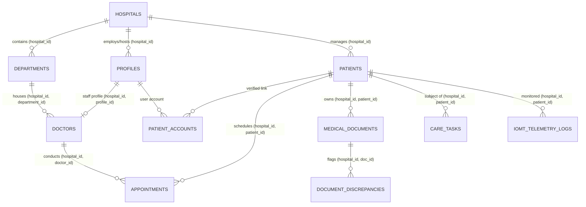

# Phase 2 Implementation Plan: Supabase Schema, Authentication, and Multi-Tenant Row Level Security (RLS)

**Document:** `docs/phase-plans/PHASE_2_PLAN.md`  
**Phase:** 2 — Database Foundation, Authentication, Tenant Isolation, and Multi-Tenant Security Architecture  
**Status:** PROPOSED (REVISION 2) — PENDING OWNER FORMAL REVIEW AND APPROVAL  
**Author:** CareBridge AI Product Engineering  
**Date:** 2026-10-14  

---

## 1. Executive Summary & Objectives

The objective of Phase 2 is to establish a hardened, production-grade relational database architecture, authentication mapping, storage security, and multi-tenant Row Level Security (RLS) enforcement in Supabase PostgreSQL for CareBridge AI.

This revision directly addresses the security review feedback by:
1. **Eliminating contact-based identity heuristics** (no matching by phone or email) in favor of explicit, cryptographically verifiable `patient_accounts` and caregiver delegations.
2. **Enforcing composite tenant foreign keys** `(hospital_id, id)` across all tables, making cross-tenant foreign-key poisoning mathematically impossible at the database level.
3. **Hardening `profiles` updates**, completely locking down `role`, `hospital_id`, and `is_active` against user-level modification and defining a safe administrative provisioning workflow.
4. **Hardening `SECURITY DEFINER` functions** with explicit search paths (`SET search_path = ''`), fully qualified schema identifiers, execution permission restrictions, and recursion guards.
5. **Specifying explicit `USING` and `WITH CHECK` clauses** across `SELECT`, `INSERT`, `UPDATE`, and `DELETE` operations for all 10 schema tables and Supabase Storage buckets.
6. **Securing Supabase Storage** with private buckets, path-based tenant validation, MIME type and size checks, and RLS policies on `storage.objects`.
7. **Adopting a forward-only, non-destructive migration philosophy** with strict rollback safety protocols.
8. **Expanding the automated security test matrix** to validate cross-tenant denial, privilege escalation prevention, inactive account termination, and real authenticated user context isolation vs service-role execution.

> [!IMPORTANT]
> **GOVERNANCE NOTICE:** This document is a formal specification only. In accordance with project governance, **no SQL migrations will be applied, no application code will be changed, and no database state will be mutated until this proposal is formally approved by the owner.**

---

## 2. Infrastructure Inspection & Live Status

A non-destructive pre-flight audit confirms:
- **Supabase REST Gateway:** `https://vmuzexvtbodnkzhfitzf.supabase.co` is online (200 OK).
- **PostgreSQL Port:** `db.vmuzexvtbodnkzhfitzf.supabase.co:5432` responds to TCP handshakes.
- **Environment & Secrets:** `carebridge/backend/.env` and `carebridge/frontend/.env.local` remain strictly git-ignored; no secrets are committed.
- **Remote Database State:** Fresh Supabase project instance; zero custom tables exist in `public`.
- **Existing Research Assets:** All CSCM PyTorch checkpoints, dataset loaders, preprocessing scripts, and evaluation metrics remain intact and completely isolated outside the database.

---

## 3. Scope Definition & Boundary Separation (Minimum Phase 2 Foundation)

To maintain architectural focus, prevent premature feature implementation, and minimize attack surface, Phase 2 is strictly bounded to the **Core Identity, Tenant Isolation, and Scheduling Foundation**:

### In Scope for Minimum Phase 2:
1. **Multi-Tenant Foundation Schema**:
   - `hospitals`: Tenant root boundary.
   - `departments`: Hospital organizational structure.
   - `profiles`: User accounts linked to `auth.users`, roles, and hospital assignments.
   - `doctors`: Clinical practitioner profiles linked to staff accounts.
   - `patients`: Authoritative Patient Master Index (PMI).
   - `patient_accounts`: Explicit cryptographic patient/caregiver identity mapping (replaces contact heuristics).
   - `appointments`: Outpatient bookings with composite tenant foreign keys and concurrency exclusion constraint.
2. **Security & Authorization Infrastructure**:
   - Hardened `SECURITY DEFINER` functions with fixed search paths (`SET search_path = ''`).
   - Profile privilege lockdown trigger preventing self-modification of `role`, `hospital_id`, or `is_active`.
   - Comprehensive Row Level Security (RLS) matrix with explicit `USING` and `WITH CHECK` conditions across `SELECT`, `INSERT`, `UPDATE`, and `DELETE`.
3. **Validation & Testing**:
   - Automated security test suite (`tests/test_phase2_security.py`) executing under real authenticated JWT contexts.
   - Fully synthetic, fictional seed dataset for two isolated hospitals.

### Explicitly Excluded from Phase 2 (Deferred to Future Feature Phases):
- **Document Intelligence & Storage** (`medical_documents` and Supabase Storage bucket policies): Deferred to **Phase 6**.
- **Document Discrepancy Engine** (`document_discrepancies`): Deferred to **Phase 7**.
- **Care Coordination Tasks** (`care_tasks`): Deferred to **Phase 8**.
- **CSCM IoMT Telemetry Integration** (`iomt_telemetry_logs`): Deferred to **Phase 12**.
- **User Interface & Front-End Pages**: Deferred to **Phases 3 & 4**.
- **Groq LLM Orchestration**: Deferred to **Phase 5**.


---

## 4. Database Schema Architecture & Tenant Integrity

### 4.1 Cross-Tenant Foreign-Key Integrity Design
A critical vulnerability in multi-tenant systems occurs when an entity in Hospital A references a foreign key belonging to Hospital B (e.g., an appointment in Hospital A referencing a doctor in Hospital B).

To make cross-tenant foreign key violations impossible at the PostgreSQL engine level, all referenced tables expose a composite unique constraint `UNIQUE (hospital_id, id)`. All child tables enforce a composite foreign key:
```sql
FOREIGN KEY (hospital_id, doctor_id) REFERENCES public.doctors(hospital_id, id)
```
This ensures that a record cannot be linked across tenant boundaries even if an attacker attempts direct SQL injection or API parameter tampering.



---

### 4.2 Data Types & ENUMs
```sql
CREATE TYPE public.user_role AS ENUM (
    'hospital_admin',
    'doctor',
    'nurse',
    'receptionist',
    'lab_technician',
    'patient'
);

CREATE TYPE public.appointment_status AS ENUM (
    'scheduled',
    'confirmed',
    'in_progress',
    'completed',
    'cancelled',
    'no_show'
);

CREATE TYPE public.document_type AS ENUM (
    'prescription',
    'lab_report',
    'discharge_summary',
    'insurance_card',
    'clinical_note',
    'other'
);

CREATE TYPE public.ocr_status AS ENUM (
    'pending',
    'processing',
    'completed',
    'failed'
);

CREATE TYPE public.task_priority AS ENUM (
    'low',
    'medium',
    'high',
    'urgent'
);

CREATE TYPE public.task_status AS ENUM (
    'pending',
    'in_progress',
    'completed',
    'escalated',
    'cancelled'
);

CREATE TYPE public.discrepancy_severity AS ENUM (
    'low',
    'moderate',
    'high',
    'critical'
);

CREATE TYPE public.account_link_status AS ENUM (
    'pending_verification',
    'verified',
    'revoked'
);
```

---

### 4.3 Table Specifications

#### 1. `hospitals`
Root multi-tenant boundary.
```sql
CREATE TABLE public.hospitals (
    id UUID PRIMARY KEY DEFAULT gen_random_uuid(),
    name TEXT NOT NULL,
    slug TEXT NOT NULL UNIQUE,
    license_number TEXT UNIQUE,
    address TEXT NOT NULL,
    contact_email TEXT NOT NULL,
    contact_phone TEXT NOT NULL,
    is_active BOOLEAN NOT NULL DEFAULT true,
    created_at TIMESTAMPTZ NOT NULL DEFAULT timezone('utc', now()),
    updated_at TIMESTAMPTZ NOT NULL DEFAULT timezone('utc', now()),
    CONSTRAINT uq_hospitals_id UNIQUE (id)
);
```

#### 2. `departments`
Hospital departments enforcing tenant isolation.
```sql
CREATE TABLE public.departments (
    id UUID PRIMARY KEY DEFAULT gen_random_uuid(),
    hospital_id UUID NOT NULL REFERENCES public.hospitals(id) ON DELETE CASCADE,
    name TEXT NOT NULL,
    code TEXT NOT NULL,
    head_of_department TEXT,
    created_at TIMESTAMPTZ NOT NULL DEFAULT timezone('utc', now()),
    CONSTRAINT uq_departments_tenant_code UNIQUE (hospital_id, code),
    CONSTRAINT uq_departments_tenant_id UNIQUE (hospital_id, id)
);
```

#### 3. `profiles`
Links `auth.users` to a hospital and role.
```sql
CREATE TABLE public.profiles (
    id UUID PRIMARY KEY REFERENCES auth.users(id) ON DELETE CASCADE,
    hospital_id UUID NOT NULL REFERENCES public.hospitals(id) ON DELETE RESTRICT,
    role public.user_role NOT NULL DEFAULT 'patient',
    full_name TEXT NOT NULL,
    email TEXT NOT NULL,
    phone TEXT,
    is_active BOOLEAN NOT NULL DEFAULT true,
    created_at TIMESTAMPTZ NOT NULL DEFAULT timezone('utc', now()),
    updated_at TIMESTAMPTZ NOT NULL DEFAULT timezone('utc', now()),
    CONSTRAINT uq_profiles_tenant_id UNIQUE (hospital_id, id)
);
CREATE INDEX idx_profiles_tenant_role ON public.profiles(hospital_id, role);
```

#### 4. `doctors`
Clinical practitioner profiles linked to hospital staff accounts.
```sql
CREATE TABLE public.doctors (
    id UUID PRIMARY KEY DEFAULT gen_random_uuid(),
    hospital_id UUID NOT NULL,
    profile_id UUID NOT NULL,
    department_id UUID NOT NULL,
    license_number TEXT NOT NULL,
    specialization TEXT NOT NULL,
    qualification TEXT NOT NULL,
    opd_room TEXT,
    consultation_fee NUMERIC(10, 2) NOT NULL DEFAULT 0.00 CHECK (consultation_fee >= 0),
    is_available BOOLEAN NOT NULL DEFAULT true,
    created_at TIMESTAMPTZ NOT NULL DEFAULT timezone('utc', now()),
    CONSTRAINT fk_doctors_profile FOREIGN KEY (hospital_id, profile_id)
        REFERENCES public.profiles(hospital_id, id) ON DELETE CASCADE,
    CONSTRAINT fk_doctors_department FOREIGN KEY (hospital_id, department_id)
        REFERENCES public.departments(hospital_id, id) ON DELETE RESTRICT,
    CONSTRAINT uq_doctors_profile UNIQUE (profile_id),
    CONSTRAINT uq_doctors_license_per_hospital UNIQUE (hospital_id, license_number),
    CONSTRAINT uq_doctors_tenant_id UNIQUE (hospital_id, id)
);
CREATE INDEX idx_doctors_tenant_dept ON public.doctors(hospital_id, department_id);
```

#### 5. `patients`
Authoritative clinical Patient Master Index (PMI) records created by hospital staff.
```sql
CREATE TABLE public.patients (
    id UUID PRIMARY KEY DEFAULT gen_random_uuid(),
    hospital_id UUID NOT NULL REFERENCES public.hospitals(id) ON DELETE RESTRICT,
    mrn TEXT NOT NULL,
    first_name TEXT NOT NULL,
    last_name TEXT NOT NULL,
    date_of_birth DATE NOT NULL CHECK (date_of_birth <= CURRENT_DATE),
    gender TEXT NOT NULL CHECK (gender IN ('male', 'female', 'other')),
    blood_group TEXT CHECK (blood_group IN ('A+', 'A-', 'B+', 'B-', 'AB+', 'AB-', 'O+', 'O-')),
    phone TEXT NOT NULL,
    email TEXT,
    address TEXT,
    emergency_contact_name TEXT,
    emergency_contact_phone TEXT,
    created_at TIMESTAMPTZ NOT NULL DEFAULT timezone('utc', now()),
    updated_at TIMESTAMPTZ NOT NULL DEFAULT timezone('utc', now()),
    CONSTRAINT uq_patients_mrn_per_hospital UNIQUE (hospital_id, mrn),
    CONSTRAINT uq_patients_tenant_id UNIQUE (hospital_id, id)
);
CREATE INDEX idx_patients_tenant_mrn ON public.patients(hospital_id, mrn);
```

#### 6. `patient_accounts` (Explicit Identity & Caregiver Mapping)
**Eliminates contact-heuristic matching.** Maps authenticated user accounts to patient clinical records with explicit verification tokens and authorization scope.
```sql
CREATE TABLE public.patient_accounts (
    id UUID PRIMARY KEY DEFAULT gen_random_uuid(),
    hospital_id UUID NOT NULL,
    user_id UUID NOT NULL,
    patient_id UUID NOT NULL,
    relationship TEXT NOT NULL DEFAULT 'self' CHECK (relationship IN ('self', 'parent', 'guardian', 'caregiver', 'spouse')),
    status public.account_link_status NOT NULL DEFAULT 'pending_verification',
    verified_at TIMESTAMPTZ,
    verified_by UUID,
    created_at TIMESTAMPTZ NOT NULL DEFAULT timezone('utc', now()),
    CONSTRAINT fk_patient_accounts_user FOREIGN KEY (hospital_id, user_id)
        REFERENCES public.profiles(hospital_id, id) ON DELETE CASCADE,
    CONSTRAINT fk_patient_accounts_patient FOREIGN KEY (hospital_id, patient_id)
        REFERENCES public.patients(hospital_id, id) ON DELETE CASCADE,
    CONSTRAINT fk_patient_accounts_verifier FOREIGN KEY (hospital_id, verified_by)
        REFERENCES public.profiles(hospital_id, id) ON DELETE SET NULL,
    CONSTRAINT uq_user_patient_link UNIQUE (user_id, patient_id),
    CONSTRAINT uq_patient_accounts_tenant_id UNIQUE (hospital_id, id)
);
CREATE INDEX idx_patient_accounts_lookup ON public.patient_accounts(user_id, status);
```

#### 7. `appointments`
Outpatient visits and clinical consultations. Enforces tenant consistency across patient, doctor, and department. Includes appointment exclusion protection against doctor double-booking.
```sql
CREATE TABLE public.appointments (
    id UUID PRIMARY KEY DEFAULT gen_random_uuid(),
    hospital_id UUID NOT NULL,
    patient_id UUID NOT NULL,
    doctor_id UUID NOT NULL,
    department_id UUID NOT NULL,
    scheduled_at TIMESTAMPTZ NOT NULL,
    duration_minutes INT NOT NULL DEFAULT 30 CHECK (duration_minutes BETWEEN 10 AND 240),
    status public.appointment_status NOT NULL DEFAULT 'scheduled',
    reason_for_visit TEXT,
    clinical_notes TEXT,
    created_at TIMESTAMPTZ NOT NULL DEFAULT timezone('utc', now()),
    updated_at TIMESTAMPTZ NOT NULL DEFAULT timezone('utc', now()),
    CONSTRAINT fk_appointments_patient FOREIGN KEY (hospital_id, patient_id)
        REFERENCES public.patients(hospital_id, id) ON DELETE CASCADE,
    CONSTRAINT fk_appointments_doctor FOREIGN KEY (hospital_id, doctor_id)
        REFERENCES public.doctors(hospital_id, id) ON DELETE RESTRICT,
    CONSTRAINT fk_appointments_department FOREIGN KEY (hospital_id, department_id)
        REFERENCES public.departments(hospital_id, id) ON DELETE RESTRICT,
    CONSTRAINT uq_appointments_tenant_id UNIQUE (hospital_id, id)
);
CREATE INDEX idx_appointments_schedule ON public.appointments(hospital_id, doctor_id, scheduled_at);
```

> **Concurrency & Double-Booking Protection:**  
> To protect against doctor overbooking at the schema level, an exclusion constraint is created using PostgreSQL `btree_gist`:
> ```sql
> CREATE EXTENSION IF NOT EXISTS btree_gist;
> ALTER TABLE public.appointments
> ADD CONSTRAINT exclude_doctor_double_booking
> EXCLUDE USING gist (
>     doctor_id WITH =,
>     tstzrange(scheduled_at, scheduled_at + (duration_minutes || ' minutes')::interval) WITH &&
> ) WHERE (status NOT IN ('cancelled', 'no_show'));
> ```

#### 8. `medical_documents`
Registry for uploaded medical reports, prescriptions, and lab records.
```sql
CREATE TABLE public.medical_documents (
    id UUID PRIMARY KEY DEFAULT gen_random_uuid(),
    hospital_id UUID NOT NULL,
    patient_id UUID NOT NULL,
    uploaded_by UUID NOT NULL,
    document_type public.document_type NOT NULL,
    title TEXT NOT NULL,
    storage_path TEXT NOT NULL UNIQUE,
    mime_type TEXT NOT NULL CHECK (mime_type IN ('application/pdf', 'image/jpeg', 'image/png')),
    file_size_bytes BIGINT NOT NULL CHECK (file_size_bytes > 0 AND file_size_bytes <= 10485760), -- 10MB limit
    ocr_status public.ocr_status NOT NULL DEFAULT 'pending',
    ocr_raw_text TEXT,
    extracted_data JSONB NOT NULL DEFAULT '{}'::jsonb,
    is_confidential BOOLEAN NOT NULL DEFAULT false,
    created_at TIMESTAMPTZ NOT NULL DEFAULT timezone('utc', now()),
    CONSTRAINT fk_medical_documents_patient FOREIGN KEY (hospital_id, patient_id)
        REFERENCES public.patients(hospital_id, id) ON DELETE CASCADE,
    CONSTRAINT fk_medical_documents_uploader FOREIGN KEY (hospital_id, uploaded_by)
        REFERENCES public.profiles(hospital_id, id) ON DELETE RESTRICT,
    CONSTRAINT uq_medical_documents_tenant_id UNIQUE (hospital_id, id)
);
CREATE INDEX idx_documents_tenant_patient ON public.medical_documents(hospital_id, patient_id);
```

#### 9. `document_discrepancies`
Audit logs for conflicting clinical records (medication interactions, dosage anomalies).
```sql
CREATE TABLE public.document_discrepancies (
    id UUID PRIMARY KEY DEFAULT gen_random_uuid(),
    hospital_id UUID NOT NULL,
    patient_id UUID NOT NULL,
    source_document_id UUID NOT NULL,
    conflicting_document_id UUID,
    severity public.discrepancy_severity NOT NULL DEFAULT 'moderate',
    category TEXT NOT NULL,
    summary TEXT NOT NULL,
    clinical_recommendation TEXT,
    is_resolved BOOLEAN NOT NULL DEFAULT false,
    resolved_by UUID,
    resolved_at TIMESTAMPTZ,
    created_at TIMESTAMPTZ NOT NULL DEFAULT timezone('utc', now()),
    CONSTRAINT fk_discrepancy_patient FOREIGN KEY (hospital_id, patient_id)
        REFERENCES public.patients(hospital_id, id) ON DELETE CASCADE,
    CONSTRAINT fk_discrepancy_src_doc FOREIGN KEY (hospital_id, source_document_id)
        REFERENCES public.medical_documents(hospital_id, id) ON DELETE CASCADE,
    CONSTRAINT fk_discrepancy_conflict_doc FOREIGN KEY (hospital_id, conflicting_document_id)
        REFERENCES public.medical_documents(hospital_id, id) ON DELETE SET NULL,
    CONSTRAINT fk_discrepancy_resolver FOREIGN KEY (hospital_id, resolved_by)
        REFERENCES public.profiles(hospital_id, id) ON DELETE SET NULL,
    CONSTRAINT uq_discrepancies_tenant_id UNIQUE (hospital_id, id)
);
CREATE INDEX idx_discrepancies_tenant_unresolved ON public.document_discrepancies(hospital_id, is_resolved);
```

#### 10. `care_tasks`
Operational task tracking and clinical follow-ups.
```sql
CREATE TABLE public.care_tasks (
    id UUID PRIMARY KEY DEFAULT gen_random_uuid(),
    hospital_id UUID NOT NULL,
    patient_id UUID NOT NULL,
    assigned_to UUID,
    created_by UUID NOT NULL,
    title TEXT NOT NULL,
    description TEXT,
    priority public.task_priority NOT NULL DEFAULT 'medium',
    status public.task_status NOT NULL DEFAULT 'pending',
    due_date TIMESTAMPTZ,
    completed_at TIMESTAMPTZ,
    created_at TIMESTAMPTZ NOT NULL DEFAULT timezone('utc', now()),
    CONSTRAINT fk_care_tasks_patient FOREIGN KEY (hospital_id, patient_id)
        REFERENCES public.patients(hospital_id, id) ON DELETE CASCADE,
    CONSTRAINT fk_care_tasks_assignee FOREIGN KEY (hospital_id, assigned_to)
        REFERENCES public.profiles(hospital_id, id) ON DELETE SET NULL,
    CONSTRAINT fk_care_tasks_creator FOREIGN KEY (hospital_id, created_by)
        REFERENCES public.profiles(hospital_id, id) ON DELETE RESTRICT,
    CONSTRAINT uq_care_tasks_tenant_id UNIQUE (hospital_id, id)
);
CREATE INDEX idx_care_tasks_tenant_status ON public.care_tasks(hospital_id, status);
```

#### 11. `iomt_telemetry_logs`
Audit table recording physiological sensor anomalies evaluated by CSCM IoMT research checkpoints.
```sql
CREATE TABLE public.iomt_telemetry_logs (
    id UUID PRIMARY KEY DEFAULT gen_random_uuid(),
    hospital_id UUID NOT NULL,
    patient_id UUID NOT NULL,
    device_id TEXT NOT NULL,
    dataset_source TEXT NOT NULL CHECK (dataset_source IN ('physionet', 'wesad', 'live_monitor')),
    anomaly_score FLOAT NOT NULL CHECK (anomaly_score BETWEEN 0.0 AND 1.0),
    is_attack_suspected BOOLEAN NOT NULL DEFAULT false,
    flagged_channels TEXT[] NOT NULL DEFAULT '{}',
    inconsistency_summary TEXT,
    recorded_at TIMESTAMPTZ NOT NULL DEFAULT timezone('utc', now()),
    CONSTRAINT fk_iomt_logs_patient FOREIGN KEY (hospital_id, patient_id)
        REFERENCES public.patients(hospital_id, id) ON DELETE CASCADE,
    CONSTRAINT uq_iomt_logs_tenant_id UNIQUE (hospital_id, id)
);
CREATE INDEX idx_iomt_logs_threats ON public.iomt_telemetry_logs(hospital_id, is_attack_suspected);
```

---

## 5. Hardened Helper Functions & Privilege Lockdown

To eliminate security definer vulnerabilities (search path hijacking, recursion, and unprivileged execution), all helper functions are hardened as follows:

```sql
-- Revoke all default execution permissions from PUBLIC
ALTER DEFAULT PRIVILEGES REVOKE EXECUTE ON FUNCTIONS FROM PUBLIC;

-- 1. Helper: Current User Hospital ID
CREATE OR REPLACE FUNCTION public.get_auth_hospital_id()
RETURNS UUID
LANGUAGE sql
STABLE
SECURITY DEFINER
SET search_path = ''
AS $$
    SELECT p.hospital_id
    FROM public.profiles p
    WHERE p.id = (SELECT auth.uid())
      AND p.is_active = true
    LIMIT 1;
$$;

-- 2. Helper: Current User Role
CREATE OR REPLACE FUNCTION public.get_auth_role()
RETURNS public.user_role
LANGUAGE sql
STABLE
SECURITY DEFINER
SET search_path = ''
AS $$
    SELECT p.role
    FROM public.profiles p
    WHERE p.id = (SELECT auth.uid())
      AND p.is_active = true
    LIMIT 1;
$$;

-- 3. Helper: Check if Current User is Staff in the Given Hospital
CREATE OR REPLACE FUNCTION public.is_hospital_staff(check_hospital_id UUID)
RETURNS BOOLEAN
LANGUAGE sql
STABLE
SECURITY DEFINER
SET search_path = ''
AS $$
    SELECT EXISTS (
        SELECT 1
        FROM public.profiles p
        WHERE p.id = (SELECT auth.uid())
          AND p.hospital_id = check_hospital_id
          AND p.role IN ('hospital_admin', 'doctor', 'nurse', 'receptionist', 'lab_technician')
          AND p.is_active = true
    );
$$;

-- 4. Helper: Check if Current User is Verified for Patient Access
CREATE OR REPLACE FUNCTION public.has_patient_access(check_hospital_id UUID, check_patient_id UUID)
RETURNS BOOLEAN
LANGUAGE sql
STABLE
SECURITY DEFINER
SET search_path = ''
AS $$
    SELECT (
        -- Either the user is hospital staff
        public.is_hospital_staff(check_hospital_id)
        OR
        -- Or the user has an active, verified patient_account mapping
        EXISTS (
            SELECT 1
            FROM public.patient_accounts pa
            WHERE pa.hospital_id = check_hospital_id
              AND pa.user_id = (SELECT auth.uid())
              AND pa.patient_id = check_patient_id
              AND pa.status = 'verified'
        )
    );
$$;

-- Grant execution explicitly to authenticated users only
GRANT EXECUTE ON FUNCTION public.get_auth_hospital_id() TO authenticated;
GRANT EXECUTE ON FUNCTION public.get_auth_role() TO authenticated;
GRANT EXECUTE ON FUNCTION public.is_hospital_staff(UUID) TO authenticated;
GRANT EXECUTE ON FUNCTION public.has_patient_access(UUID, UUID) TO authenticated;
```

---

## 6. Profile Modification Protection & Safe Staff Provisioning

### 6.1 Privilege Escalation Prevention
A user must **never** be permitted to modify their own `role`, `hospital_id`, or `is_active` status.

We enforce this with a PostgreSQL trigger that executes before any update on `public.profiles`:

```sql
CREATE OR REPLACE FUNCTION public.protect_profile_privilege_fields()
RETURNS TRIGGER
LANGUAGE plpgsql
SECURITY DEFINER
SET search_path = ''
AS $$
DECLARE
    executing_role public.user_role;
    is_service_role BOOLEAN;
BEGIN
    -- Check if executing context is Supabase service_role
    is_service_role := (SELECT current_user = 'service_role' OR auth.jwt() ->> 'role' = 'service_role');
    
    IF is_service_role THEN
        RETURN NEW;
    END IF;

    executing_role := public.get_auth_role();

    -- Ordinary users cannot change hospital_id, role, or is_active
    IF (OLD.hospital_id IS DISTINCT FROM NEW.hospital_id) THEN
        RAISE EXCEPTION 'Security Violation: hospital_id cannot be modified.';
    END IF;

    IF (OLD.role IS DISTINCT FROM NEW.role) THEN
        IF executing_role != 'hospital_admin' THEN
            RAISE EXCEPTION 'Security Violation: Only hospital administrators can change roles.';
        END IF;
    END IF;

    IF (OLD.is_active IS DISTINCT FROM NEW.is_active) THEN
        IF executing_role != 'hospital_admin' THEN
            RAISE EXCEPTION 'Security Violation: Only hospital administrators can change account activation status.';
        END IF;
    END IF;

    RETURN NEW;
END;
$$;

CREATE TRIGGER trg_protect_profile_privilege_fields
BEFORE UPDATE ON public.profiles
FOR EACH ROW
EXECUTE FUNCTION public.protect_profile_privilege_fields();
```

### 6.2 Safe Staff Provisioning Workflow
1. Initial hospital setup is executed via authenticated backend admin service or service-role migration script.
2. Hospital Administrators create invitations via Supabase Auth Admin API (`auth.admin.inviteUserByEmail`).
3. The user profile is created with status `is_active = true` and assigned the appropriate staff `user_role`.
4. Role changes require deliberate administrator action verified through audit logs.

---

## 7. Complete Row Level Security (RLS) Policy Matrix

Row Level Security is enabled on **all 11 tables**:
```sql
ALTER TABLE public.hospitals ENABLE ROW LEVEL SECURITY;
ALTER TABLE public.departments ENABLE ROW LEVEL SECURITY;
ALTER TABLE public.profiles ENABLE ROW LEVEL SECURITY;
ALTER TABLE public.doctors ENABLE ROW LEVEL SECURITY;
ALTER TABLE public.patients ENABLE ROW LEVEL SECURITY;
ALTER TABLE public.patient_accounts ENABLE ROW LEVEL SECURITY;
ALTER TABLE public.appointments ENABLE ROW LEVEL SECURITY;
ALTER TABLE public.medical_documents ENABLE ROW LEVEL SECURITY;
ALTER TABLE public.document_discrepancies ENABLE ROW LEVEL SECURITY;
ALTER TABLE public.care_tasks ENABLE ROW LEVEL SECURITY;
ALTER TABLE public.iomt_telemetry_logs ENABLE ROW LEVEL SECURITY;
```

### 7.1 Detailed CRUD Policies by Table

#### Table: `hospitals`
- **SELECT**: Authenticated users can view their own hospital details only.
  ```sql
  CREATE POLICY hospitals_select ON public.hospitals
  FOR SELECT TO authenticated
  USING (id = public.get_auth_hospital_id());
  ```
- **INSERT, UPDATE, DELETE**: Prohibited for regular authenticated users (Service Role / System Admin only).

#### Table: `departments`
- **SELECT**: Users can view departments in their assigned hospital.
  ```sql
  CREATE POLICY departments_select ON public.departments
  FOR SELECT TO authenticated
  USING (hospital_id = public.get_auth_hospital_id());
  ```
- **INSERT, UPDATE, DELETE**: Hospital Admins only.
  ```sql
  CREATE POLICY departments_write ON public.departments
  FOR ALL TO authenticated
  USING (hospital_id = public.get_auth_hospital_id() AND public.get_auth_role() = 'hospital_admin')
  WITH CHECK (hospital_id = public.get_auth_hospital_id() AND public.get_auth_role() = 'hospital_admin');
  ```

#### Table: `profiles`
- **SELECT**: Staff can view all profiles in their hospital; patients can view only their own profile.
  ```sql
  CREATE POLICY profiles_select ON public.profiles
  FOR SELECT TO authenticated
  USING (
      (hospital_id = public.get_auth_hospital_id() AND public.is_hospital_staff(hospital_id))
      OR id = (SELECT auth.uid())
  );
  ```
- **UPDATE**: Users can update their own personal details (name, phone); Hospital Admins can update any profile in their hospital. (Trigger prevents unauthorized field escalation).
  ```sql
  CREATE POLICY profiles_update ON public.profiles
  FOR UPDATE TO authenticated
  USING (
      id = (SELECT auth.uid())
      OR (hospital_id = public.get_auth_hospital_id() AND public.get_auth_role() = 'hospital_admin')
  )
  WITH CHECK (
      hospital_id = public.get_auth_hospital_id()
  );
  ```

#### Table: `patients`
- **SELECT**: Staff in the hospital, OR verified patients/caregivers linked via `patient_accounts`.
  ```sql
  CREATE POLICY patients_select ON public.patients
  FOR SELECT TO authenticated
  USING (
      hospital_id = public.get_auth_hospital_id()
      AND public.has_patient_access(hospital_id, id)
  );
  ```
- **INSERT**: Hospital Admin, Receptionist, or Doctor within their hospital.
  ```sql
  CREATE POLICY patients_insert ON public.patients
  FOR INSERT TO authenticated
  WITH CHECK (
      hospital_id = public.get_auth_hospital_id()
      AND public.get_auth_role() IN ('hospital_admin', 'receptionist', 'doctor')
  );
  ```
- **UPDATE**: Hospital Admin, Receptionist, or Doctor within their hospital.
  ```sql
  CREATE POLICY patients_update ON public.patients
  FOR UPDATE TO authenticated
  USING (
      hospital_id = public.get_auth_hospital_id()
      AND public.get_auth_role() IN ('hospital_admin', 'receptionist', 'doctor')
  )
  WITH CHECK (
      hospital_id = public.get_auth_hospital_id()
  );
  ```
- **DELETE**: Prohibited. Clinical patient records are never hard-deleted.

#### Table: `patient_accounts`
- **SELECT**: Hospital staff, or the specific user the link belongs to.
  ```sql
  CREATE POLICY patient_accounts_select ON public.patient_accounts
  FOR SELECT TO authenticated
  USING (
      (hospital_id = public.get_auth_hospital_id() AND public.is_hospital_staff(hospital_id))
      OR user_id = (SELECT auth.uid())
  );
  ```
- **INSERT**: Hospital staff, or a user registering a link request for themselves.
  ```sql
  CREATE POLICY patient_accounts_insert ON public.patient_accounts
  FOR INSERT TO authenticated
  WITH CHECK (
      hospital_id = public.get_auth_hospital_id()
      AND (
          public.is_hospital_staff(hospital_id)
          OR (user_id = (SELECT auth.uid()) AND status = 'pending_verification')
      )
  );
  ```
- **UPDATE (Verification / Revocation)**: Hospital staff can verify or revoke links; user can revoke their own link.
  ```sql
  CREATE POLICY patient_accounts_update ON public.patient_accounts
  FOR UPDATE TO authenticated
  USING (
      (hospital_id = public.get_auth_hospital_id() AND public.is_hospital_staff(hospital_id))
      OR user_id = (SELECT auth.uid())
  )
  WITH CHECK (
      hospital_id = public.get_auth_hospital_id()
  );
  ```

#### Table: `doctors`
- **SELECT**: All authenticated users within the same hospital.
  ```sql
  CREATE POLICY doctors_select ON public.doctors
  FOR SELECT TO authenticated
  USING (hospital_id = public.get_auth_hospital_id());
  ```
- **INSERT, UPDATE**: Hospital Admin or the Doctor updating their own OPD availability.
  ```sql
  CREATE POLICY doctors_write ON public.doctors
  FOR ALL TO authenticated
  USING (
      hospital_id = public.get_auth_hospital_id()
      AND (
          public.get_auth_role() = 'hospital_admin'
          OR profile_id = (SELECT auth.uid())
      )
  )
  WITH CHECK (
      hospital_id = public.get_auth_hospital_id()
  );
  ```

#### Table: `appointments`
- **SELECT**: Hospital staff, OR the verified patient linked to the appointment.
  ```sql
  CREATE POLICY appointments_select ON public.appointments
  FOR SELECT TO authenticated
  USING (
      hospital_id = public.get_auth_hospital_id()
      AND public.has_patient_access(hospital_id, patient_id)
  );
  ```
- **INSERT**: Staff (Doctor, Receptionist, Admin), OR a verified patient booking an appointment for themselves.
  ```sql
  CREATE POLICY appointments_insert ON public.appointments
  FOR INSERT TO authenticated
  WITH CHECK (
      hospital_id = public.get_auth_hospital_id()
      AND public.has_patient_access(hospital_id, patient_id)
      AND (
          public.is_hospital_staff(hospital_id)
          OR (public.get_auth_role() = 'patient' AND status = 'scheduled')
      )
  );
  ```
- **UPDATE**: Staff can update status and notes; patient can cancel their own scheduled appointment.
  ```sql
  CREATE POLICY appointments_update ON public.appointments
  FOR UPDATE TO authenticated
  USING (
      hospital_id = public.get_auth_hospital_id()
      AND public.has_patient_access(hospital_id, patient_id)
  )
  WITH CHECK (
      hospital_id = public.get_auth_hospital_id()
      AND (
          public.is_hospital_staff(hospital_id)
          OR (public.get_auth_role() = 'patient' AND status = 'cancelled')
      )
  );
  ```

#### Table: `medical_documents`
- **SELECT**: Clinical staff (Doctor, Nurse, Admin, Lab Tech), OR the verified patient if `is_confidential = false`.
  ```sql
  CREATE POLICY medical_documents_select ON public.medical_documents
  FOR SELECT TO authenticated
  USING (
      hospital_id = public.get_auth_hospital_id()
      AND public.has_patient_access(hospital_id, patient_id)
      AND (
          public.is_hospital_staff(hospital_id)
          OR (public.get_auth_role() = 'patient' AND is_confidential = false)
      )
  );
  ```
- **INSERT**: Clinical staff or the verified patient uploading their own record.
  ```sql
  CREATE POLICY medical_documents_insert ON public.medical_documents
  FOR INSERT TO authenticated
  WITH CHECK (
      hospital_id = public.get_auth_hospital_id()
      AND uploaded_by = (SELECT auth.uid())
      AND public.has_patient_access(hospital_id, patient_id)
  );
  ```
- **UPDATE**: Doctors, Lab Techs, or Hospital Admins (e.g., updating OCR status or extracted data).
  ```sql
  CREATE POLICY medical_documents_update ON public.medical_documents
  FOR UPDATE TO authenticated
  USING (
      hospital_id = public.get_auth_hospital_id()
      AND public.get_auth_role() IN ('hospital_admin', 'doctor', 'lab_technician')
  )
  WITH CHECK (
      hospital_id = public.get_auth_hospital_id()
  );
  ```

#### Table: `document_discrepancies`
- **SELECT**: Doctors, Nurses, and Hospital Admins. Patients are never exposed to raw internal discrepancy logs.
  ```sql
  CREATE POLICY discrepancies_select ON public.document_discrepancies
  FOR SELECT TO authenticated
  USING (
      hospital_id = public.get_auth_hospital_id()
      AND public.get_auth_role() IN ('hospital_admin', 'doctor', 'nurse')
  );
  ```
- **INSERT, UPDATE**: Doctors and Hospital Admins (conflict resolution and clinical reviews).
  ```sql
  CREATE POLICY discrepancies_write ON public.document_discrepancies
  FOR ALL TO authenticated
  USING (
      hospital_id = public.get_auth_hospital_id()
      AND public.get_auth_role() IN ('hospital_admin', 'doctor')
  )
  WITH CHECK (
      hospital_id = public.get_auth_hospital_id()
  );
  ```

#### Table: `care_tasks`
- **SELECT**: Hospital staff within the hospital.
  ```sql
  CREATE POLICY care_tasks_select ON public.care_tasks
  FOR SELECT TO authenticated
  USING (
      hospital_id = public.get_auth_hospital_id()
      AND public.is_hospital_staff(hospital_id)
  );
  ```
- **INSERT, UPDATE**: Hospital staff within the hospital.
  ```sql
  CREATE POLICY care_tasks_write ON public.care_tasks
  FOR ALL TO authenticated
  USING (
      hospital_id = public.get_auth_hospital_id()
      AND public.is_hospital_staff(hospital_id)
  )
  WITH CHECK (
      hospital_id = public.get_auth_hospital_id()
  );
  ```

#### Table: `iomt_telemetry_logs`
- **SELECT**: Doctors, Nurses, Hospital Admins.
  ```sql
  CREATE POLICY iomt_logs_select ON public.iomt_telemetry_logs
  FOR SELECT TO authenticated
  USING (
      hospital_id = public.get_auth_hospital_id()
      AND public.get_auth_role() IN ('hospital_admin', 'doctor', 'nurse')
  );
  ```
- **INSERT**: Backend service-role or clinical investigators. Prohibited for regular client tokens.

---

## 8. Supabase Storage Security Architecture

Medical records, prescriptions, and lab images contain sensitive health data and must never be placed in a public storage bucket.

### 8.1 Bucket Definition: `medical-documents`
- **Public Access:** Disabled (`public = false`).
- **File Size Limit:** 10,485,760 bytes (10 MB).
- **Allowed MIME Types:** `['application/pdf', 'image/jpeg', 'image/png']`.

### 8.2 Path Structure & Isolation
Storage paths are structured strictly by hospital ID and patient ID with a cryptographically random UUID filename to prevent path guessing or directory traversal:
```
medical-documents/{hospital_id}/{patient_id}/{random_uuid}.{ext}
```

### 8.3 Storage RLS Policies (`storage.objects`)

```sql
-- 1. Storage Upload Policy
CREATE POLICY "medical_docs_storage_upload" ON storage.objects
FOR INSERT TO authenticated
WITH CHECK (
    bucket_id = 'medical-documents'
    -- Path format: {hospital_id}/{patient_id}/{filename}
    AND (storage.foldername(name))[1] = (public.get_auth_hospital_id())::text
    AND public.has_patient_access(
        ((storage.foldername(name))[1])::uuid,
        ((storage.foldername(name))[2])::uuid
    )
);

-- 2. Storage Read / Download Policy
CREATE POLICY "medical_docs_storage_read" ON storage.objects
FOR SELECT TO authenticated
USING (
    bucket_id = 'medical-documents'
    AND (storage.foldername(name))[1] = (public.get_auth_hospital_id())::text
    AND public.has_patient_access(
        ((storage.foldername(name))[1])::uuid,
        ((storage.foldername(name))[2])::uuid
    )
);

-- 3. Storage Delete Policy
CREATE POLICY "medical_docs_storage_delete" ON storage.objects
FOR DELETE TO authenticated
USING (
    bucket_id = 'medical-documents'
    AND (storage.foldername(name))[1] = (public.get_auth_hospital_id())::text
    AND public.get_auth_role() = 'hospital_admin'
);
```

---

## 9. Migration & Rollback Safety Strategy

### 9.1 Non-Destructive, Forward-Only Philosophy
- The primary migration file (`0001_phase2_schema.sql`) is written using idempotent DDL (`CREATE TABLE IF NOT EXISTS`, `CREATE TYPE ... EXCEPTION`, `ADD CONSTRAINT IF NOT EXISTS`).
- **Never run automatic destructive rollbacks in shared or staging environments.** Destructive drop scripts are strictly restricted to local or disposable test databases.
- If a schema defect is detected, resolution is achieved via a forward corrective migration (`0002_phase2_fix.sql`).

### 9.2 Reversible Rollback Script (`0001_phase2_down.sql`)
A corresponding down-migration script is authored for clean local environment teardown. It operates in reverse dependency order:
```sql
-- Down-migration executes only if explicitly confirmed by developer
DROP TRIGGER IF EXISTS trg_protect_profile_privilege_fields ON public.profiles;
DROP FUNCTION IF EXISTS public.protect_profile_privilege_fields();
DROP FUNCTION IF EXISTS public.has_patient_access(UUID, UUID);
DROP FUNCTION IF EXISTS public.is_hospital_staff(UUID);
DROP FUNCTION IF EXISTS public.get_auth_role();
DROP FUNCTION IF EXISTS public.get_auth_hospital_id();

DROP TABLE IF EXISTS public.iomt_telemetry_logs CASCADE;
DROP TABLE IF EXISTS public.care_tasks CASCADE;
DROP TABLE IF EXISTS public.document_discrepancies CASCADE;
DROP TABLE IF EXISTS public.medical_documents CASCADE;
DROP TABLE IF EXISTS public.appointments CASCADE;
DROP TABLE IF EXISTS public.patient_accounts CASCADE;
DROP TABLE IF EXISTS public.patients CASCADE;
DROP TABLE IF EXISTS public.doctors CASCADE;
DROP TABLE IF EXISTS public.profiles CASCADE;
DROP TABLE IF EXISTS public.departments CASCADE;
DROP TABLE IF EXISTS public.hospitals CASCADE;

DROP TYPE IF EXISTS public.account_link_status;
DROP TYPE IF EXISTS public.discrepancy_severity;
DROP TYPE IF EXISTS public.task_status;
DROP TYPE IF EXISTS public.task_priority;
DROP TYPE IF EXISTS public.ocr_status;
DROP TYPE IF EXISTS public.document_type;
DROP TYPE IF EXISTS public.appointment_status;
DROP TYPE IF EXISTS public.user_role;
```

---

## 10. Comprehensive Security Verification & Test Suite

An automated test suite (`tests/test_phase2_security.py`) will be executed upon approval. **Tests run using real authenticated user contexts** (signing in with test users representing distinct roles across two separate hospitals) and distinguish regular JWT authorization from service-role operations.

### 10.1 Test Scenarios & Invariant Matrix

| Test ID | Category | Scenario / Action | Expected Result |
|---|---|---|---|
| `SEC-AUTH-01` | **Unauthenticated Access** | Anonymous request attempts `SELECT * FROM public.patients` | **Blocked**: returns empty array (0 rows) or 401. |
| `SEC-AUTH-02` | **Unauthenticated Write** | Anonymous request attempts `INSERT INTO public.appointments` | **Blocked**: 401 Unauthorized / RLS rejection. |
| `SEC-TENANT-01`| **Cross-Hospital Read** | Doctor at Hospital A attempts `SELECT` on patients in Hospital B | **Blocked by RLS**: returns 0 rows. |
| `SEC-TENANT-02`| **Cross-Hospital Write** | Receptionist at Hospital A attempts `INSERT` into Hospital B patients | **Blocked by RLS WITH CHECK**: violates tenant policy. |
| `SEC-TENANT-03`| **Cross-Tenant FK Poison** | Doctor at Hospital A books appointment referencing a Doctor in Hospital B | **Rejected by DB Engine**: composite FK constraint violation. |
| `SEC-PATIENT-01`| **Patient-to-Patient Isolation** | Patient 1 attempts to read Patient 2's medical records or appointments | **Blocked by RLS**: returns 0 rows. |
| `SEC-PATIENT-02`| **Unverified Caregiver Read** | User with `status = 'pending_verification'` attempts patient access | **Blocked**: helper function requires `status = 'verified'`. |
| `SEC-PATIENT-03`| **Verified Caregiver Access** | User with verified relationship queries linked patient's appointments | **Permitted**: returns linked patient records only. |
| `SEC-ESCALATE-01`| **Privilege Escalation** | Patient attempts to update their profile `role = 'doctor'` | **Blocked by Trigger**: `Security Violation` raised. |
| `SEC-ESCALATE-02`| **Tenant Tampering** | Doctor attempts to change their own `hospital_id` | **Blocked by Trigger**: `hospital_id cannot be modified`. |
| `SEC-INACTIVE-01`| **Inactive Account Lockout**| User profile with `is_active = false` attempts any queries | **Blocked**: `get_auth_hospital_id()` returns NULL, denying all rows. |
| `SEC-MUTATE-01`| **Unauthorized DELETE** | Doctor or patient attempts `DELETE FROM public.patients` | **Blocked**: DELETE is completely prohibited by policy. |
| `SEC-STORAGE-01`| **Guessed Path Read** | Patient A attempts download of `medical-documents/hospA/patientB/file.pdf` | **Blocked by Storage RLS**: permission denied. |
| `SEC-STORAGE-02`| **Invalid MIME Upload** | Uploading an executable `.exe` file to `medical-documents` | **Rejected by Storage Bucket MIME validation**. |
| `SEC-DOUBLEBOOK-01`| **Concurrency Protection** | Booking overlapping appointments for same doctor at same time | **Rejected by DB Engine**: exclusion constraint violation. |

---

## 11. Purely Synthetic Seed Dataset Specification

To guarantee 100% privacy compliance, all seed data uses purely fictional, synthetic records:

- **Hospital 1 (Primary Tenant):**
  - Name: "Aegis Metro General Hospital" (Chennai)
  - Slug: `aegis-metro-general`
- **Hospital 2 (Tenant Isolation Verification):**
  - Name: "St. Jude Regional Infirmary" (Coimbatore)
  - Slug: `st-jude-regional`
- **Clinical Staff (Fictional):**
  - Hospital A Admin: `admin@aegis-hospital.example.com`
  - Dr. Aris Thorne (Cardiology) — `dr.thorne@aegis-hospital.example.com`
  - Dr. Maya Lin (Neurology) — `dr.lin@aegis-hospital.example.com`
  - Nurse Clara Oswald — `nurse.clara@aegis-hospital.example.com`
  - Receptionist John Watson — `reception.john@aegis-hospital.example.com`
  - Hospital B Doctor: Dr. Gregory House — `dr.house@stjude-hospital.example.com`
- **Synthetic Patients (Fictional MRNs & Vitals):**
  - Fictional Patient 1: "Alice Vance", MRN: `SYN-PAT-001`, DOB: `1985-04-12`
  - Fictional Patient 2: "Bob Pendelton", MRN: `SYN-PAT-002`, DOB: `1972-11-03`
  - Fictional Patient 3: "Charlie Higgins", MRN: `SYN-PAT-003`, DOB: `1998-07-22`
  - Hospital B Patient: "David Bowman", MRN: `SYN-STJ-001`, DOB: `1968-01-30`

Seed scripts will be stored in `carebridge/backend/supabase/seed.sql` and clearly demarcated as non-clinical test assets.

---

## 12. Privacy, Regulatory & Technical Risk Assessment

| Risk Domain | Potential Vulnerability | Mitigating Control in Plan |
|---|---|---|
| **Identity Spoofing** | User registers with patient's phone/email to steal records | Heuristic contact matching removed. Replaced with explicit `patient_accounts` requiring hospital staff verification. |
| **Tenant Bleed** | API allows Hospital A doctor to schedule in Hospital B | Composite foreign keys `(hospital_id, id)` enforce relational tenant consistency at database engine level. |
| **Search Path Poisoning** | Malicious schema objects intercept helper functions | `SECURITY DEFINER` functions specify `SET search_path = ''` and fully qualify all schema references (`public.*`). |
| **Privilege Escalation** | Compromised user account updates profile role to admin | Pre-update trigger blocks modifications to `role`, `hospital_id`, and `is_active` for non-admin tokens. |
| **Document Leakage** | Patient guesses storage file UUIDs of other patients | Storage RLS validates both tenant and patient folder ownership before authorizing download. |
| **Accidental Overbooking**| Rapid parallel appointment requests double-book doctor | PostgreSQL `tstzrange` exclusion constraint blocks overlapping appointment slots. |
| **Accidental Data Loss** | Destructive down-migration run in production | Forward-only migration strategy; destructive down-scripts restricted strictly to disposable local test environments. |

---

## 13. Acceptance Criteria for Phase 2 Completion

Phase 2 will be marked **COMPLETED** only when all of the following criteria are validated with verifiable test logs:

| # | Acceptance Criterion | Verification Method |
|---|---------------------|---------------------|
| **AC 2.1** | Schema migration applied cleanly without warnings | PostgreSQL catalog check verifies all 11 tables and ENUMs |
| **AC 2.2** | Composite tenant foreign keys enforced | Attempting cross-hospital foreign key insert raises SQL error |
| **AC 2.3** | Hardened security functions active | Function definitions verified with `SET search_path = ''` |
| **AC 2.4** | Profile privilege lock verified | Attempting to update `role` as ordinary user raises security exception |
| **AC 2.5** | Row Level Security enabled across all tables | Catalog inspection confirms `rowsecurity = true` on all 11 tables |
| **AC 2.6** | Multi-tenant test suite passes 100% | `pytest tests/test_phase2_security.py` passes all 15 test cases |
| **AC 2.7** | Storage RLS and MIME restrictions active | Storage test validates upload rejection for unauthorized/disallowed files |
| **AC 2.8** | Existing research assets untouched | Git diff confirms `src/`, `models/`, and dataset directories remain 100% identical |

---

## 14. Unresolved Questions for Owner Decision

1. **Patient Verification Mechanism:** For demo purposes, should patient account linking (`patient_accounts`) be auto-verified via a synthetic demo flag, or should we require an explicit hospital staff sign-off flow for all accounts? *(Recommended: support staff sign-off with an automated one-click verification helper for local testing).*
2. **Double-Booking Buffer:** The appointment exclusion constraint currently prevents exact overlapping time intervals (`tstzrange`). Would you like a mandatory 5-minute buffer between appointments enforced at the database level, or handled at the application scheduling layer? *(Recommended: application scheduling layer to maintain database simplicity).*

---

**END OF REVISED PROPOSAL — STOPPED FOR OWNER REVIEW. NO CODE OR DATABASE MODIFICATIONS HAVE BEEN APPLIED.**
