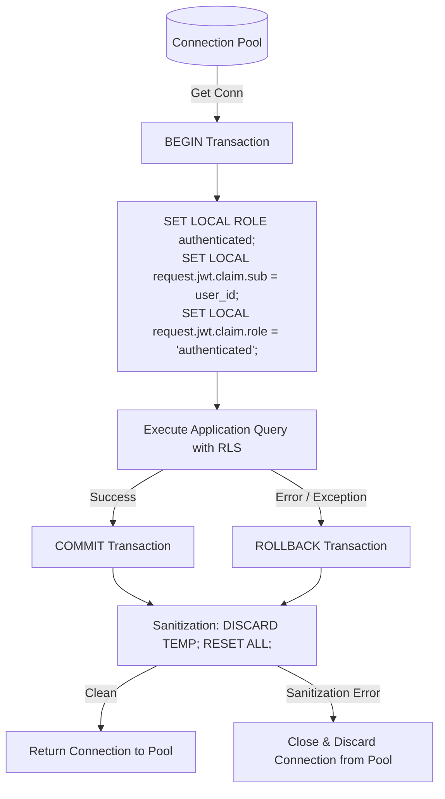

# Phase 3 Implementation Plan: Core Hospital Workflows & API Layer

**Document:** `docs/phase-plans/PHASE_3_PLAN.md`  
**Phase:** 3 — Core Hospital Workflows (FastAPI REST Services, Patient Master Index, and Appointment Management)  
**Status:** PROPOSED (REVISION 5) — PENDING OWNER FORMAL REVIEW AND APPROVAL  
**Author:** CareBridge AI Product Engineering  
**Date:** 2026-10-14  

---

## 1. Executive Summary & Objective

The objective of Phase 3 is to implement the authoritative, production-grade backend API service in FastAPI providing core hospital operational workflows:
1. **Patient Master Index (PMI)** management (creation, retrieval, search, field-level access control).
2. **Clinical Directory & Availability** (departments, doctors, dynamic IANA timezone slot generation, working hours).
3. **Deterministic Appointment Lifecycle** (state transition matrix, atomic rescheduling, two-hour cutoff, concurrency protection).
4. **Caregiver Identity & Legal Consent Verification** (standardized evidence enum, staff verification audit, patient-owned revocation).
5. **Connection Pool Isolation & Session Sanitization** (verified role switching, transaction-scoped `SET LOCAL`, rollback safety, failed-connection discard).
6. **Hardened JWT Cryptographic Verification** (algorithm whitelisting, JWKS vs Project Secret enforcement, zero fallback in production).
7. **Privacy-Preserving Structured Audit Logging** (keyed-hash pseudonymization, client IP masking, log rotation, tamper protection).

> [!IMPORTANT]
> **GOVERNANCE NOTICE:** This document is a formal specification only. In accordance with project governance, **no application code will be modified, no endpoints deployed, and no database mutations executed until this proposal is reviewed and explicitly approved by the owner.**

---

## 2. Authentication, JWT Validation & Security Context

### 2.1 Key Strategy & Algorithm Enforcement
To eliminate algorithm substitution attacks (e.g., `alg: "none"`, HMAC-vs-RSA confusion):
1. **Explicit Algorithm Whitelisting**:
   - The API enforces a strict algorithm whitelist: `["HS256"]` when using Supabase shared HMAC secret, or `["RS256", "ES256"]` when using Supabase asymmetric JWKS.
   - The token header `alg` is checked before decoding; tokens with unapproved algorithms are rejected immediately with HTTP 401.
2. **Production vs. Local Development Key Strategy**:
   - **Production Mode (`ENVIRONMENT=production`)**: The verification key source is deterministic. If configured for JWKS, it fetches and caches public keys from `https://<project-ref>.supabase.co/auth/v1/.well-known/jwks.json`. Silent fallback to shared secrets in production is **strictly prohibited**.
   - **Development/Test Mode (`ENVIRONMENT=development`)**: Allows verification against local secret configured in `.env` for offline test suites, logged explicitly at startup as a non-production configuration.
3. **Mandatory Claims Validation**:
   - `iss` (Issuer): Must exactly match `https://<project-ref>.supabase.co/auth/v1`.
   - `aud` (Audience): Must be `'authenticated'`.
   - `exp` (Expiry): Strict UTC expiry validation with a maximum clock skew leeway of 30 seconds.
   - `sub` (Subject): Must be a valid UUID.

### 2.2 Profile Resolution & Inactive Account Check
1. Upon successful signature and claims verification, the `sub` UUID is resolved against `public.profiles`.
2. If `profiles.is_active == false`, the request is rejected immediately with HTTP 403 Forbidden (`ACCOUNT_DEACTIVATED`).
3. An immutable `SecurityContext` is injected into the route handler:
   ```python
   class SecurityContext(BaseModel):
       user_id: UUID
       hospital_id: UUID
       role: UserRole
       email: str
       is_active: bool
   ```

---

## 3. Database Connection Pool Safety & Verified Role Switching

### 3.1 Verified Fact: Live Role Membership & `SET LOCAL ROLE` Mechanics
A read-only inspection of the live PostgreSQL database catalog confirms:
- **Connecting User**: The database backend connects as `postgres`.
- **Role Memberships**: `postgres` is an explicit, verified member of `authenticated`, `anon`, `service_role`, `authenticator`, and `supabase_privileged_role`.
- **Role Switching**: Executing `SET LOCAL ROLE authenticated` successfully transitions the current execution role within the active transaction to `authenticated`.
- **Identity Evaluation**: The Phase 2 security functions (`public.get_auth_hospital_id()`, `public.get_auth_role()`, `public.is_hospital_staff()`, `public.has_patient_access()`) execute with `SECURITY DEFINER` and evaluate identity via `auth.uid()`, which reads `current_setting('request.jwt.claim.sub', true)::uuid`.
- **RLS Activation**: When switched to `authenticated`, Row Level Security policies active on the tables are strictly enforced.

### 3.2 Transaction Boundaries & Sanitization Protocol
When using connection pooling, connection reuse can leak session context across requests if an uncommitted state or session variable persists. To guarantee isolation:



1. **Transaction-Scoped Context (`SET LOCAL`)**:
   - Every database operation is wrapped in an explicit transaction (`BEGIN ... COMMIT / ROLLBACK`).
   - `SET LOCAL` modifies configuration variables and role strictly within the transaction boundary; PostgreSQL resets them to session defaults upon `COMMIT` or `ROLLBACK`.
2. **Mandatory Rollback on Exception**:
   - If any query error or route exception occurs, the context manager issues `conn.rollback()` immediately.
3. **Connection Sanitization & Discard Behavior**:
   - Before returning any connection to the pool, the context manager issues `DISCARD TEMP; RESET ALL;`.
   - **Sanitization Failure Defense**: If `RESET ALL` or connection verification fails, or if the connection is in an invalid/broken state, the context manager catches the exception, **closes and discards the physical connection from the pool (`pool.putconn(conn, close=True)`)**, and logs an alert. It never returns a suspect connection to the pool.
4. **Defense-in-Depth Application Scoping**:
   - Every single SQL query includes an explicit `WHERE hospital_id = :context_hospital_id` filter. Cross-tenant leakage is prevented at both the application and database layers.

---

## 4. Hospital Time Zones, Availability & DST Handling

### 4.1 Schema Enhancement (Forward Migration `0002`)
Phase 3 includes an idempotent forward migration adding the IANA timezone column:
```sql
ALTER TABLE public.hospitals 
ADD COLUMN IF NOT EXISTS timezone TEXT NOT NULL DEFAULT 'Asia/Kolkata';
```
*(Owner Decision Recorded: `Asia/Kolkata` is configured as the seed-hospital default, with full dynamic support for per-hospital IANA time zones).*

### 4.2 IANA Validation & Fallback Behavior
1. **Validation**: Pydantic input schemas validate incoming timezone identifiers against `zoneinfo.available_timezones()`. Any unrecognized identifier (e.g., `"Invalid/Zone"`, `"GMT+5:30"`) is rejected with HTTP 422 (`INVALID_TIMEZONE`).
2. **Existing Records Fallback**: If an existing hospital record has a NULL or corrupt timezone value, the runtime safely defaults to `'Asia/Kolkata'` and emits an operational system warning.

### 4.3 DST Transitions (Spring-Forward Gaps & Fall-Back Overlaps)
For hospitals located in regions observing Daylight Saving Time:
1. **Spring-Forward (Nonexistent Local Time)**:
   - When clocks skip forward (e.g., 02:00 -> 03:00), local times such as 02:30 do not exist.
   - The slot generation engine detects nonexistent local times via `zoneinfo` and omits them from available slots.
   - Any manual booking request submitted for a nonexistent local timestamp is rejected with **HTTP 422 Unprocessable Entity** (`NONEXISTENT_LOCAL_TIME`).
2. **Fall-Back (Ambiguous Local Time)**:
   - When clocks repeat an hour (e.g., 01:00 -> 02:00 occurs twice), local times are ambiguous.
   - The API requires clients to supply explicit UTC offsets (`Z` or `+HH:MM`). If an ambiguous local datetime is provided without an explicit offset, the API defaults deterministically to standard time (`fold=0`) and notes the resolution in the response metadata.

---

## 5. Comprehensive Appointment Lifecycle Transition Table

To ensure deterministic scheduling without invalid states, transitions follow an explicit state machine:

| Current State | Target State | Permitted Actors | Conditions & Validation Rules | Audit Action |
|---|---|---|---|---|
| *(New)* | `scheduled` | Patient, Caregiver, Receptionist, Doctor, Admin | Requested slot must be in future, doctor available, no overlapping booking. Patient must be verified. | `APPOINTMENT_CREATED` |
| `scheduled` | `confirmed` | Receptionist, Doctor, Hospital Admin | Staff confirms patient attendance / pre-consultation readiness. | `APPOINTMENT_CONFIRMED` |
| `scheduled` | `cancelled` | Patient, Caregiver, Receptionist, Doctor, Admin | Allowed up to 2 hours before scheduled start time. Mandatory `cancellation_reason`. | `APPOINTMENT_CANCELLED` |
| `confirmed` | `in_progress`| Assigned Doctor, Hospital Admin | Doctor begins consultation. Sets `consultation_start_time = now()`. | `CONSULTATION_STARTED` |
| `confirmed` | `cancelled` | Receptionist, Doctor, Hospital Admin | Allowed if emergency or doctor unavailable. Mandatory reason. | `APPOINTMENT_CANCELLED` |
| `confirmed` | `no_show` | Receptionist, Assigned Doctor | Recorded if patient does not attend within 30 minutes of scheduled start. | `APPOINTMENT_NO_SHOW` |
| `in_progress`| `completed` | Assigned Doctor, Hospital Admin | Doctor completes consultation and submits final clinical notes. | `CONSULTATION_COMPLETED` |
| `in_progress`| `cancelled` | Assigned Doctor | Terminated due to medical emergency / transfer. | `CONSULTATION_ABORTED` |
| `completed` | *(Any)* | **NONE (Terminal State)** | Closed appointments cannot be reopened or transitioned. Attempt returns HTTP 422. | `ILLEGAL_TRANSITION_BLOCKED` |
| `cancelled` | *(Any)* | **NONE (Terminal State)** | Cancelled appointments cannot be un-cancelled. Must book new slot. Returns HTTP 422. | `ILLEGAL_TRANSITION_BLOCKED` |
| `no_show` | *(Any)* | **NONE (Terminal State)** | No-show records cannot be edited. Returns HTTP 422. | `ILLEGAL_TRANSITION_BLOCKED` |

### 5.1 Atomic Rescheduling & Two-Hour Cutoff Mechanics
Rescheduling operates under strict business rules:
1. **Permitted States**: Rescheduling is permitted **only** when current status is `scheduled` or `confirmed`. Attempting to reschedule `in_progress`, `completed`, `cancelled`, or `no_show` returns HTTP 422 (`INVALID_RESCHEDULE_STATE`).
2. **Two-Hour Cutoff**:
   - For patients and caregivers, rescheduling requests submitted within 2 hours of `scheduled_at` are rejected with HTTP 422 (`RESCHEDULE_WINDOW_EXPIRED`).
   - Hospital Administrators and Receptionists may override the cutoff for medical emergencies, requiring a mandatory `override_reason`.
3. **Atomic Rescheduling Transaction**:
   - Rescheduling executes inside a single database transaction:
     ```sql
     BEGIN;
     -- Step 1: Lock existing appointment FOR UPDATE
     -- Step 2: Validate state and 2-hour window
     -- Step 3: Insert new appointment for target slot (triggers exclusion constraint if slot overlaps)
     -- Step 4: Update existing appointment SET status = 'cancelled', clinical_notes = 'Rescheduled to <new-id>'
     COMMIT;
     ```
   - **Rollback Guarantee**: If Step 3 triggers an `ExclusionViolation` (doctor slot unavailable) or any validation fails, the entire transaction issues `ROLLBACK`. The original appointment remains untouched, active, and in its initial state.

---

## 6. Caregiver Identity, Legal Consent & Precise Revocation Permissions

Caregiver access provides access to sensitive medical records. To avoid implementing binary document storage prematurely in Phase 3, caregiver identity relies on structured evidence references and multi-party revocation permissions:

### 6.1 Standardized Evidence Enum & Legal Disclaimer
1. **Evidence Type Enum (`evidence_type`)**:
   - `legal_guardianship_order`
   - `power_of_attorney`
   - `written_patient_consent`
   - `birth_certificate_minor`
2. **Legal Authority Disclaimer**:
   > **Important Security Boundary:** Submitting caregiver metadata, reference numbers, or an electronic declaration does **NOT** confer legal authority or grant access to patient records. Access remains strictly blocked (`status = 'pending_verification'`) until an authorized hospital administrator or receptionist physically or legally inspects the backing documentation and records their staff verification.
3. **Request Payload (`POST /api/v1/patient-accounts/request`)**:
   - `patient_id`: Target patient UUID.
   - `relationship`: Must be one of `'parent'`, `'guardian'`, `'caregiver'`, `'spouse'`.
   - `evidence_type`: Value from the standardized enum above.
   - `evidence_reference_id`: Sanitized alphanumeric string (e.g., court order registration number, notary seal reference, or clinic physical file ID).
   - `issuing_authority`: Name of issuing government body, court, or notary.
   - `declaration_signed`: Boolean flag certifying legal authorization under penalty of perjury.
4. **Staff Verification Procedure (`POST /api/v1/patient-accounts/{id}/verify`)**:
   - Only `hospital_admin` or `receptionist` in the same hospital can verify.
   - Self-approval blocked: `assert context.user_id != link_request.user_id` (returns HTTP 403).
   - Records verification metadata: `verified_by = staff_id`, `verified_at = now()`, `verification_method` (`'in_person_inspection'`, `'notarized_consent_verified'`).
   - Link transitions to `status = 'verified'`.

### 6.2 Precise Revocation Permissions
Who can revoke a caregiver link (`PATCH /api/v1/patient-accounts/{id}/revoke`):
1. **The Patient Themselves (Patient-Owned Revocation)**:
   - A patient who holds a verified account (`relationship = 'self'`) has authoritative ownership and can revoke **any** caregiver link associated with their `patient_id`.
2. **The Caregiver Themselves**:
   - The user who requested the link can self-revoke their own link (`user_id = context.user_id`).
3. **Hospital Staff**:
   - Hospital Administrators and Receptionists in the same hospital can revoke the link upon patient request or dispute.
4. **Strict Denial**:
   - Any third-party patient, unlinked user, or staff from another hospital is denied with HTTP 404 (anti-enumeration).
5. **Immediate Access Cutoff**:
   - Revocation immediately sets `status = 'revoked'`.
   - Because all patient queries enforce `status = 'verified'`, subsequent read/write requests by the caregiver are instantly denied (0 rows returned).

---

## 7. Role-Permission & Field-Level Authorization Matrix

### 7.1 Operation Permissions by Role

| Workflow Endpoint | Hospital Admin | Doctor | Nurse | Receptionist | Lab Tech | Patient | Verified Caregiver |
|---|---|---|---|---|---|---|---|
| `GET /hospitals/me` | Read | Read | Read | Read | Read | Read | Read |
| `GET /departments` | Read | Read | Read | Read | Read | Read | Read |
| `GET /doctors` | Full | Full | Full | Full | Full | Public Info | Public Info |
| `GET /doctors/{id}/slots`| Full | Full | Full | Full | Full | Full | Full |
| `POST /patients` | Create | Create | Denied | Create | Denied | Denied | Denied |
| `GET /patients` (Search) | Full | Full | Full | Demographics | MRN Lookup | Denied | Denied |
| `GET /patients/{id}` | Full | Full | Full | Demographics Only | Demographics Only | Self Only | Linked Patient Only |
| `POST /appointments` | Create | Create | Create | Create | Denied | Self Only | Linked Patient Only |
| `GET /appointments` | Full | Assigned | Assigned | Full | Denied | Self Only | Linked Patient Only |
| `PATCH /appointments/{id}/status`| Admin rules | Doctor rules | Denied | Reception rules | Denied | Cancel Only | Cancel Only |
| `POST /patient-accounts/request`| Denied | Denied | Denied | Denied | Denied | Allowed | Allowed |
| `POST /patient-accounts/{id}/verify`| Allowed | Denied | Denied | Allowed | Denied | Denied | Denied |
| `PATCH /patient-accounts/{id}/revoke`| Allowed | Denied | Denied | Allowed | Denied | Patient-Owned | Self Only |

### 7.2 Field-Level Redaction Rules
- **Patient Record View (`GET /api/v1/patients/{id}`)**:
  - `Demographic Fields` (`mrn`, `first_name`, `last_name`, `gender`, `dob`, `phone`, `emergency_contact`): Returned to all authorized roles.
  - `Clinical Fields` (`medical_history_notes`, `confidential_flags`): Redacted from Receptionist and Lab Tech responses.
- **Appointment Updates**:
  - `clinical_notes`: Only assigned Doctor or Admin can edit. Field is stripped/rejected from Receptionist and Patient requests.

---

## 8. Safe Error Handling & Anti-Enumeration Design

1. **Anti-Enumeration via HTTP 404**:
   - If an authenticated user queries a resource (patient, doctor, appointment) that either does not exist OR belongs to another hospital, the API returns **HTTP 404 Not Found**.
   - Returning HTTP 403 Forbidden reveals that the resource exists. Returning HTTP 404 ensures cross-tenant resources are indistinguishable from nonexistent IDs.
2. **Sanitized RFC 7807 Error Bodies**:
   - Internal exceptions, database schema names, SQL error text, and stack traces are never exposed.
   - Structured format:
     ```json
     {
       "type": "https://carebridge.health/errors/not-found",
       "title": "Resource Not Found",
       "status": 404,
       "detail": "The requested resource was not found.",
       "instance": "/api/v1/patients/11111111-aaaa-aaaa-aaaa-aaaaaaaaaaaa"
     }
     ```

---

## 9. Structured Audit Logging: Tamper Protection, Access Control & Retention

CareBridge AI introduces an enterprise structured audit logger (`app.core.audit`). Audit logging provides verifiable operational traces to support future independent compliance reviews. *(Note: Technical logging controls do not themselves constitute legal compliance certification; organizational privacy assessments must be performed prior to clinical deployment).*

### 9.1 Zero-PHI & Keyed-Hash Pseudonymization
To prevent patient re-identification while maintaining traceable audit records:
1. **Identifier Minimization (No Plaintext Patient UUIDs)**:
   - For clinical queries, `target_id` is replaced with a **cryptographic pseudonym**:
     `target_pseudonym = HMAC-SHA256(patient_uuid, server_audit_salt)[:16]`
   - This prevents correlation across unauthorized logs while allowing compliance officers holding the salt to verify specific patient events.
2. **Strictly Prohibited in Logs**:
   - Patient names, dates of birth, phone numbers, email addresses, and residential addresses.
   - Medical diagnoses, prescription details, clinical notes, and symptoms.
   - Bearer JWT tokens, refresh tokens, credentials, and API keys.
3. **Client IP Masking**:
   - IPv4 addresses are masked to subnet `/24` (e.g., `192.168.1.xxx`), and IPv6 addresses are masked to prefix `/48`.

### 9.2 Log Format (JSON)
```json
{
  "timestamp": "2026-10-14T18:00:00.123456Z",
  "event_type": "PATIENT_RECORD_ACCESSED",
  "actor_id": "88888888-8888-8888-8888-888888888888",
  "actor_role": "doctor",
  "hospital_id": "11111111-1111-1111-1111-111111111111",
  "target_resource": "patient",
  "target_pseudonym": "a1b2c3d4e5f60718",
  "action": "READ",
  "status": "SUCCESS",
  "client_ip_masked": "192.168.1.xxx"
}
```

### 9.3 Tamper Protection, Access Control & 90-Day Retention Policy
*(Owner Decision Recorded: Local rotating JSONL files with POSIX 0600 permissions in Phase 3; cloud SIEM integration deferred to Phase 13).*
1. **File Permissions & Process Isolation**:
   - The audit log file (`logs/audit.jsonl`) is created with strict POSIX permissions `0600` (read/write restricted exclusively to the backend service account).
2. **Rotation Policy**:
   - Logs rotate automatically using `RotatingFileHandler` when reaching 100 MB, retaining up to 10 compressed historical archives (`audit.jsonl.1.gz`).
3. **Tamper-Evident Daily Manifests**:
   - Daily log archives are sealed with a companion SHA-256 integrity manifest (`audit-YYYY-MM-DD.sha256`) to detect post-hoc tampering.
4. **Automated 90-Day Retention Purge**:
   - An automated background purge worker scans rotated log files and permanently removes archives older than 90 days.
5. **Access Control**:
   - Read access to audit logs is restricted to designated Security & Compliance Administrators; no standard hospital staff or patient API endpoints can query raw audit logs.

---

## 10. Comprehensive Automated Test Matrix

A comprehensive test suite (`carebridge/backend/tests/test_phase3_workflows.py`) will be executed:

| Test ID | Category | Scenario / Action | Expected Result |
|---|---|---|---|
| `TEST-JWT-01` | JWT Signature | Forged HMAC signature | HTTP 401 Unauthorized |
| `TEST-JWT-02` | Algorithm Attack | Token with `alg: "none"` | HTTP 401 Unauthorized |
| `TEST-JWT-03` | Expired Token | Token with past `exp` claim | HTTP 401 Unauthorized |
| `TEST-JWT-04` | Inactive User | Valid JWT for user with `is_active = false` | HTTP 403 Forbidden |
| `TEST-POOL-01`| Pool Isolation | Sequential requests with User A then User B | User B cannot see User A session claims |
| `TEST-POOL-02`| Sanitization Fail| Simulate reset error on connection return | Connection discarded from pool; replaced cleanly |
| `TEST-TENANT-01`| Cross-Tenant Read | User in Hospital A queries Hospital B patient | HTTP 404 Not Found (no leak) |
| `TEST-TENANT-02`| Cross-Tenant Write| Staff in Hospital A books doctor in Hospital B | HTTP 404 / 409 Rejected |
| `TEST-PRIVACY-01`| Field Redaction | Receptionist queries `GET /patients/{id}` | Clinical notes omitted from JSON |
| `TEST-PRIVACY-02`| Patient Isolation| Patient A queries Patient B's records | HTTP 404 Not Found |
| `TEST-CAREGIVER-01`| Pending Access | Pending caregiver attempts patient read | HTTP 404 Not Found |
| `TEST-CAREGIVER-02`| Self-Verification | Caregiver attempts to approve own request | HTTP 403 Forbidden |
| `TEST-CAREGIVER-03`| Staff Approval | Staff verifies valid caregiver request with evidence | HTTP 200; access activated |
| `TEST-CAREGIVER-04`| Patient Revoke | Patient revokes caregiver link for themselves | HTTP 200; immediate access cutoff (404) |
| `TEST-CAREGIVER-05`| Foreign Revoke | Unlinked Patient B tries to revoke Patient A caregiver | HTTP 404 Not Found (denied) |
| `TEST-APPT-01` | Dynamic Slots | Slot calculation in hospital timezone | Correct local working hours |
| `TEST-APPT-DST-01`| DST Spring Gap | Booking during nonexistent spring-forward local time | HTTP 422 Unprocessable Entity |
| `TEST-APPT-DST-02`| DST Fall Overlap| Booking during ambiguous fall-back local time | Disambiguates to fold=0 or requires offset |
| `TEST-APPT-02` | State Machine | Receptionist attempts `completed -> scheduled` | HTTP 422 Unprocessable Entity |
| `TEST-APPT-03` | Terminal State | Attempting transition from `cancelled` state | HTTP 422 Unprocessable Entity |
| `TEST-APPT-04` | Reschedule Cutoff| Patient attempts reschedule within 2 hours of slot | HTTP 422 Unprocessable Entity |
| `TEST-APPT-05` | Reschedule Rollback| Slot conflict during reschedule step 3 | Full transaction rollback; old appt intact |
| `TEST-APPT-06` | Unauthorized Field | Patient attempts to set `clinical_notes` | HTTP 403 Forbidden |
| `TEST-CONCUR-01`| Double-Booking | Parallel requests booking identical slot | Exactly one 201, one 409 Conflict |

---

## 11. Measurable Acceptance Criteria

Phase 3 will be marked **COMPLETED** only when all criteria are validated by executed tests:

| # | Acceptance Criterion | Verification Method |
|---|---------------------|---------------------|
| **AC 3.1** | JWT cryptographic validation active | `TEST-JWT-01`, `02`, `03` pass with 401 |
| **AC 3.2** | Deactivated account lockout verified | `TEST-JWT-04` passes with 403 |
| **AC 3.3** | Connection pool context isolation & discard verified | `TEST-POOL-01`, `02` pass without context bleed |
| **AC 3.4** | Anti-enumeration 404 verified for cross-tenant calls | `TEST-TENANT-01`, `02` pass with 404 |
| **AC 3.5** | Field-level privacy redaction verified | `TEST-PRIVACY-01` passes without clinical notes |
| **AC 3.6** | Caregiver self-approval blocked & patient revocation verified | `TEST-CAREGIVER-02`, `04`, `05` pass |
| **AC 3.7** | DST spring gap & fall overlap handling verified | `TEST-APPT-DST-01`, `02` pass with correct handling |
| **AC 3.8** | Atomic rescheduling & two-hour cutoff enforced | `TEST-APPT-04`, `05` pass with full rollback on conflict |
| **AC 3.9** | Concurrency race condition returns HTTP 409 | `TEST-CONCUR-01` passes under parallel execution |
| **AC 3.10**| Automated test suite passes 100% | `pytest tests/test_phase3_workflows.py` exits code 0 |

---

## 12. Recorded Decisions & Assumptions

1. **Hospital Timezone Default (Decision Recorded)**: `'Asia/Kolkata'` is the default timezone for the seed hospital, with full dynamic support for per-hospital IANA timezones stored in `hospitals.timezone`.
2. **Audit Log Architecture (Decision Recorded)**: Local rotating JSONL logs with POSIX `0600` permissions and SHA-256 daily manifests are used in Phase 3. Cloud SIEM streaming is deferred to Phase 13.
3. **Caregiver Evidence (Assumption Confirmed)**: Evidence is submitted as structured reference metadata (document registration IDs, issuing authorities); binary document file storage is deferred to Phase 6.

---

**END OF PHASE 3 PROPOSAL (REVISION 5) — STOPPED FOR OWNER REVIEW. NO CODE OR DATABASE MODIFICATIONS HAVE BEEN PERFORMED.**
